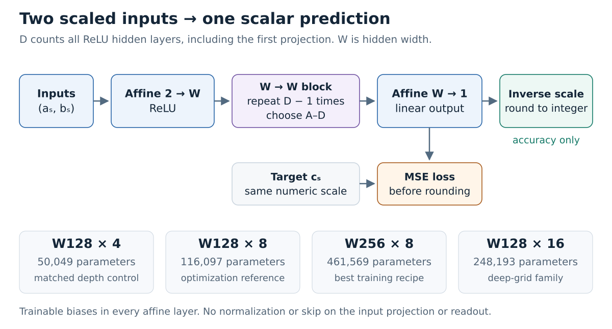
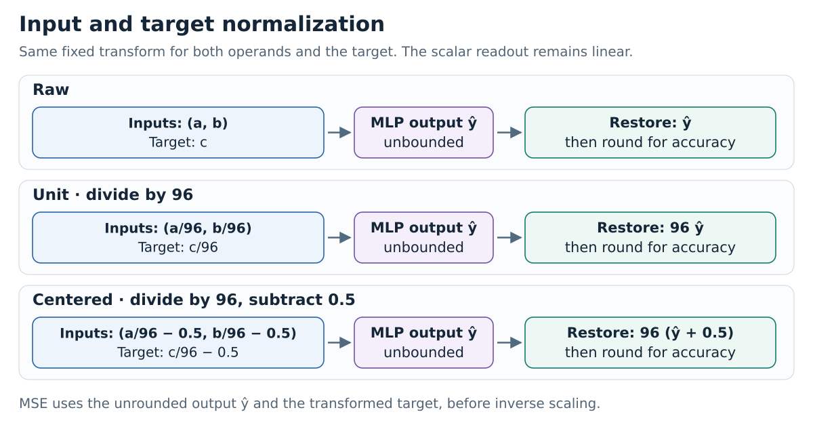
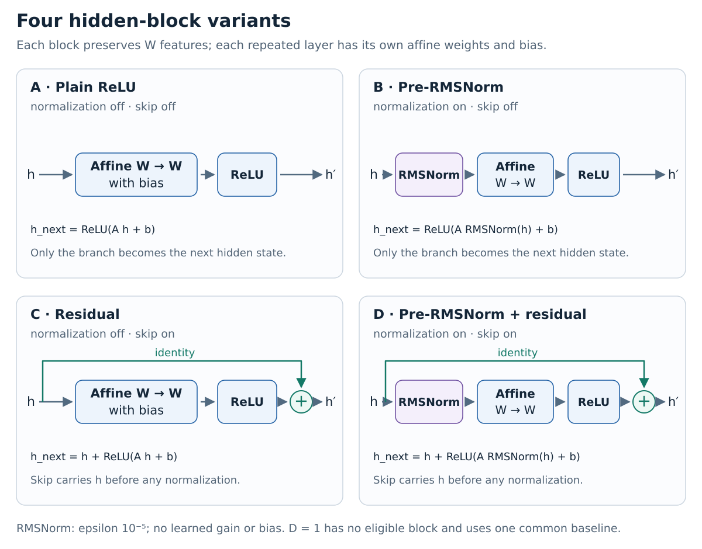

# Division modulo 97: local MLP investigation

*Completed 16 October 2026. Local Rust/CUDA experiments on an RTX 3050 Laptop GPU.*[^build]

**The scalar MLP fitted the training equations well in several optimized configurations, reaching up to 99.01% train accuracy.** The strongest confirmed training recipe averaged 93.16% train accuracy and 1.40% held-out accuracy over three seeds. Strong held-out generalization was not observed: the highest confirmed mean held-out accuracy anywhere in the division search was 3.04%.

The task is to predict the residue $c$ satisfying $bc\equiv a\pmod{97}$, with $a\in\{0,\ldots,96\}$ and $b\in\{1,\ldots,96\}$. The 9,312 valid equations are split equally: 4,656 training rows and 4,656 held-out rows. Each seed changes the split, parameter initialization and training order together.

The numeric model takes two floating-point inputs, uses ReLU hidden layers with Kaiming initialization, and produces one linear scalar output. Training minimizes mean squared error (MSE). Accuracy restores the residue scale and rounds the prediction to an integer, without clipping or applying another modulo operation. Root mean squared error (RMSE) is reported in original residue units.

{width=100%}

In total, **556 scalar-MLP division trials** completed with finite parameters, including smaller-task and subset controls. The original grid contributed 324 short screens and 24 full-budget runs. The deep grid contributed 128 screens at depths 8 and 16 and all 12 selected full-budget confirmations. Short screens used 1,000 epochs; full confirmations used 10,000 epochs. The original grid covered widths 16, 64 and 128 and depths 1, 2 and 4; the deep grid covered widths 64 and 128. Targeted follow-ups also tested width 256. These were staged searches, not one Cartesian grid over every reported width and depth. Poor accuracy in a trial describes its learned predictions, not an execution failure.

<!-- pagebreak -->

## Input and target normalization

Residues modulo 97 range from 0 to 96. Dividing by **96**, the largest residue, maps that interval to $[0,1]$. The same fixed transformation is applied to both input operands and the target answer. The nonzero denominator restriction remains: $b$ ranges from 1 to 96.

Let $\hat y$ denote the MLP's scalar output in training units. The three representations are:

| Mode | MLP inputs | Training target | Restored prediction |
| --- | --- | --- | --- |
| Raw | $(a,b)$ | $c$ | $\hat y$ |
| Unit | $(a/96,b/96)$ | $c/96$ | $96\hat y$ |
| Centered | $(a/96-0.5,b/96-0.5)$ | $c/96-0.5$ | $96(\hat y+0.5)$ |

{width=100%}

For example, $30/5\pmod{97}=6$. Unit scaling gives inputs $(0.3125,0.0520833\ldots)$ and target $0.0625$. Centering gives inputs $(-0.1875,-0.4479166\ldots)$ and target $-0.4375$. A centered prediction of $-0.4375$ restores to $96(-0.4375+0.5)=6$.

MSE compares $\hat y$ with the transformed target **before** inverse scaling or rounding. Accuracy rounds the restored prediction; residue RMSE uses that prediction without rounding. The readout stays linear and can produce values outside the target interval. No clipping or extra modulo is applied.

For fixed predictions in residue units, unit or centered scaling divides squared error by $96^2=9,216$. An output error of 0.01 training units corresponds to 0.96 residue units. Input centering also changes where the operand region lies relative to ReLU thresholds. These data transforms use fixed constants; RMSNorm separately normalizes hidden activations and never replaces input or target scaling.

<!-- pagebreak -->

The raw and unit-scaled searches covered all four combinations of pre-RMSNorm and residual addition. Both options apply only to the $D-1$ width-preserving hidden layers after the initial two-feature projection. The input projection and scalar readout have neither option. At depth one, all four families therefore share a single common baseline. Centered follow-ups had narrower coverage, as recorded in the results table below.

{width=100%}

Every affine layer has a trainable bias. Hidden matrices use Kaiming normal initialization with variance $2/\text{fan-in}$; the linear readout uses variance $1/\text{fan-in}$. RMSNorm has epsilon $10^{-5}$ and no learned gain or bias. There is no final RMSNorm in the scalar MLP.

The original grid used raw and unit-scaled data. Centering was introduced in the diagnostic and optimization follow-ups.

The original division grid reached at most **2.88% final training accuracy**. In a first-layer geometry check at seed 11, zero-bias W128 with unit-scaled inputs had 36 neurons inactive throughout the complete operand square; centered inputs had none. This identifies one optimization factor, rather than proving a single cause of poor fitting. Bias controls preserved the Kaiming matrices; uniform and domain-anchored modes also preserved identical later-layer biases.

<!-- pagebreak -->

The strongest confirmed training configuration was **W256 with eight ReLU hidden layers**, without RMSNorm or residual connections. Inputs and targets were centered to the range $[-0.5,0.5]$. Domain-anchored first-layer biases placed ReLU hinges through the operand region; later-layer biases followed the paired uniform rule. AdamW used initial learning rate 0.01, weight decay 0, $\beta_1=0.9$, $\beta_2=0.999$ and epsilon $10^{-8}$. The learning rate followed cosine decay to 0.001 of its initial value, after a ten-update warmup. Each update used the complete 4,656-row training set. The budget was 10,000 epochs and 10,000 optimizer updates.

| Seed | Train accuracy | Held-out accuracy | Train RMSE | Held-out RMSE |
| --- | ---: | ---: | ---: | ---: |
| 11 | 99.01% | 1.59% | 0.301 | 37.885 |
| 17 | 81.98% | 1.29% | 5.841 | 42.187 |
| 23 | 98.50% | 1.33% | 0.525 | 37.699 |
| **Mean** | **93.16%** | **1.40%** | **2.222** | **39.257** |

The configuration was fixed before the two additional seeds were launched. The seed-11 run was reused with verified checkpoint and history hashes. All three saved models reproduced their train and held-out predictions after reloading on CUDA. **Training accuracy above 95% is attainable, but was not robust across these three seeds.** High training accuracy was accompanied by weak held-out accuracy.

Matched seed-11 follow-ups used a W128, eight-layer, centered-input, domain-bias reference with full-batch training, cosine decay and $\beta_2=0.999$. Each row below changes one setting from that reference.

| Setting | Train accuracy | Held-out accuracy |
| --- | ---: | ---: |
| Reference W128, eight hidden layers | **90.96%** | 1.37% |
| Four hidden layers | 6.21% | 0.99% |
| Constant learning rate 0.01 | 10.37% | 1.05% |
| Batch size 512 | 2.94% | 2.06% |
| AdamW $\beta_2=0.98$ | 86.10% | 1.16% |
| Zero biases | 90.08% | 1.25% |
| Uniform biases | 82.28% | 1.35% |
| Width 256 | 99.01% | 1.59% |

These are individual seed-11 comparisons, not three-seed effect estimates. The batch comparison preserves epochs and visits per equation, while changing the number of optimizer updates from 10,000 to 100,000. It therefore does not isolate gradient noise alone. The results support a substantial role for depth and optimization settings in fitting this dataset.

<!-- pagebreak -->

The table separates **data scaling** from **hidden-block RMSNorm** and residual addition. Each populated cell gives **mean train / held-out accuracy** for the completed three-seed, 10,000-epoch cohort with the highest mean train accuracy within that scale and flag combination. Only full-data modulo-97 runs are included.

| Pre-RMSNorm | Residual | Raw | Unit: divide by 96 | Centered |
| --- | --- | ---: | ---: | ---: |
| Off | Off | 1.47% / 1.28% | 8.26% / 2.18% | **93.16% / 1.40%** |
| Off | On | 1.67% / 1.37% | 1.31% / 1.31% | — |
| On | Off | 7.08% / 3.04% | 7.04% / 1.91% | — |
| On | On | 2.27% / 1.32% | 1.58% / 1.31% | — |

A dash means no completed three-seed full-budget cohort. Centered data with both RMSNorm and residual had short diagnostic controls only; the two centered single-flag combinations were not run. Raw/unit cohorts here use zero biases, batch 512, constant learning rates and $\beta_2=0.98$; widths, depths, learning rates and weight decays vary between cells. The centered cohort uses the optimized full-batch W256 settings above. These are results of selected configurations, rather than isolated estimates of the effect of scaling or RMSNorm.

**Training fit and held-out generalization gave different outcomes.** Several centered plain MLPs reached 90–99% train accuracy. The best confirmed mean held-out rounded accuracy was 3.04%, from raw-input W128 with eight layers, pre-RMSNorm and no skip; its mean train/held-out RMSE was 19.111/31.799. Selection by held-out RMSE favored different configurations from selection by accuracy.

Independent controls checked both learning correctness and representational capacity. Smaller division tasks modulo 7 and 31, and 64- or 256-row training subsets modulo 97, could reach 100% train accuracy. Equal optimizer-update budgets were used for these controls; dataset sizes changed the number of epochs and repeated visits. Their success does not replace the full-data results.

A plain, raw-input ReLU network with width 128 and eight hidden layers was also given **hand-set weights**, and exactly reproduced all 9,312 division equations in float32. This establishes that the architecture can represent the complete rule. It does not establish that gradient descent from Kaiming initialization learns that construction.

Numerical validation included independent f64 checks of scalar outputs, MSE, gradients, gathered batches and AdamW. Saved selected and deep MLP models were reloaded on CUDA and their complete train/held-out predictions checked against recorded metrics. Initial and final model files were checked for correct sizes and finite parameters. The shared Rust test run passed 72 tests, and the scalar CUDA suite passed 20 verification cases.

The evidence supports three conclusions: substantial training memorization is attainable after targeted optimization; seed-to-seed reliability remains limited; and the numeric scalar MLP does not show strong held-out generalization in the tested search spaces and budgets. These experiments do not isolate MSE itself as the cause of poor held-out performance.

Held-out data guided hyperparameter selection; these are exploratory validation results. The search was finite. Seeds change data, initialization and training order together. Shared-GPU runtimes are not isolated speed benchmarks. This report required no new training. Complete MLP run artifacts, checkpoints and PDFs stay under ignored `target/`. No results were pushed, deployed or uploaded.

The division-only figures in this directory are editable SVGs. The authoritative combined evidence remains in the ignored local directory `target/local-ablations-2026-10-16/`: `mlp-investigation.json`, `mlp-investigation.txt`, the saved run directories and `completion-audit.json`. This document selects only division results from that evidence.

[^build]: Rebuild the SVGs and PDF with `node scripts/build-div97-report.mjs` from the repository root. This requires Pandoc, XeLaTeX and Inkscape. The PDF and intermediate files remain under the already ignored `target/div97-report/` directory.
