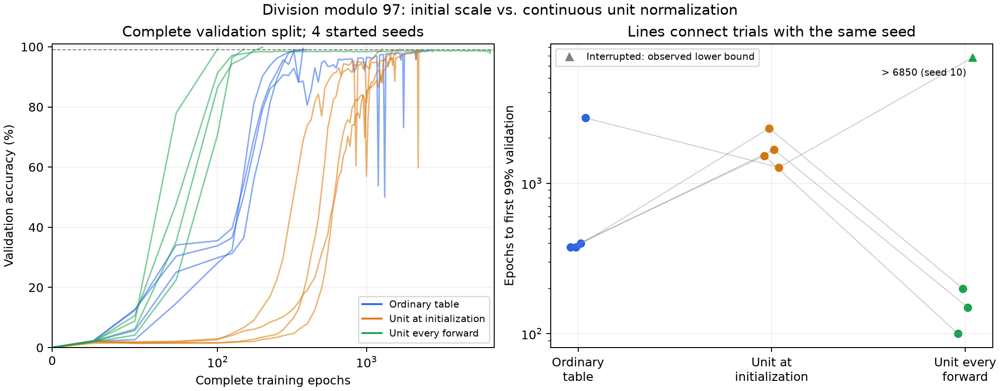

# Modular division size search

Search dense GPTMini first in
`/home/misha/lean_projects/transformer/experiments/mod97_size_search`, then
repeat with this repository's Mesh GPT. The user limits each run to 10,000
epochs, where an epoch visits every training equation once, and requests
frequent commits. Model size means learned parameter count, counting tied
tensors once. The user's successful model was around 500,000 parameters.

Both stages use all 9,312 valid `a / b mod 97` equations and fixed 50%
training splits. Batch 512 has nine full batches and a short batch of 48:
ten updates per epoch. The dense and Mesh implementations have different
seeded splits, token vocabularies, and supervised positions. These searches
therefore compare sizes within each architecture, rather than claiming an
otherwise matched cross-architecture experiment.

The dense starting recipe comes from the user's archived experiments:
AdamW, learning rate 0.001, weight decay 0.1, betas (0.9, 0.98), and ten
warmup updates. Dense GPTMini uses learned tied embeddings, fused QKV,
QKNorm with learned head temperatures, RoPE, XSA, parameter-free RMSNorm,
and a ReLU-squared feed-forward network. Mesh GPT retains its generated
embeddings, mesh projections, ELU, fixed QK normalization and tied head.

## Evidence and criteria

Evaluate both complete splits every 250 updates, or 25 epochs. Generalization
is the first observation with held-out accuracy at least 99%. On 2026-10-11
the user also made it the stopping rule: new runs pass
`--stop-validation-accuracy 0.99` and end at that observation. It replaced
20 consecutive observations at 99% on both splits, and it does not measure
whether accuracy stays above the target. Earlier runs trained their whole
budgets; their summaries apply the new rule to the recorded histories.
Delayed grokking additionally requires an earlier stretch of five
consecutive observations with training accuracy at least 99% and held-out
accuracy at most 10%. Record the first training 99% crossing separately.
This checks sampled observations, not every intervening update. A minimum
refers to tested configurations and seeds; failure of one setting does not
establish a universal lower bound.

Raw artifacts remain in ignored run directories. Summaries retain settings,
epoch counts and history SHA-256 hashes. `--output` also archives portable
accuracy histories beside the summary so plots do not depend on the original
run directories. Recompute them with:

```sh
uv run --locked scripts/summarize-grokking.py \
  /home/misha/lean_projects/transformer/experiments/mod97_size_search/runs/graph-w128 \
  target/grok-div97-search/default-w128-h4-l2-d4-f6-s7 \
  --output target/grok-div97-search/summary.json
uv run --locked scripts/plot-grokking-search.py \
  target/grok-div97-search/summary.json --output target/grok-div97-search/plots
```

The dense environment is locked to PyTorch 2.14.1+cu126. Its historical
CPU fixtures were generated with 2.14.0+cu126 and fail exact floating-point
comparisons under the current environment, including at update zero. The
new study does not change its training engine or fixtures. Fresh results
record their own engine fingerprints and do not claim bitwise equality
with those historical trajectories.

## Results

The preliminary Mesh control began before the user specified dense-first
ordering. It completed the full budget; subsequent Mesh searches follow
the dense stage. This control reported every 100 epochs; new search runs
report every 25 epochs.

| Model | Parameters | Width / blocks / heads | Mesh depths | LR / decay | Epochs | Final training / held-out | Result |
| --- | ---: | --- | --- | --- | ---: | --- | --- |
| Mesh control, seed 7 | 12,288 | 128 / 2 / 4 | 4 / 6 | 0.001 / 1 | 10,000 | 1.63% / 0.71% | Neither fitting nor grokking |
| Mesh control, seed 7, gain 1.4 | 12,288 | 128 / 2 / 4 | 4 / 6 | 0.001 / 0.1 | 10,000 | 6.23% / 1.80% | Neither fitting nor grokking |
| Mesh calibrated, seed 7, gain 1.4, embedding gain 0.1 | 26,624 | 128 / 2 / 4 | 8 / 16 | 0.003 / 0.01 | 10,000 | 32.28% / 2.08% | Neither fitting nor grokking |
| Mesh calibrated, seed 7, gain 1.4, embedding gain 0.1, Q/K signs | 26,624 | 128 / 2 / 4 | 8 / 16 | 0.003 / 0.01 | 10,000 | 27.75% / 1.89% | Neither fitting nor grokking |
| Mesh fitting pilot, seed 7, gain 1.4, embedding gain 0.02, Q/K signs | 507,904 | 1024 / 5 / 8 | 8 / 16 | 0.001 / 0.01 | 400 (retired) | 100% / 2.62% | Confirmed memorization plateau; no grokking before retirement |
| Dense GPTMini, seed 1 | 423,816 | 128 / 2 / 4 | Dense | 0.001 / 0.1 | 10,000 | 100% / 100% | Generalized at epoch 2,600 |
| Dense GPTMini, seed 1 | 113,608 | 64 / 2 / 4 | Dense | 0.001 / 0.1 | 10,000 | 100% / 100% | Generalized at epoch 100 |
| Dense GPTMini, seed 1 | 32,232 | 32 / 2 / 4 | Dense | 0.001 / 0.1 | 10,000 | 99.81% / 96.41% | Below held-out target at the cap |
| Dense GPTMini, seed 1 | 9,976 | 16 / 2 / 4 | Dense | 0.001 / 0.1 | 10,000 | 61.96% / 37.26% | Neither fitting nor grokking |
| Dense GPTMini, seed 1 | 32,232 | 32 / 2 / 4 | Dense | 0.001 / 0.2 | 10,000 | 100% / 100% | Delayed grokking at epoch 7,675 |
| Dense GPTMini, seed 1 | 19,568 | 24 / 2 / 4 | Dense | 0.001 / 0.2 | 10,000 | 99.89% / 37.46% | Fitted training; failed held-out target |
| Dense GPTMini, seed 1 | 9,976 | 16 / 2 / 4 | Dense | 0.001 / 0.2 | 10,000 | 69.61% / 34.60% | Neither fitting nor grokking |

The dense run first fitted training at epoch 725 and first reached 99%
held-out accuracy at epoch 2,600, 1,875 epochs later. It did not have the
strict near-chance memorization plateau. Having trained the whole budget,
it later fell below 99% at some observations; two in its final 1,000 epochs
did so, with minimum held-out accuracy 96.28%.

Width 64 first fitted training at epoch 75 and reached 99% held-out accuracy
at epoch 100. It did not exhibit the strict near-chance memorization plateau.

Width 32 first fitted training at epoch 575 but never reached 99% held-out
accuracy within the cap. Its late generalization transition reached 96.41%
held-out accuracy at epoch 10,000. Width 16 remained below the training
threshold. Changing only weight decay to 0.2 brought width 32's transition
inside the budget. Training first reached 99% at epoch 825. A near-chance
memorization plateau began at epoch 1,050 and was confirmed at 1,150.
Held-out accuracy first reached 99% at epoch 7,675, and the run finished at
100% on both splits. This 32,232-parameter model is the smallest tested
delayed-grokking model so far. Width 24 with the same stronger-decay recipe
finished at 99.89% training and 37.46% held-out accuracy, without a
generalization event.
Width 16 with decay 0.2 finished at 69.61% training and 34.60% held-out
accuracy. The dense stage completed seven fresh runs. The successful
recipe and refinements are committed as `033597a` in the dense repository;
the Mesh stage is active.

## Mesh search settings

The frozen candidates are in
[div97-mesh-search.json](../experiments/div97-mesh-search.json). The first
candidate has 495,616 parameters: width 512, two blocks, eight heads, and
attention/embedding and feed-forward mesh depths both 44. Initialization
gain 1.4 scales every original seeded mesh edge before training, including
each projection's final layer. It preserves all operators and connectivity.
A two-update smoke test had finite complete-split training loss
`15.23044 -> 13.28423`; this checks initialization and updates, not grokking.

The runner saves the exact command, frozen settings, binary SHA-256 and
console log. It skips a completed identical configuration and refuses to
overwrite a different or unfinished run. Mesh checkpoints currently hold
weights only, so an interrupted run needs a separately named fresh attempt.
Each runner invocation executes its selected candidates in order:

```sh
uv run --locked scripts/run-mesh-search.py experiments/div97-mesh-search.json --dry-run
uv run --locked scripts/run-mesh-search.py experiments/div97-mesh-search.json \
  w512-h8-l2-d44-f44-g14-wd01
```

Optional buffer reuse is enabled in
[div97-mesh-cached-search.json](../experiments/div97-mesh-cached-search.json).
Its separately named candidates use the same mathematics, seeds, batches
and budgets, with a bounded pool of three batch shapes. A 50-epoch,
500-update comparison at 123,904 parameters took 25.41 seconds with the
original binary and 18.85 seconds with reuse, a 1.35x speedup. All recorded
losses, accuracies and final checkpoint bytes matched exactly. The other
experiment was paused during timing. This is a timing experiment, not a
grokking result; speedup at other sizes is not established. Commands and
binary/checkpoint hashes are in
[workspace-cache-comparison.json](grokking-results/workspace-cache-comparison.json).
The GPU verification suite also checks exact AdamW trajectories across
full/tail batches, different sequence lengths, cache eviction, invalid
inputs and shrinking the cache. Independent numerical checks still pass.

The lightweight 12,288-parameter control overlapped the initial large-model
run and finished the full budget without fitting training data. Accuracy and
complete epochs are the comparison measures for overlapping runs. The large
control is temporarily paused with its optimizer state preserved in process
memory while the smaller calibrated comparisons run. Its pause is recorded
in the raw run's `scheduling.json`; it has no final-budget result yet.

Initialization refinements are in
[div97-mesh-calibrated-search.json](../experiments/div97-mesh-calibrated-search.json).
The initial 495,616-parameter run had cross-entropy 15.23, well above the
uniform 99-token baseline of about 4.60. The new `--embedding-output-gain`
scales only the final linear embedding layer after the global gain, setting
both the input and tied output embedding amplitudes. Defaults preserve the
original initialization. The candidates test gains 0.1 and 0.02, shallower
mesh projections, learning rates 0.001 and 0.003, and decay 0.01. Results
apply to each complete configuration because several settings vary.

The four original candidates passed a two-update, batch-eight initialization check,
with exhaustive evaluations and finite losses. Starting training losses
were 4.6310 (26,624 parameters), 4.5964 (63,488), 4.6765 (495,616), and
4.6417 (507,904). Zero, negative, NaN and infinite output gains are rejected
before device creation. Exact settings, commands, losses and the binary
hash are archived in
[mesh-initialization-smoke.json](grokking-results/mesh-initialization-smoke.json).
These checks establish valid execution; the full epoch-budget runs measure
learning and grokking. The first calibrated search used 26,624 parameters
and completed all 10,000 epochs without fitting the training set. Its final
training/held-out cross-entropies were 2.7389/6.7946, and neither split
reached 99%. Its controlled sign-initialization variant also completed the
full budget without either split reaching 99%, finishing at 27.75% training
and 1.89% held-out accuracy. The first-block initialization geometry check
therefore did not produce a successful small model under these settings.
The five-block, 63,488-parameter variant is running. A 507,904-parameter sign variant uses
batch 256: eighteen full batches and the short batch of 48, or nineteen
updates per epoch. It evaluates every 475 updates (25 epochs) and has a
190,000-update cap. Its two-update capacity check passed with finite
complete-split losses; that check is excluded from the grokking results.

The controlled `--qk-signs 1` variant changes only the final Q/K rows using
a separate seeded sign stream. An independent f64 reconstruction of the
initialized first block gives mean self-attention probability 82.83% with
the original directions and 29.82% with the signs, averaged over all 9,312
inputs and four heads. The captured parameter magnitudes are exactly equal,
and every other parameter is unchanged. Capture uses one update at learning
rate `1e-30`; observed losses are unchanged. This checks initialization
geometry, not learning. The complete-budget controlled run measures whether
this difference helps fitting and grokking.

See [qk-initialization-analysis.json](grokking-results/qk-initialization-analysis.json).
Reproduce the captures and f64 analysis in a fresh directory:

```sh
uv run --locked scripts/analyze-mesh-qk-initialization.py --output target/qk-init-recheck
```

The regularization candidates are frozen in
[div97-mesh-regularization-search.json](../experiments/div97-mesh-regularization-search.json).
They retain the five-block signed initialization and batch-256 protocol,
increase weight decay to 0.1, and test widths 1024, 512, 256 and 128
(507,904, 253,952, 126,976 and 63,488 parameters). Width 1024 is running;
the smaller three have not run yet.
At width 1024 only decay changes from the retained fitting pilot.
To prioritize regularization trials, that decay-0.01 run may be retired
after it establishes five consecutive training-99% / held-out-at-most-10%
observations, or after reaching the 500-epoch fitting-pilot budget. The
500-epoch stop was added after the first transient training-99% result at
epoch 200, before observing epoch 500. Any retired run is recorded as
interrupted at its last
observation, without claiming failure over the full 10,000-epoch budget.
The stronger-decay trial starts from the original seed, without reusing
weights or optimizer state. Each fresh trial remains capped at 10,000 epochs.

The 507,904-parameter pilot first reached training 99% at epoch 200, then
fell below the threshold at epochs 225, 250 and 275. A qualifying
memorization plateau began at epoch 300 and was confirmed at epoch 400;
training was 100% at the last four observations, with final held-out
accuracy 2.62%. The pilot was retired at its epoch-400 checkpoint. This
result covers 400 epochs and leaves later generalization under that recipe
unmeasured. Its retained checkpoint hash, scheduling events and the fresh
run's command are in
[mesh-regularization-handoff.json](grokking-results/mesh-regularization-handoff.json).
The binary hash, complete split bytes and every initial recorded loss,
accuracy and weight norm match between the pilot and fresh trial. The sole
settings difference is weight decay, 0.01 to 0.1.

Smaller-model head pilots are defined in
[div97-mesh-head-pilots.json](../experiments/div97-mesh-head-pilots.json).
They keep 63,488 learned mesh parameters, width 128, five blocks and depths
8/16, and vary heads between two, one and four. The two-head pilot started
after the 26,624-parameter signed control finished. These pilots
use exactly 500 complete epochs and measure early fitting. Their shorter
budgets cannot establish failure to grok within 10,000 epochs. A promising
pilot gets a separately named full-budget run from the original seed.
The eight-head full run supplies the corresponding first-500-epoch control
with the same split, seed, initialization, batches, learning rate and decay.

The two-head pilot completed 500 epochs at 20.15% training and 1.91%
held-out accuracy, without reaching training 99%. The eight-head control
was at 23.67% training and 2.04% held-out accuracy at the same epoch.
These observations do not favor fewer heads for early fitting at this size.
One- and four-head pilots remain unrun.

Depth pilots are defined in
[div97-mesh-depth-pilots.json](../experiments/div97-mesh-depth-pilots.json).
They use width 128, two heads, two blocks, embedding-output gain 0.1 and
attention/embedding depths 16, 32 and 64, with feed-forward depths twice
as large. Their counts are 53,248, 106,496 and 212,992 parameters, and
each pilot visits the full training set 500 times. The depth-32 pilot is
selected first. These vary the complete configuration from the head
pilots; their results cannot isolate a single cause or establish failure
at the 10,000-epoch cap.

The depth-32 pilot completed 500 epochs at 11.71% training and 2.13%
held-out accuracy. The fresh matched pilot changed only learning rate from
0.001 to 0.003 and finished at 3.41% training and 3.01% held-out accuracy.
Its binary, split and every initial recorded loss, accuracy and weight norm
match the first pilot. Neither reached training 99%; these short results
do not establish either recipe's behavior over 10,000 epochs. The other
depth variants have not run yet. Pilot summaries are separate from
the full-budget comparison in
[head-pilot-summary.json](grokking-results/head-pilot-summary.json),
[head-pilot-comparison.json](grokking-results/head-pilot-comparison.json),
and [depth-pilot-summary.json](grokking-results/depth-pilot-summary.json).
The matched learning-rate evidence is in
[depth-pilot-comparison.json](grokking-results/depth-pilot-comparison.json).

See the [portable results](grokking-results/summary.json) and
[learning curves](grokking-results/grokking-size-search.svg). The original
Mesh defaults are substantially
smaller than the user's successful parameter count, so their failure does
not settle the larger-model search.

## Architecture ablations

Before these ablations, no completed Mesh run raised held-out accuracy above
chance, including the runs that fit the training set. Two architectural
constraints could explain this. The embedding mesh computes each token vector
from fixed codes of an abstract symbol ID through a depth-`d` neighbor mesh.
Channel `c` therefore depends only on code channels `c..c+d`, and tokens
cannot receive independent vectors. Neighbor meshes also mix channels only
locally, so the Q/K/V, output and feed-forward meshes cannot form global
channel combinations.

The factorial ablation in
[div97-mesh-ablations.json](../experiments/div97-mesh-ablations.json) crosses
`--embedding mesh|table` with `--connectivity neighbor|butterfly`; see
[Mesh GPT](mesh-gpt.md#ablation-variants). All four arms use width 128, four
heads, two blocks, depths 8/16, initialization gain 1.4, embedding-output gain
0.1, and the dense recipe's learning rate 0.001 and decay 0.1. Mesh arms have
26,624 learned parameters, and table arms have 37,248. Each table arm starts as
the same function as its mesh arm, and their one-epoch smoke runs had identical
initial complete-split losses. Each arm has the 10,000-epoch cap.

A first launch without a stop rule reached epoch 3,325 in the mesh arms and
3,575 in the table arms before the stopping rule changed. Its table arms first
reached 99% held-out accuracy at epochs 375 (neighbor) and 525 (butterfly).
Afterwards, transient loss spikes lowered accuracy on both splits at once:
held-out accuracy fell below 99% at 7 of 129 and 12 of 123 later
observations, to minima of 85.72% and 76.91%. Its mesh arms stayed near
chance, peaking at 6.29% and 22.68% training and 2.38% and 2.36% held-out
accuracy. All four arms then restarted from the original seed with
`--stop-validation-accuracy 0.99`. The interrupted runs keep their
interruption records and checkpoints in their ignored directories.

The restarted arms ran concurrently until both table arms stopped. With one
GPU, concurrency does not raise total throughput, so the mesh arms then ran
one at a time. At epoch 375, mesh-butterfly was suspended with `SIGSTOP`
while mesh-neighbor finished, then resumed with `SIGCONT`. The suspended
process kept its weights and AdamW moments in memory. `scheduling.json` in
each mesh run directory records both signals, and recorded elapsed seconds
include the suspension. Every observation the restarted arms share with the
interrupted launch matches it exactly: 134 per mesh arm through epoch 3,325,
and all 16 and 22 table observations. The suspension therefore did not
change the mesh-butterfly trajectory.

| Arm | Parameters | First training 99% | First held-out 99% | Epochs run | Final training / held-out | Peak held-out |
| --- | ---: | ---: | ---: | ---: | --- | ---: |
| Mesh embedding, neighbor | 26,624 | Not reached | Not reached | 10,000 | 5.48% / 1.37% | 2.38% |
| Table embedding, neighbor | 37,248 | Epoch 175 | Epoch 375 | 375 | 100% / 99.12% | 99.12% |
| Mesh embedding, butterfly | 26,624 | Not reached | Not reached | 10,000 | 27.64% / 1.87% | 2.38% |
| Table embedding, butterfly | 37,248 | Epoch 200 | Epoch 525 | 525 | 100% / 99.16% | 99.16% |

Both table arms generalized, 200 and 325 epochs after first fitting the
training set. Neither had the near-chance memorization plateau, so these are
generalization events rather than delayed grokking. Both mesh arms used the
whole budget, and their held-out accuracy never exceeded 2.38%, against 1/97
or 1.03% for a uniform guess. Butterfly strides raised the mesh arm's
training fit, to a peak of 28.63% at epoch 9,925 against 6.29% at epoch 400
with neighbor strides, but not its held-out accuracy. The strides apply to
every mesh, so in that arm each embedding channel also depends on every code
channel. Under this recipe a learned table was sufficient for
generalization. Global channel mixing was neither necessary (table-neighbor)
nor sufficient (mesh-butterfly). Each arm is a single seed, so the 150-epoch
gap between the table arms favors neither connectivity.

[analyze-token-vectors.py](../scripts/analyze-token-vectors.py) reads the
residue vectors each run saves at its end. Division subtracts discrete
logarithms, so the script orders the 96 nonzero residues by their discrete
logarithm base 5, a primitive root modulo 97. Along this cycle it measures
the share of non-constant Fourier power in the five strongest frequencies,
compared with 1,000 random cycle orders. It also reports the effective rank
of the centered vectors (the exponential of their spectral entropy), the
directions holding 99% of their energy, and cosine similarity between
residues. Results are in
[ablation-token-vectors.json](grokking-results/ablation-token-vectors.json),
and the training summaries in
[ablation-summary.json](grokking-results/ablation-summary.json):

| Residue vectors | Epoch | Top-5 Fourier share (null mean / 99th percentile) | p | Effective rank (99% directions) | Nearest-neighbor cosine, mean (maximum) |
| --- | ---: | --- | ---: | --- | --- |
| All four smoke runs | 1 | 0.117–0.120 (0.118–0.119 / 0.123–0.124) | 0.23–0.77 | 76.6–78.0 (92) | 0.415–0.428 (0.496–0.521) |
| Table, neighbor | 375 | 0.435 (0.143 / 0.158) | 0.001 | 30.0 (63) | 0.515 (0.628) |
| Table, butterfly | 525 | 0.492 (0.149 / 0.166) | 0.001 | 24.9 (61) | 0.465 (0.549) |
| Mesh, neighbor | 10,000 | 0.226 (0.203 / 0.247) | 0.100 | 5.0 (15) | 0.918 (0.979) |
| Mesh, butterfly | 10,000 | 0.200 (0.205 / 0.248) | 0.591 | 4.8 (5) | 0.912 (0.988) |

A p-value of 0.001 is the smallest that 1,000 permutations can report. Both
tables concentrate significant power in a few discrete-log frequencies:
17, 27, 33, 47 and 21 with neighbor strides, and 38, 45, 42, 48 and 6 with
butterfly strides. The two sets do not overlap. The generated vectors
instead collapse: effective rank falls from about 77 after one epoch to 5,
and residues become nearly parallel. With so few directions left, random
orders also concentrate more power, which raises their null, and their
observed shares stay within it. Because the head is tied, these vectors also
score every answer, so the head can separate answers only within the few
remaining directions.

Within this recipe, the generated token embedding is the binding
constraint. Replacing it with a table that starts as the same function was
enough to generalize, while global mixing in every mesh, the embedding mesh
included, was not. Its 2,048 shared weights generate all 99 vectors, so no
residue's vector can change independently. These arms do not separate the
responsible property: the number of shared weights, the two-parent layer
form, the fixed input codes, or tying the head to the generated vectors.

## Embedding geometry trials

[div97-embedding-geometry.json](../experiments/div97-embedding-geometry.json)
adds 33 arms that use the [embedding geometry](embedding-geometry.md)
options. Every arm otherwise uses the ablation recipe with neighbor
connectivity, and the arms run one at a time. The ablation's mesh-neighbor
and table-neighbor runs serve as parity baselines. One-epoch smoke runs of
both, made with the binary used here, reproduce the ablation smoke runs
exactly.

Two settings correct for scale. Geometric codes have unit norm, except
signed permutations at √30, while parity codes have norm √128. Through the
embedding mesh at output gain 0.1 they give mean vector norms from 0.009 to
0.096 after one warmup update, against 0.223 for parity. The mesh's last
layer is linear, so each mesh-code arm uses the output gain, between 0.232
and 2.52, that restores a mean norm of 0.223. The final RMSNorm also gives
the state norm √128 ≈ 11.3, so with the tied head a vector of norm 0.14,
the scale at which geometric tables start, bounds every logit by 1.6.
Frozen geometric tables therefore use `--embedding-norm unit`, as does one
frozen parity table. A second frozen parity table keeps its initial scale.

| Learned table start | Initial mean norm | First training 99% | First held-out 99% | Final training / held-out | Peak held-out |
| --- | ---: | ---: | ---: | --- | ---: |
| Parity (ablation) | 0.22 | Epoch 175 | Epoch 375 | 100% / 99.12% | 99.12% |
| Parity, unit-normalized | 1 | Epoch 100 | Epoch 100 | 99.94% / 99.27% | 99.27% |
| Antipodal | 0.14 | Epoch 150 | Epoch 325 | 100% / 99.12% | 99.12% |
| Orthogonal | 0.14 | Epoch 275 | Epoch 500 | 100% / 99.01% | 99.01% |
| Simplex | 0.14 | Epoch 200 | Epoch 650 | 100% / 99.05% | 99.05% |
| Sphere | 0.14 | Epoch 175 | Epoch 925 | 100% / 99.16% | 99.16% |
| Circle | 0.14 | Epoch 175 | Epoch 2,500 | 100% / 99.29% | 99.29% |
| Hypercube | 0.14 | Epoch 500 | Epoch 3,800 | 100% / 99.05% | 99.05% |
| Fourier, 8 harmonics | 0.14 | Epoch 300 | Not reached | 100% / 98.39% | 98.73% |
| Equiangular, overlap 0 | 0.14 | Epoch 625 | Not reached | 100% / 96.46% | 96.82% |
| Signed permutations | 0.77 | Epoch 350 | Not reached | 100% / 92.89% | 97.32% |

Every learned table fit the training set by epoch 625, without a
memorization plateau. Seven of the ten reached 99% held-out accuracy. The
other three ended between 92.9% and 98.4%, with peaks between 96.8% and
98.7%. The order does not follow the starting geometry. The rank-one antipodal
start, which gives half the tokens one vector and the rest its negative, was the fastest
geometric start. The simplex and equiangular starts differ only by a 0.5%
rescale and one coordinate equal to 0.014 for every token, yet the first
stopped at epoch 650 and the second stayed below 97%. With one seed per
arm, these differences are not attributed to geometry. The unit-normalized
parity table reached 99% at epoch 100, 225 epochs before any other learned
table. Training summaries are in
[embedding-geometry-summary.json](grokking-results/embedding-geometry-summary.json).

Ten mesh and frozen-table arms ran the full 10,000 epochs without reaching
99% training or held-out accuracy. Chance is 1/97, about 1.0%. Learned weights
exclude a frozen table and the weights fixed by protected features.

| Diagnostic arm | Learned weights | Final training / held-out | Peak training | Peak held-out |
| --- | ---: | --- | ---: | ---: |
| Mesh, unit-normalized | 26,624 | 9.45% / 2.56% | 10.46% | 2.71% |
| Mesh, RMS-normalized | 26,624 | 7.39% / 2.23% | 7.39% | 2.60% |
| Mesh, 7 protected features | 26,568 | 5.28% / 1.85% | 5.63% | 2.15% |
| Mesh, orthogonal codes | 26,624 | 7.11% / 2.00% | 7.58% | 2.02% |
| Mesh, sphere codes | 26,624 | 5.07% / 1.22% | 5.69% | 2.30% |
| Mesh, equiangular codes | 26,624 | 7.15% / 1.91% | 7.30% | 2.30% |
| Frozen parity table, initial scale | 24,576 | 6.92% / 2.19% | 7.54% | 2.34% |
| Frozen parity table, unit | 24,576 | 6.53% / 1.83% | 6.98% | 2.21% |
| Frozen orthogonal table, unit | 24,576 | 7.24% / 1.50% | 7.88% | 2.02% |
| Frozen discrete-log Fourier table, unit | 24,576 | 21.31% / 20.36% | 23.95% | 23.56% |

Neither normalization, protected token identities nor geometric input
codes lets the mesh embedding fit the training set. Each mesh arm ends
within four points of the ablation's mesh-neighbor run, at 5.48% / 1.37%.
Freezing a table produces the same failure. The frozen parity table starts
from the table-neighbor initialization, which reached 99% held-out accuracy
at epoch 375 when trained, yet frozen it fits 6.92% of the training set.
Unit normalization and an orthogonal table do not change this. Of the
frozen tables, only the one that supplies the discrete-log order fits more
than 8%.

That arm is also the only diagnostic whose held-out accuracy tracks its
training accuracy. It peaked at 23.56% held-out at epoch 650 and 23.95%
training at epoch 1,175, then ended at 20.36% and 21.31%. Its errors
concentrate next to the answer in discrete-log order. Exact answers and the
two adjacent logarithms account for 48.26% of training and 46.28% of
held-out predictions. A further 6.44% and 6.98% fall two steps away, and
the rest scatter across other offsets. The frozen readout limits
resolution. Adjacent codes of the eight equal harmonics have cosine 0.946,
so a final state of norm √128 aligned exactly with the answer's code leads
each neighbor by 0.61 in logit. That state gives the answer probability
0.435 and cross-entropy 0.834; the run ended at cross-entropy 2.19.

The queue was stopped at epoch 9,975 of the mesh-simplex arm, at 6.62%
training and 1.80% held-out accuracy. The remaining 12 manifest arms were
not run: five mesh-code arms, four frozen tables and the three
arithmetic-order arms. In these trials every learned table fit the training
set, while every mesh embedding and every frozen table without the
discrete-log order stayed below 11% training accuracy.

## Initial scale versus continuous unit normalization

[div97-table-unit-control.json](../experiments/div97-table-unit-control.json)
predefines fifteen trials: three table variants at seeds 7, 8, 9, 10, and 11.
All use the same binary, 37,248 parameters, parity initialization, neighbor
meshes, and the preceding geometry-trial optimizer and model settings. Runs
execute sequentially on one GPU, rotating the variant order across seeds.
Within a seed, the model initialization, abstract-symbol mapping, train/validation
split, and minibatch order are shared. A new seed changes all four together.

- **Ordinary table:** the original raw table, with no embedding normalization.
- **Unit at initialization:** normalize every raw table row once after the
  initialization gains, using `--embedding-init-unit`; then train unconstrained.
- **Unit every forward:** retain the original raw parameters and apply
  `--embedding-norm unit` to the effective tied input/output vectors throughout
  training, including the normalization derivative.

The last two variants start from matching effective vectors and predictions,
up to FP32 rounding. Their raw table lengths and optimizer parameterizations
differ, so this compares the complete normalization methods rather than
isolating the norm constraint from its gradient scaling. All variants continue
to train both the table and the Transformer; none supplies arithmetic ordering.

The target remains the first complete-validation observation at 99%, with
evaluation every 250 updates (25 complete epochs), and a 10,000-epoch cap.
Crossing times are sampled observations; successful runs do not measure
post-threshold stability. Group medians use the cap for any unsuccessful run
and report success counts separately. User-interrupted trials are censored
at the last recorded observation and excluded from medians. After an early
stop, medians compare only seeds whose three variants all completed.

Each run retains `initial-model.bin` and `initial-embeddings.csv`, as well as
the final artifacts. The paired audit checks byte-identical splits, symbol
maps and initial block weights; identical ordinary/continuous raw tables;
matching initial effective vectors for the two unit variants; and agreement
between final exhaustive predictions and recorded accuracies for completed
runs. Interrupted runs retain their histories and initial artifacts; no final
prediction audit is claimed for them.

The following runner command describes the original fifteen-trial protocol.
The analysis command audits the saved execution, including its early stop.

```bash
cargo oxide build --arch sm_86 -- --release --locked --bin mesh-gpt
uv run --locked scripts/run-mesh-search.py experiments/div97-table-unit-control.json
uv run --locked scripts/summarize-grokking.py \
  target/grok-div97-search/table-unit-control/table-* \
  --output docs/grokking-results/table-unit-control/summary.json
uv run --locked scripts/analyze-table-unit-control.py \
  docs/grokking-results/table-unit-control/summary.json \
  --execution docs/grokking-results/table-unit-control/execution.json \
  --output docs/grokking-results/table-unit-control/comparison.json
```

The user stopped the queue during `table-unit-s10`: eleven trials completed,
one was interrupted, and none of the seed-11 trials started. The original
manifest is unchanged; [execution.json](grokking-results/table-unit-control/execution.json)
records which trials ran and the user-requested interruption. The GPU process
was stopped, and no further trials were launched.

| Seed | Ordinary table: epochs to 99% | Unit at initialization: epochs to 99% | Unit every forward: epochs to 99% |
| --- | ---: | ---: | ---: |
| 7 | 375 | 1,525 | 100 |
| 8 | 375 | 2,325 | 200 |
| 9 | 400 | 1,675 | 150 |
| 10 | 2,725 | 1,275 | >6,850; interrupted |

For the three complete triplets (seeds 7–9), median crossing times are 375,
1,675, and 150 epochs, respectively. Continuous unit normalization reached
the target faster on each of these seeds. Normalizing only at initialization
did not reproduce that acceleration, despite matching the continuous-unit
variant's initial effective vectors to within `3e-8` and its initial train and
validation cross-entropies to within `1.96e-7` across all four started seeds.
On seed 7, the one-time variant's final mean vector length was 2.38, against
1.00 for continuous unit normalization; one-time normalization did not retain
the effective scale throughout training.

Seed 10 is a counterexample to uniform acceleration: both unconstrained
variants reached 99%, whereas continuous unit normalization had not crossed
the target by its last observation at epoch 6,850. Its peak observed validation
accuracy was 98.90%, and the last was 98.58%. This trial was stopped by the
user before the 10,000-epoch cap; it is not a completed failure. The three-seed
medians exclude this incomplete triplet and do not establish robustness over
all four started seeds.

These results show that initial effective scale alone does not explain the
fast unit runs. The continuing norm constraint and its optimizer geometry
remain joint explanations: the one-time variant starts with raw row lengths
of 1, whereas continuous normalization starts with the original raw lengths
(mean approximately 0.22), and their gradients differ. This experiment does
not isolate those two effects or establish a universal benefit.

The paired initialization audit passed for all four started seeds, and final
exhaustive predictions agreed with recorded accuracies for all eleven
completed trials. Implementation validation passed 49 CPU tests, strict
Clippy, formatting, the locked CUDA release build, and GPU verification,
including all 35 fused-attention shapes against the f64 reference.

The archived histories and settings are in
[summary.json](grokking-results/table-unit-control/summary.json); paired checks,
individual outcomes, norms, and group statistics are in
[comparison.json](grokking-results/table-unit-control/comparison.json).
The left plot uses a linear epoch axis up to 100 and a logarithmic axis
afterward. The triangle on the right marks the interrupted trial's observed
lower bound, rather than a measured crossing time. An
[SVG copy](grokking-results/table-unit-control/table-unit-control.svg) is available.



## Attention-free baselines

[div97-simple-models.json](../experiments/div97-simple-models.json) asks how
simple a network can reach 99% held-out accuracy under the same protocol.
`mesh-gpt grok-simple` trains bias-free models on both operands: an MLP with
one or two hidden ReLU or squared layers, a residual MLP with pre-RMSNorm
blocks of expansion 4 and a final RMSNorm, and a bilinear model
`(U a) ⊙ (V b)` followed by a linear readout. Operands enter as residue values
rather than abstract symbols, encoded as one-hot vectors, ±1 bits, a centered
scalar, or a zero flag with the centered discrete logarithm base 5. Every run
uses seed 7 and the split, sampler, warmup, AdamW settings, complete-split
evaluation, stopping rule and epoch cap of the Mesh trials. `grok-simple
--verify` compares CUDA logits, losses and gradients with an independent f64
reference, and AdamW steps with an FP32 host computation.

The user stopped the queue during `mlp2-relu-binary-w512` at epoch 6,675,
when it had 100% training and 3.76% held-out accuracy. The five remaining
binary and scalar arms did not start;
[execution.json](grokking-results/simple-models/execution.json) records the
stop. With one-hot operands, a plateau is a confirmed stretch of five
observations at training accuracy of at least 99% and held-out accuracy of at
most 10%:

| Model | Parameters | First training 99% | First held-out 99% | Plateau | Final training / held-out |
| --- | ---: | ---: | ---: | --- | --- |
| ReLU MLP, width 512 | 148,992 | Epoch 125 | Epoch 2,700 | Yes | 100% / 99.10% |
| ReLU MLP, width 256 | 74,496 | Epoch 225 | Epoch 4,250 | Yes | 100% / 99.01% |
| ReLU MLP, width 128 | 37,248 | Epoch 475 | Epoch 6,350 | Yes | 100% / 99.08% |
| ReLU MLP, width 64 | 18,624 | Epoch 1,375 | Not reached | Yes | 100% / 98.50% |
| ReLU MLP, width 32 | 9,312 | Epoch 4,350 | Not reached | No | 100% / 93.00% |
| ReLU MLP, width 16 | 4,656 | Not reached | Not reached | No | 78.09% / 56.23% |
| ReLU MLP, width 8 | 2,328 | Not reached | Not reached | No | 29.42% / 19.85% |
| Two-layer ReLU MLP, width 128 | 53,632 | Epoch 300 | Epoch 3,575 | Yes | 100% / 99.08% |
| Two-layer ReLU MLP, width 64 | 22,720 | Epoch 625 | Epoch 5,325 | No | 100% / 99.12% |
| Squared MLP, width 128 | 37,248 | Epoch 125 | Epoch 525 | No | 100% / 99.10% |
| Squared MLP, width 64 | 18,624 | Epoch 225 | Epoch 1,225 | No | 100% / 99.05% |
| Squared MLP, width 32 | 9,312 | Epoch 350 | Epoch 9,600 | No | 100% / 99.01% |
| Squared MLP, width 16 | 4,656 | Epoch 775 | Not reached | No | 100% / 86.04% |
| Squared MLP, width 8 | 2,328 | Not reached | Not reached | No | 77.73% / 65.46% |
| Residual MLP, width 128 | 168,320 | Epoch 25 | Epoch 1,000 | Yes | 100% / 99.68% |
| Residual MLP, width 64 | 51,392 | Epoch 75 | Epoch 725 | Yes | 100% / 99.01% |
| Residual MLP, width 32 | 17,504 | Epoch 200 | Epoch 500 | No | 100% / 99.48% |
| Residual MLP, width 16 | 6,704 | Epoch 975 | Epoch 1,525 | No | 100% / 99.31% |
| Two-block residual MLP, width 64 | 84,160 | Epoch 50 | Epoch 5,350 | Yes | 100% / 99.48% |
| Bilinear, rank 64 | 18,624 | Epoch 200 | Epoch 1,450 | No | 100% / 99.01% |
| Bilinear, rank 32 | 9,312 | Epoch 275 | Epoch 1,225 | No | 100% / 99.01% |
| Bilinear, rank 16 | 4,656 | Epoch 575 | Not reached | No | 100% / 97.04% |
| Bilinear, rank 8 | 2,328 | Not reached | Not reached | No | 61.10% / 49.85% |
| Bilinear, rank 4 | 1,164 | Not reached | Not reached | No | 16.37% / 11.28% |
| Bilinear, rank 2 | 582 | Not reached | Not reached | No | 4.98% / 2.94% |

The smallest tested one-hot models to reach the target are the
6,704-parameter residual MLP at epoch 1,525, the 9,312-parameter bilinear
model at epoch 1,225 and squared MLP at epoch 9,600, and the 22,720-parameter
two-layer ReLU MLP at epoch 5,325. One ReLU layer needed width 128. The
closest misses peaked at 98.50% (ReLU width 64), 97.16% (bilinear rank 16)
and 93.26% (ReLU width 32). At 37,248 parameters, the count of the
unit-normalized table GPT that reached the target at epoch 100, the squared
MLP took 525 epochs and the ReLU MLP 6,350.

Only ReLU models showed delayed grokking. One-layer ReLU MLPs of widths 128
to 512, the two-layer ReLU MLP of width 128, the residual MLPs of widths 64
and 128 and the two-block residual MLP fitted the training set by epoch 475
and generalized 550 to 5,775 epochs after their plateaus were confirmed. The
one-layer ReLU MLP of width 64 also had a plateau but missed the target.
Smaller ReLU models that generalized, and every squared and bilinear model,
had no plateau. In `summary.json` a family omits depth, so
`mlp-relu-one-hot` covers both MLP depths.

| Encoding | Model | Parameters | Final training / held-out | Peak held-out |
| --- | --- | ---: | --- | ---: |
| Discrete logarithm | ReLU MLP, width 128 | 12,928 | 6.92% / 5.15% | 6.01% |
| Discrete logarithm | ReLU MLP, width 512 | 51,712 | 7.07% / 5.71% | 6.79% |
| Discrete logarithm | Two-layer ReLU MLP, width 512 | 313,856 | 11.43% / 7.56% | 8.40% |
| Discrete logarithm | Residual MLP, width 128 | 144,000 | 26.61% / 18.34% | 20.53% |
| ±1 bits | ReLU MLP, width 512 | 56,832 | 99.12% / 3.67% | 3.87% |
| ±1 bits | Two-layer ReLU MLP, width 512, interrupted | 318,976 | 100% / 3.76% | 3.80% |

Neither structured encoding generalized. Discrete logarithms turn division
into subtraction modulo 96, yet no model fitted its training split within
10,000 epochs. Both binary models memorized the training split, first at
epochs 6,025 and 125, while held-out accuracy stayed below 4%, against 1.03%
for a uniform guess. Summaries and archived histories are in
[summary.json](grokking-results/simple-models/summary.json).

## Shrinking the unit-normalized table

[div97-table-unit-size-search.json](../experiments/div97-table-unit-size-search.json)
shrinks the fastest learned table, the parity table with continuous unit
normalization. Every candidate keeps that arm's recipe, seed 7, the 99%
held-out stopping rule and the 10,000-epoch cap; only the dimensions change.
At width W, with L blocks, attention depth a and feed-forward depth f, the
model has 99W table weights and 2WL(4a + f) mesh weights.

The first stage halves the width from 128 to 8, keeping two blocks, four
heads and depths 8/16:

| Width | Table weights | Mesh weights | Parameters |
| ---: | ---: | ---: | ---: |
| 128 | 12,672 | 24,576 | 37,248 |
| 64 | 6,336 | 12,288 | 18,624 |
| 32 | 3,168 | 6,144 | 9,312 |
| 16 | 1,584 | 3,072 | 4,656 |
| 8 | 792 | 1,536 | 2,328 |

The width-128 candidate repeats `table-unit-s7` with the binary that added
`grok-simple`; an identical history would confirm that the GPT path is
unchanged. `mesh-gpt verify` runs before the first candidate. The tied head
reads unit vectors with the final RMSNorm state, whose norm √W bounds every
logit; the bound falls from 11.3 at width 128 to 2.8 at width 8, so a failure
at a small width need not reflect capacity alone. Later stages reduce depth
and blocks at the smallest successful widths, then repeat the smallest
success with further seeds. They are added to the manifest as new candidates
after the preceding stage finishes.

GPU verification passed, and the width-128 repeat matched `table-unit-s7`
exactly: every recorded loss and accuracy, the split, the symbol map, and the
initial and final checkpoints and token vectors.

| Width | Parameters | First training 99% | First held-out 99% | Final training / held-out |
| ---: | ---: | ---: | ---: | --- |
| 128 | 37,248 | Epoch 100 | Epoch 100 | 99.94% / 99.27% |
| 64 | 18,624 | Epoch 150 | Epoch 175 | 99.83% / 99.08% |
| 32 | 9,312 | Epoch 650 | Epoch 750 | 99.59% / 99.16% |
| 16 | 4,656 | Not reached | Not reached | 60.72% / 58.48% |

Width 16 used the whole budget without fitting the training set. Its training
and held-out accuracies rose together, peaking at 66.47% and 63.04%, and its
final training cross-entropy was 2.18. At the user's request, width 8 did not
run after width 16 missed the target. At 9,312 and 18,624 parameters the table
GPT reached the target sooner than every attention-free model of the same size
(bilinear at epochs 1,225 and 1,450, squared MLP at 9,600 and 1,225); the
6,704-parameter residual MLP remains the smallest tested success.

The second stage starts from width 32. `run-mesh-search.py --stop-after-miss`
ends a ladder at its first miss, so a smaller rung runs only after the larger
one has reached the target. One ladder keeps two blocks and lowers the depths
from 4/8 to 1/2 (6,240, 4,704 and 3,936 parameters); the other uses one block
with depths from 8/16 to 1/2 (6,240, 4,704, 3,936 and 3,552). A final control
repeats width 16 with `--embedding-norm rms`, whose radius √W raises the logit
bound from 4 to 16 at the same 4,656 parameters.

Width 32 kept the target while its meshes shrank to depths 2/4. Depths 1/2 and
the first one-block rung missed it:

| Blocks | Depths | Parameters | First training 99% | First held-out 99% | Final training / held-out |
| ---: | --- | ---: | ---: | ---: | --- |
| 2 | 8/16 | 9,312 | Epoch 650 | Epoch 750 | 99.59% / 99.16% |
| 2 | 4/8 | 6,240 | Epoch 300 | Epoch 325 | 99.79% / 99.61% |
| 2 | 2/4 | 4,704 | Epoch 325 | Epoch 350 | 99.85% / 99.33% |
| 2 | 1/2 | 3,936 | Not reached | Not reached | 95.21% / 93.64% |
| 1 | 8/16 | 6,240 | Not reached | Not reached | 31.64% / 22.16% |

The first row is the width-32 run of the first stage. Shallower meshes reached
the target sooner: depths 4/8 and 2/4 took 325 and 350 epochs, against 750 at
8/16. At depths 1/2, training and held-out accuracy stayed at 37–45% and
27–31% from epoch 250 to 7,000. Held-out accuracy then rose from 30.2% to
92.7% by epoch 7,200 and stayed between 88.81% and 95.34% for the rest of the
budget. The one-block run peaked at 63.04% held-out accuracy at epoch 650 and
then degraded. At epoch 1,350 its training cross-entropy jumped from 2.15 to
4.59 and both accuracies fell to zero; it ended at 31.64% / 22.16%. The three
smaller one-block rungs did not run.

The RMS control reached the target with the 4,656 parameters at which the
unit-normalized run had peaked at 63.04%. Training accuracy first reached 99%
at epoch 850 and held-out accuracy at epoch 3,450, with 99.36% / 99.01%. The
run did not settle. Held-out accuracy first passed 90% at epoch 650 and reached
98.05% at epoch 1,350, but it fell by more than 10 points between consecutive
observations 25 times, by up to 79.5 points. It was 14.9% at epoch 3,350, four
observations before the crossing, so the stopping rule recorded the first good
observation of an oscillating run. No unit-normalized run that reached the
target fell by more than 10 points between observations before stopping; the
width-16 unit run had 12 such falls and the one-block run 25. RMS
normalization scales both the input vectors and the tied-head vectors by √W,
so the control does not isolate the logit bound. It does show that 4,656
parameters at width 16 can reach the target.

The smallest unit-normalized success, two blocks with depths 2/4, reached the
target on all five seeds:

| Seed | First training 99% | First held-out 99% | Final training / held-out |
| ---: | ---: | ---: | --- |
| 7 | Epoch 325 | Epoch 350 | 99.85% / 99.33% |
| 8 | Epoch 325 | Epoch 400 | 99.66% / 99.14% |
| 9 | Epoch 475 | Epoch 575 | 99.57% / 99.18% |
| 10 | Epoch 325 | Epoch 475 | 99.38% / 99.01% |
| 11 | Epoch 275 | Epoch 275 | 99.57% / 99.05% |

The median crossing is epoch 400 and the slowest epoch 575. None of these runs
fell by more than 10 points between observations, and no run in the size
search had a memorization plateau. At 4,704 parameters this model is about 30%
smaller than the 6,704-parameter residual MLP, which needed 1,525 epochs.

The third stage shrinks the RMS-normalized table at width 16 along the same
two ladders: two blocks with depths 4/8, 2/4 and 1/2 (3,120, 2,352 and 1,968
parameters), and one block with depths 8/16 to 1/2 (3,120, 2,352, 1,968 and
1,776). Each run is also described by its largest fall in held-out accuracy
between consecutive observations. The smallest RMS success is then repeated
on seeds 8 to 11.

The user stopped the third stage during the first one-block run, to grow the
model instead. Two blocks reached the target down to depths 4/8:

| Blocks | Depths | Parameters | First training 99% | First held-out 99% | Final training / held-out | Falls over 10 points |
| ---: | --- | ---: | ---: | ---: | --- | ---: |
| 2 | 8/16 | 4,656 | Epoch 850 | Epoch 3,450 | 99.36% / 99.01% | 25 |
| 2 | 4/8 | 3,120 | Epoch 6,475 | Epoch 8,725 | 99.63% / 99.05% | 43 |
| 2 | 2/4 | 2,352 | Epoch 7,175 | Not reached | 97.38% / 95.51% | 39 |
| 1 | 8/16 | 3,120 | Not reached | Not reached | 22.47% / 15.85% at epoch 5,050 | 3 |

The first row is the control. Depths 4/8 reached the target at epoch 8,725 of
10,000, and its largest fall was 90.2 points. Depths 2/4 missed the target,
peaking at 98.93% held-out accuracy at epoch 8,875 with falls of up to 95.9
points, so depths 1/2 did not run. The one-block run peaked at 24.61% held-out accuracy at epoch
1,050 and was interrupted after its observation at epoch 5,050. Its smaller
rungs and the RMS seed repeats did not run;
[execution.json](grokking-results/table-unit-size/execution.json) records
every label that was skipped or interrupted.

The smallest successes are 4,704 parameters with unit normalization, on five
of five seeds, and 3,120 with RMS normalization, on one seed and close to the
epoch cap. No run memorized before it generalized: none had a memorization
plateau, and whenever training accuracy first reached 99%, held-out accuracy
was already between 97.0% and 99.3%.

Each ladder ran as one `run-mesh-search.py` call with its labels in order and
`--stop-after-miss`; the RMS control and the seed repeats ran without it. The
first stage predates the option, which reproduces its stop after width 16.
The summary archives every history, including the interrupted run:

```bash
uv run --locked scripts/run-mesh-search.py experiments/div97-table-unit-size-search.json \
  --stop-after-miss unit-w32-h4-l2-d4-f8-s7 unit-w32-h4-l2-d2-f4-s7 unit-w32-h4-l2-d1-f2-s7
uv run --locked scripts/summarize-grokking.py target/grok-div97-search/table-unit-size/* \
  --output docs/grokking-results/table-unit-size/summary.json
```

## Growing the RMS-normalized table

The size search found no memorization plateau, so
[div97-table-rms-growth.json](../experiments/div97-table-rms-growth.json) asks
at what size one appears. It keeps the recipe of the width-16 RMS control, with
two blocks and depths 8/16, and doubles the width from 32 to 1,024. The model
grows from 9,312 to 297,984 parameters, 291 per unit of width. Only the width
changes, because depth alone changed the learning time at width 32; depth and
blocks are grown only if width 1,024 has no plateau. Widths 32, 64 and 128
match unit-normalized runs of the same architecture and seed.

`run-mesh-search.py --stop-after-plateau` ends the ladder at the first run with
a memorization plateau, the criterion of `summarize-grokking.py`. Each run also
reports held-out accuracy at its first observation with 99% training accuracy,
a graded measure of memorization. Once a plateau appears, a width between that
rung and the previous one narrows the onset.

The user stopped width 256 at epoch 5,625, and widths 512 and 1,024 did not
start, so that the GPU could take the attention-free ladder below;
[execution.json](grokking-results/table-rms-growth/execution.json) records the
stop. No width had a memorization plateau:

| Width | Parameters | First training 99% | Held-out then | First held-out 99% | Final training / held-out |
| ---: | ---: | ---: | ---: | ---: | --- |
| 32 | 9,312 | Epoch 250 | 98.1% | Epoch 300 | 100% / 99.46% |
| 64 | 18,624 | Epoch 175 | 95.1% | Epoch 250 | 100% / 99.21% |
| 128 | 37,248 | Epoch 200 | 73.0% | Epoch 2,325 | 100% / 99.03% |
| 256 | 74,496 | Epoch 150 | 74.6% | Not reached by epoch 5,625 | 98.97% / 95.45% |

Growth separated fitting from generalization without a plateau. Held-out
accuracy at the first 99% training observation fell from 98.1% at width 32 to
73.0% and 74.6% at widths 128 and 256, and the largest gap between training
and held-out accuracy, 42.8 points at epochs 125 and 100, left held-out
accuracy at 31.4% and 50.0%. Width 128 reached the target 2,125 epochs after
fitting; width 256 peaked at 97.29% before it stopped. The unit-normalized
runs of widths 32, 64 and 128 had 98.4%, 97.4% and 99.3% held-out accuracy at
their first 99% training observation. Summaries and histories are in
[summary.json](grokking-results/table-rms-growth/summary.json).

## Memorization onset of the one-hot ReLU MLP

Among the attention-free baselines, the one-layer one-hot ReLU MLP had a
plateau at widths 64 to 512 and none at width 32.
[div97-mlp-memorization.json](../experiments/div97-mlp-memorization.json)
narrows the onset with widths 32, 40, 48, 56 and 64, each 2,328 parameters
larger, under the protocol of those baselines and `--stop-after-plateau`.
Widths 32 and 64 repeat earlier runs, and both loss histories and final
weights match them bitwise.

| Width | Parameters | First training 99% | Held-out then | First held-out 99% | Plateau | Final training / held-out |
| ---: | ---: | ---: | ---: | ---: | --- | --- |
| 32 | 9,312 | Epoch 4,350 | 59.0% | Not reached | No | 100% / 93.00% |
| 40 | 11,640 | Epoch 2,575 | 27.4% | Not reached | No | 100% / 98.09% |
| 48 | 13,968 | Epoch 2,200 | 20.0% | Epoch 8,700 | No | 100% / 99.05% |
| 56 | 16,296 | Epoch 1,775 | 11.1% | Not reached | No | 100% / 93.00% |
| 64 | 18,624 | Epoch 1,375 | 5.8% | Not reached | Epochs 1,375 to 1,825 | 100% / 98.50% |

Held-out accuracy at the first 99% training observation falls with every
step in width, and only width 64 stays under the 10% ceiling for five
observations. Its 19 plateau observations span 450 epochs; held-out accuracy
then rises gradually, to 23.7% at epoch 3,000, 53.7% at epoch 5,000 and
98.50% at the cap. Summaries and histories are in
[summary.json](grokking-results/mlp-memorization/summary.json).

## Mesh layers in the one-hot ReLU MLP

The table GPT trained into its mesh without a plateau, while the dense
one-hot MLP memorized from width 64. `grok-simple --model mesh-mlp` puts the
mesh into that MLP: every hidden layer after the first is a mesh layer in
which unit `c` adds its own activated channel and channel `c + s` with two
learned weights, where `s = 1` for neighbor connectivity and
`2^(l mod floor(log2 W))` in mesh layer `l` for butterfly connectivity.
Depth `D` adds `2W(D - 1)` parameters to the one-layer MLP. Mesh layers start
as the identity and draw no random numbers, so at every depth a ReLU mesh MLP
first computes the one-layer MLP of the same seed, and depth 1 is that MLP.
`grok-simple --verify` checks the mesh kernels against the f64 reference with
uneven self and neighbor weights.

[div97-mesh-mlp-depth.json](../experiments/div97-mesh-mlp-depth.json) keeps
the onset width 64 and the MLP's settings and runs depths 1, 2, 3, 5 and 9
with neighbor connectivity, and 3, 5 and 9 with butterfly connectivity:
18,624 to 19,648 parameters. Depth 1 must reproduce the width-64 MLP bitwise.

Depth 1 reproduced the loss history and final weights of the width-64 MLP
bitwise. Every run memorized before it generalized:

| Connectivity | Depth | Parameters | First training 99% | Held-out then | First held-out 99% | Plateau | Final training / held-out |
| --- | ---: | ---: | ---: | ---: | ---: | --- | --- |
| Neighbor | 1 | 18,624 | Epoch 1,375 | 5.8% | Not reached | Epochs 1,375 to 1,825 | 100% / 98.50% |
| Neighbor | 2 | 18,752 | Epoch 825 | 4.3% | Not reached | Epochs 825 to 1,350 | 100% / 95.62% |
| Neighbor | 3 | 18,880 | Epoch 625 | 3.4% | Not reached | Epochs 625 to 1,075 | 100% / 88.12% |
| Neighbor | 5 | 19,136 | Epoch 450 | 3.3% | Epoch 7,100 | Epochs 450 to 1,300 | 100% / 99.05% |
| Neighbor | 9 | 19,648 | Epoch 350 | 2.8% | Epoch 5,850 | Epochs 350 to 975 | 100% / 99.03% |
| Butterfly | 3 | 18,880 | Epoch 650 | 3.1% | Not reached | Epochs 650 to 1,350 | 100% / 97.51% |
| Butterfly | 5 | 19,136 | Epoch 500 | 2.7% | Not reached | Epochs 500 to 1,825 | 100% / 96.54% |
| Butterfly | 9 | 19,648 | Epoch 350 | 2.3% | Epoch 7,775 | Epochs 350 to 1,525 | 100% / 99.16% |

Mesh layers did not remove the plateau; they moved memorization earlier. The
first 99% training observation came at epoch 1,375 at depth 1 and at epoch
350 at depth 9 under both connectivities, while held-out accuracy at that
point fell from 5.8% to 2.8% and 2.3%, against 1.0% for chance. Each run had
a single plateau, and butterfly meshes held theirs longer than neighbor meshes
of the same depth: 29 to 54 observations against 19 to 35. A dense second
layer of width 64, 22,720 parameters, had generalized at epoch 5,325 without
a plateau, whereas one mesh layer kept the plateau.

Held-out accuracy then also rose earlier with depth: at epoch 5,000 it was
53.7% at depth 1 and 88.6% and 95.0% at neighbor depths 5 and 9. Those two
and butterfly depth 9 reached the target 6,650, 5,500 and 7,425 epochs after
fitting, delayed grokking by the criterion of `summarize-grokking.py`. At
19,136 parameters, neighbor depth 5 is the smallest attention-free model with
delayed grokking so far; the one-layer ReLU MLP needed width 128 and 37,248
parameters. Neighbor depths 2 and 3 and butterfly depths 3 and 5 led the MLP
at epochs 3,000 and 5,000 but fell behind it by epoch 9,000 and ended at
88.12% to 97.51%. From depth 3, held-out accuracy was also less stable: it
fell 4.9 to 14.3 points below its running peak within at most 200 epochs,
most at butterfly depth 9, from 94.46% at epoch 6,400 to 80.11% at epoch
6,425, whereas the MLP and neighbor depth 2 never lost more than 0.4 points.
These are single runs with seed 7. Summaries and histories are in
[summary.json](grokking-results/mesh-mlp-depth/summary.json).

## Narrower mesh MLPs

[div97-mesh-mlp-width.json](../experiments/div97-mesh-mlp-width.json) narrows
the two neighbor meshes that reached the target at width 64, depths 5 and 9,
to widths 56, 48, 40 and 32, where the one-layer MLP had no plateau. It keeps
the depth study's settings: 9,568 to 17,192 parameters.

| Width | Depth | Parameters | First training 99% | Held-out then | First held-out 99% | Plateau | Final training / held-out |
| ---: | ---: | ---: | ---: | ---: | ---: | --- | --- |
| 56 | 5 | 16,744 | Epoch 575 | 4.2% | Not reached | Epochs 575 to 1,250 | 100% / 97.81% |
| 56 | 9 | 17,192 | Epoch 400 | 4.0% | Epoch 5,075 | Epochs 400 to 875 | 100% / 99.05% |
| 48 | 5 | 14,352 | Epoch 600 | 10.3% | Epoch 6,300 | No | 100% / 99.05% |
| 48 | 9 | 14,736 | Epoch 400 | 8.9% | Epoch 7,950 | No | 100% / 99.05% |
| 40 | 5 | 11,960 | Epoch 700 | 11.7% | Epoch 5,800 | No | 100% / 99.01% |
| 40 | 9 | 12,280 | Epoch 525 | 10.4% | Epoch 4,400 | No | 100% / 99.01% |
| 32 | 5 | 9,568 | Epoch 1,425 | 16.0% | Epoch 9,125 | No | 100% / 99.03% |
| 32 | 9 | 9,824 | Epoch 1,000 | 15.9% | Not reached | No | 100% / 98.86% |

Mesh layers lowered the plateau's onset by one step of the ladder. At width
56, where the one-layer MLP first fitted at 11.1% held-out accuracy, depths 5
and 9 fitted at 4.2% and 4.0% and stayed at most 10% for 28 and 20
observations. At width 48, depth 9 fitted at 8.9% but stayed under the
ceiling for only two observations. The other meshes of width 48 and below
fitted at 10.3% to 16.0%, still below the one-layer MLPs of the same widths:
20.0% at width 48, 27.4% at 40 and 59.0% at 32.

Width 56 depth 9 grokked with delay: its plateau ended at epoch 875 and
held-out accuracy reached 99% at epoch 5,075. At 17,192 parameters it is now
the smallest attention-free model with delayed grokking, below 19,136 for
width 64 depth 5. Width 56 depth 5 peaked at 98.26% and ended at 97.81%.
Without a plateau, widths 48 and 40 reached the target at epochs 4,400 to
7,950 and width 32 depth 5 at epoch 9,125, with 9,568 parameters; the
one-layer MLP of the memorization ladder reached the target only from width
48, at 13,968 parameters. Width 32 depth 9 peaked at 98.99% at epoch 9,900,
one held-out equation short of the target. At epoch 3,000 every mesh led the
one-layer MLP of its width by 22.7 to 50.2 points. As at width 64, the
meshes' held-out accuracy was less stable: it fell 1.6 to 7.3 points below
its running peak, against at most 0.4 points for those MLPs. These are
single runs with seed 7. Summaries and
histories are in [summary.json](grokking-results/mesh-mlp-width/summary.json).

## Own-channel mesh layers

With `--connectivity own` a mesh unit has no second parent: it scales its
own activated channel by one learned gain, initialized to 1, and depth `D`
adds `W(D - 1)` parameters to the one-layer MLP. For ReLU the gains only
rescale the MLP's readout columns, by products of rectified gains, so these
meshes keep the depth of the neighbor meshes without mixing channels.
[div97-mesh-mlp-own.json](../experiments/div97-mesh-mlp-own.json) runs depths
2, 3, 5 and 9 at width 64 with the depth study's settings, 18,688 to 19,136
parameters, after repeating neighbor depth 5.

The repeat reproduced the depth study's loss history and final weights
bitwise. A first build of the one-parent kernels had accumulated the
two-parent sum across a branch, so the compiler fused the second product
instead of the first. With that rounding change alone, neighbor depth 5 first
reached 99% held-out accuracy at epoch 6,350 instead of 7,100. The
own-channel arithmetic is the same in both builds, and its runs repeated
bitwise.

| Depth | Parameters | First training 99% | Held-out then | First held-out 99% | Plateau | Final training / held-out |
| ---: | ---: | ---: | ---: | ---: | --- | --- |
| 2 | 18,688 | Epoch 850 | 3.8% | Not reached | Epochs 850 to 1,500 | 100% / 98.48% |
| 3 | 18,752 | Epoch 650 | 3.2% | Not reached | Epochs 650 to 1,500 | 100% / 84.04% |
| 5 | 18,880 | Epoch 475 | 2.2% | Epoch 8,925 | Epochs 475 to 1,800 | 100% / 99.01% |
| 9 | 19,136 | Epoch 350 | 2.1% | Epoch 9,475 | Epochs 350 to 1,850 | 100% / 99.14% |

Gains alone moved memorization within one observation of the neighbor
meshes. Depths 2, 3, 5 and 9 first fitted at epochs 850, 650, 475 and 350,
against 825, 625, 450 and 350 with neighbors and 1,375 for the one-layer
MLP. Held-out accuracy at that point was 3.8% to 2.1%, against 4.3% to 2.8%
with neighbors, and every plateau was longer: 27, 35, 54 and 61 observations
against 22, 19, 35 and 26.

Depths 5 and 9 also grokked with delay, but later than with neighbors, at
epochs 8,925 and 9,475 against 7,100 and 5,850. At epoch 5,000 they had
69.0% and 68.9% held-out accuracy, against 88.6% and 95.0% with neighbors
and 53.7% for the one-layer MLP. Depth 2 ended at 98.48%, against 98.50% for
the MLP and 95.62% with neighbors, and depth 3 at 84.04%, against 88.12%
with neighbors. Depths 3 to 9 fell 3.0 to 7.9 points below their running
peaks within at most 125 epochs, while depth 2 never lost more than 0.3
points. The earlier memorization and the instability thus come with depth
and need no second parent. Mixing neighbors shortened the plateau and
brought the target 1,825 and 3,625 epochs earlier at depths 5 and 9, more
than the control's 750-epoch shift from rounding. These are single runs with
seed 7. Summaries and histories, including the first build's repeat, are in
[summary.json](grokking-results/mesh-mlp-own/summary.json).

The final weights show that own-channel depth reduces to one gain per
channel. A channel's gains start at 1, and each receives the derivative by
their product times the other gains, so they stay equal: at depths 3, 5 and
9 they ended at most 1.6e-7, 2.3e-7 and 3.6e-7 apart, relative to their
size, a few roundings. Depth `D` thus computes
`R diag(relu(u)^(D - 1)) relu(E x)` with one gain `u` per channel. Rescaling
the factors of a ReLU channel leaves its function unchanged, and the least L2
penalty of a channel scale `m_c = |E_c| relu(u_c)^(D - 1) |R_c|` split over
its `D + 1` factors is `((D + 1) / 2) λ m_c^(2 / (D + 1))`, which favors
fewer, larger channels as depth grows. Raw scales seem to agree: the 16
largest of the 64 channels hold 38.5% of the summed scales in the one-layer
MLP and 47.6%, 55.4%, 81.6% and 69.0% at depths 2, 3, 5 and 9. Most of that
excess, however, sits in channels that are active for every operand pair and
whose readout rows are nearly constant across classes: the constant part
holds 79% to 99.9% of each such row's squared norm. These channels shift
every logit nearly alike, which the softmax ignores. Depths 2 and 3 have 22
and 25 of them with 57.6% and 69.1% of the summed scales, a single one holds
67.4% at depth 5 and 43.5% at depth 9, and the MLP has none. With each
readout row centered over the classes, the 16 largest channels hold 38.2% of
the summed scales in the MLP, 37.4% and 38.8% at depths 2 and 3, and 46.3%
and 46.2% at depths 5 and 9.
[analyze-channel-scales.py](../scripts/analyze-channel-scales.py) computes
these scales from the final weights, in
[channel-scales.json](grokking-results/mesh-mlp-own/channel-scales.json).

## Tied own-channel gains

`grok-simple --tied-mesh` makes every mesh layer of a mesh MLP use the first
mesh layer's weights. An own-channel mesh of depth `D` then computes
`R diag(relu(u)^(D - 1)) relu(E x)` with one stored gain per channel: 18,688
parameters at width 64 and every depth, 64 more than the one-layer MLP. In
exact arithmetic it trains as the untied mesh except for ε. Equal gains
receive equal derivatives, and the tied gain receives their sum, so its Adam
moments are `D - 1` and `(D - 1)^2` times the untied ones, and its step is
theirs with ε divided by `D - 1`. `grok-simple --verify` checks tied meshes
against the f64 reference, which repeats the stored layer.
[div97-mesh-mlp-tied.json](../experiments/div97-mesh-mlp-tied.json) runs
tied depths 3, 5 and 9 with the depth study's settings, after repeating
untied depth 5.

The repeat reproduced untied depth 5's loss history and final weights
bitwise.

| Depth | Parameters | First training 99% | Held-out then | First held-out 99% | Plateau | Final training / held-out |
| ---: | ---: | ---: | ---: | ---: | --- | --- |
| 3 | 18,688 | Epoch 650 | 3.1% | Not reached | Epochs 650 to 1,600 | 100% / 85.72% |
| 5 | 18,688 | Epoch 475 | 2.2% | Not reached | Epochs 475 to 1,900 | 100% / 98.78% |
| 9 | 18,688 | Epoch 350 | 2.2% | Epoch 9,850 | Epochs 350 to 1,750 | 100% / 99.16% |

The tied meshes followed the untied ones until ε and rounding moved them
apart. They first fitted at the same epochs, 650, 475 and 350, with 3.1%,
2.2% and 2.2% held-out accuracy against 3.2%, 2.2% and 2.1%, and held their
plateaus for 39, 58 and 57 observations against 35, 54 and 61. Their losses
differed from epoch 25 on, by more than 1% from epochs 575, 500 and 325, and
their held-out accuracy by at most 8.2, 13.7 and 7.5 points.
Depth 9 reached the target at epoch 9,850 instead of 9,475. Depth 5 peaked
at 98.95%, 4,607 of the 4,656 held-out equations, three short of the target
that untied depth 5 met at epoch 8,925 with exactly 4,610. Depth 3 ended at
85.72% instead of 84.04%. The final weights had the same structure: 27, 3
and 1 channels active for every operand pair, against 25, 2 and 1, and with
centered readout rows the 16 largest channels held 38.1%, 49.2% and 45.1% of
the summed scales, against 38.8%, 46.3% and 46.2%. One gain per channel,
raised to the power `D - 1`, thus does what the `D - 1` separate gains do.
These are single runs with seed 7. Summaries and histories are in
[summary.json](grokking-results/mesh-mlp-tied/summary.json), channel scales
in [channel-scales.json](grokking-results/mesh-mlp-tied/channel-scales.json).

## Channel decay in the one-layer MLP

If own-channel depth acted through the least L2 penalty of its balanced
factors, a one-layer MLP with that penalty and no gains would behave like it.
`grok-simple --decay-factors n` replaces the weight decay of a one-layer MLP
by a decay per hidden channel: channel `c` decays its input column `E_c` and
readout row `R_c` at `λ s_c^(2/n - 1)`, with `s_c = (|E_c|^2 + |R_c|^2) / 2`,
capped at `1 / lr`. This is the gradient of `(n λ / 2) Σ_c s_c^(2/n)`, which
for `|E_c| = |R_c|` is the least L2 penalty of the channel scale
`|E_c| |R_c|` split over `n` factors: the own mesh's penalty for
`n = D + 1`. Unlike a penalty on `|E_c| |R_c|` alone, it also penalizes
unbalanced factors, and `n = 2` is the usual decay. `grok-simple --verify`
checks the decay rates against the formula, including the cap.
[div97-mlp-channel-decay.json](../experiments/div97-mlp-channel-decay.json)
runs `n` = 3, 4, 6 and 10, the penalties of own depths 2, 3, 5 and 9, on the
width-64 MLP, after repeating it with `n = 2`.

The repeat reproduced the width-64 MLP of the memorization ladder bitwise.

| Factors | Own depth | Parameters | First training 99% | Held-out then | First held-out 99% | Plateau | Final training / held-out |
| ---: | ---: | ---: | ---: | ---: | ---: | --- | --- |
| 2 | 1 | 18,624 | Epoch 1,375 | 5.8% | Not reached | Epochs 1,375 to 1,825 | 100% / 98.50% |
| 3 | 2 | 18,624 | Epoch 1,300 | 3.3% | Not reached | Epochs 1,300 to 6,325 | 100% / 14.48% |
| 4 | 3 | 18,624 | Epoch 1,300 | 3.0% | Not reached | Epochs 1,300 to 10,000 | 100% / 7.56% |
| 6 | 5 | 18,624 | Epoch 1,275 | 2.8% | Not reached | Epochs 1,275 to 10,000 | 100% / 5.73% |
| 10 | 9 | 18,624 | Epoch 1,275 | 2.6% | Not reached | Epochs 1,275 to 10,000 | 100% / 4.88% |

The penalty did not reproduce depth. It brought the first fit 75 to 100
epochs earlier, against 525 to 1,025 epochs for own depths 2 to 9, and
lowered held-out accuracy at that point to 3.3% to 2.6%, near the own
meshes' 3.8% to 2.1%. But it stopped generalization instead of delaying it:
held-out accuracy stayed at most 10% until epoch 6,325 at `n = 3` and to the
cap at larger `n`, and ended at 14.48% to 4.88%. The weights grew instead.
Their norm ended at 282, 381, 447 and 469, against 165 for the MLP, and the
median channel then decayed at 13%, 3.3%, 0.86% and 0.29% of λ. Adam
normalizes the loss gradient, so its steps do not shrink as the loss
flattens, and a decay holds a weight only where its step grows with the
weight. When a channel's weights grow by a factor `a`, its decay step
changes by `a^(4/n - 1)`: it grows as the cube root at `n = 3`, where the
norm peaked at 309 at epoch 3,575 and then fell, stays constant at `n = 4`
and shrinks at larger `n`. An own-channel mesh instead decays each of its
`D + 1` factors in proportion to that factor, and AdamW left those factors
unbalanced: at depth 5 the median input column, gain and readout row had
sizes 5.2, 1.95 and 4.45. The least L2 penalty of balanced factors describes
the minima of an L2-penalized loss, not AdamW's decoupled decay. The own
meshes' earlier memorization thus comes with their multiplicative gains,
which the tied meshes keep, rather than with that penalty. The penalty
concentrated the channel scales only slightly: with centered readout rows
the 16 largest channels held 46.1%, 43.9%, 42.4% and 41.0% of the summed
scales, against 38.2% for the MLP, and no channel was active for every
operand pair. These are single runs with seed 7. Summaries and histories are
in [summary.json](grokking-results/mlp-channel-decay/summary.json), channel
scales in
[channel-scales.json](grokking-results/mlp-channel-decay/channel-scales.json).

## Stronger decay in the one-layer MLP

AdamW shrinks every factor of a channel scale by the same fraction `lr λ`
per step. The scale `|E_c| |R_c|` of a one-layer MLP channel thus decays at
`2 λ` per unit learning rate, and `|E_c| relu(u_c)^(D - 1) |R_c|` in an
own-channel mesh of depth `D` at `(D + 1) λ`.
[div97-mlp-weight-decay.json](../experiments/div97-mlp-weight-decay.json)
gives the width-64 MLP the weight decay `(D + 1) λ / 2` of own depths 2, 3,
5 and 9 for λ = 0.1, that is 0.15, 0.2, 0.3 and 0.5, with the memorization
ladder's other settings. It ran on the build whose repeat of the width-64
MLP in the channel decay study was bitwise.

| Weight decay | Own depth | Parameters | First training 99% | Held-out then | First held-out 99% | Plateau | Final training / held-out |
| ---: | ---: | ---: | ---: | ---: | ---: | --- | --- |
| 0.1 | 1 | 18,624 | Epoch 1,375 | 5.8% | Not reached | Epochs 1,375 to 1,825 | 100% / 98.50% |
| 0.15 | 2 | 18,624 | Epoch 1,450 | 8.9% | Epoch 8,575 | No | 100% / 99.05% |
| 0.2 | 3 | 18,624 | Epoch 1,475 | 13.5% | Epoch 8,575 | No | 100% / 99.01% |
| 0.3 | 5 | 18,624 | Epoch 1,575 | 26.6% | Epoch 7,975 | No | 100% / 99.03% |
| 0.5 | 9 | 18,624 | Epoch 2,000 | 58.4% | Not reached | No | 100% / 97.98% |

The stronger decay did the opposite of depth for memorization. The first fit
came later, at epochs 1,450 to 2,000, with 8.9% to 58.4% held-out accuracy,
and no run had a plateau. Generalization came earlier instead: at epoch
5,000 held-out accuracy was 87.3%, 91.3%, 97.3% and 96.1%, against 53.7% at
λ = 0.1 and 72.1%, 53.2%, 69.0% and 68.9% at own depths 2, 3, 5 and 9.
Decays 0.15, 0.2 and 0.3 reached the target at epochs 8,575, 8,575 and
7,975, and 0.5 peaked at 98.02%. The decay also spread the scales: with
centered readout rows the 16 largest channels held 34.5%, 33.6%, 31.7% and
29.2% of the summed scales, against 38.2% at λ = 0.1. A faster decay of the
channel scales thus explains neither the earlier memorization nor the
plateaus of the own meshes. These are single runs with seed 7. Summaries and
histories are in [summary.json](grokking-results/mlp-weight-decay/summary.json),
channel scales in
[channel-scales.json](grokking-results/mlp-weight-decay/channel-scales.json).

## Faster own-channel gains

`grok-simple --mesh-learning-rate-multiplier k` trains mesh-layer weights at
`k` times the learning rate, their decay included. A gain `u` used in `k`
mesh layers changes `relu(u)^k` by `k` times its own relative step. At
`u = 1`, one gain at `k` times the rate thus moves its channel scale as fast
as own-channel depth `k + 1`, and at any size its decay shrinks the scale as
fast. `grok-simple --verify` checks AdamW steps at multipliers 2, 3 and 8.
[div97-mesh-mlp-gain-rate.json](../experiments/div97-mesh-mlp-gain-rate.json)
trains the gains of own-channel depth 2 at 2, 4 and 8 times the rate, the
initial pace of depths 3, 5 and 9, after repeating depth 2.

The repeat reproduced own depth 2's loss history and final weights bitwise.

| Gain rate | Own depth | Parameters | First training 99% | Held-out then | First held-out 99% | Plateau | Final training / held-out |
| ---: | ---: | ---: | ---: | ---: | ---: | --- | --- |
| 1× | 2 | 18,688 | Epoch 850 | 3.8% | Not reached | Epochs 850 to 1,500 | 100% / 98.48% |
| 2× | 3 | 18,688 | Epoch 750 | 3.8% | Not reached | Epochs 750 to 1,450 | 100% / 94.39% |
| 4× | 5 | 18,688 | Epoch 700 | 3.5% | Not reached | Epochs 700 to 1,275 | 100% / 97.96% |
| 8× | 9 | 18,688 | Epoch 675 | 3.8% | Not reached | Epochs 675 to 1,225 | 100% / 98.28% |

Faster gains reproduced a small part of depth. They first fitted at epochs
750, 700 and 675, against 650, 475 and 350 at own depths 3, 5 and 9, at the
same 3.5% to 3.8% held-out accuracy, and held their plateaus for 29, 24 and
23 observations, against 27 at 1× and 35, 54 and 61 at those depths.
Held-out accuracy at epoch 5,000 stayed at 71.3% to 72.6%, against 72.1% at
1×, and the runs ended at 94.39% to 98.28%. The multiplier scales a gain's
loss step and its decay alike, so a gain whose gradient keeps its sign still
settles near 1/λ = 10: the largest gain ended at 9.3 to 9.5 at every
multiplier. Each of the `D - 1` gains of a deeper mesh has that bound, so
their product can reach about `10^(D - 1)`, and at depths 5 and 9 the largest
channel gains ended at 623 and 788. Adam moves a gain with a steady gradient
by about the learning rate per step, so a product `g` of `D - 1` equal gains
changes by about `(D - 1) lr g^(1 - 1/(D - 1))`, nearly in proportion to
itself, while one gain at `D - 1` times the rate changes by `(D - 1) lr` at
any size. The results thus suggest that own-channel depth acts through the
power of its gains, which widens their range and speeds their growth as they
grow, rather than through a faster rate or a stronger decay. These are
single runs with seed 7. Summaries and histories are in
[summary.json](grokking-results/mesh-mlp-gain-rate/summary.json), channel
scales in
[channel-scales.json](grokking-results/mesh-mlp-gain-rate/channel-scales.json).
