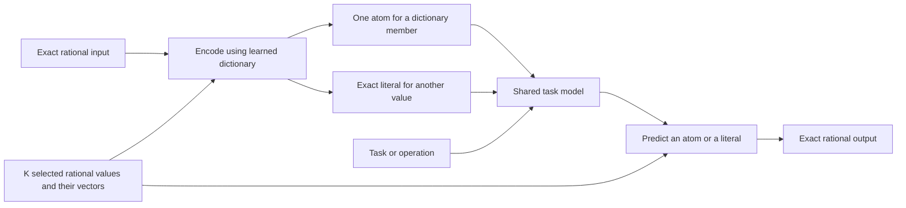

# Learning a finite vocabulary of rational numbers

Design notes, 2026-10-16.

The domain is $\mathbb Q$. The numerical vocabulary has a fixed capacity $K$.
Each entry denotes **one concrete rational number** and has its own learned
embedding. Which rational numbers occupy the entries is determined during
training, rather than prescribed as residues, digits, or numerical bins.

The main proposal is to learn **which values deserve individual parameters**,
as well as learning those parameters. An explicit learned selector chooses
dictionary membership and receives feedback from the main task loss. A
separate exact encoding handles values outside the selected dictionary.
This gives a finite vocabulary whose membership is learned without restricting
the input/output domain to its current members.

The working hypothesis is that **well-chosen numerical atoms help the model
learn general rules that also apply to numbers outside the dictionary**.
The main test should use one shared dictionary across several operations,
including evaluation on rational values never encountered during training.

This is a proposed experiment, not an established result about grokking or a
claim of scientific novelty. The [literature review](numerical-transformer-representations.md)
provides background; the present constraint is more specific than the earlier
proposal for an expanding table.

The experiment archives below retain summaries, run settings, codebooks and
source/checkpoint hashes in Git. Full compressed learning curves and FP32
checkpoints are ignored local artifacts regenerated by the reproduction commands.

## What is learned

Represent the numerical dictionary as

$$
D=\{(q_i,e_i):i=1,\ldots,K\},\qquad
q_i\in\mathbb Q,\quad e_i\in\mathbb R^d.
$$

Keep every $q_i$ as a reduced pair of exact integers, with positive denominator
and zero represented by $0/1$. Distinct occupied entries should denote distinct
values. The dictionary may initially have unused entries, but its capacity
does not grow.

Three parameter groups are involved:

- **Selector parameters $\psi$:** determine which exact rational values $q_i$
  receive entries.
- **Embedding parameters $E$:** the independently trainable vectors $e_i$ for
  the selected values.
- **Task parameters $\theta$:** use the encoded operands to predict answers.

An embedding is not a rounded numerical value. It can be stored in float32
while the associated dictionary key remains an exact rational number.
For example, an entry for $137/991$ has an exact identity even though its
learned vector uses ordinary floating-point coordinates.

## Exact coverage needs more than one dictionary index

A single index from $K$ entries can identify at most $K$ rational values.
Choosing the entries during training does not change that bound. If exact
input and output must cover all of $\mathbb Q$, off-dictionary values need
additional information.

A minimal exact interface has two forms:

$$
\operatorname{Enc}_D(x)=
\begin{cases}
\operatorname{ATOM}(i), & x=q_i,\\
\operatorname{LITERAL}(\text{sign},|p|,q), & x=p/q\notin D.
\end{cases}
$$

The literal uses a finite syntax alphabet and variable-length integer codes.
Its bit symbols are encoding syntax, not additional entries for complete
rational values. The total token vocabulary remains finite: $K$ numerical
atoms plus a fixed number of syntax symbols.

This retains independent whole-value embeddings for **dictionary members**.
It does not assign an independent learned row to every possible off-dictionary
fraction. That stronger condition cannot be supplied by a fixed finite table.
The model can process a literal compositionally; if it summarizes the literal
into one vector, the exact code must remain available whenever the task needs
more distinctions than that finite-precision summary preserves.

The output head first selects an atom or the literal route. An atom yields
its associated exact fraction; the literal route predicts an explicit
numerator and denominator using categorical decisions. The parser does not
evaluate the requested arithmetic operation for the model. Any fraction
reduction performed outside the network must be reported separately.



The representation is exact, but the model's prediction may be wrong. These
are different properties and need different measurements.

## Selecting the dictionary during training

### A learned selector over exact candidates

Let $C=\{c_1,\ldots,c_M\}$ be a pool of distinct exact rational candidates
observed in training, with $M\ge K$. A selector network scores candidates from
their exact codes and training statistics, then selects $K$ distinct values:

$$
D=(q_1,\ldots,q_K)\sim P_\psi(\cdot\mid C),\qquad
q_i\in C,\quad q_i\ne q_j\text{ for }i\ne j.
$$

For example, the selector can make $K$ categorical choices, masking already
selected candidates at each step. The sampled dictionary includes its slot
assignments, so its probability is the probability of that ordered selection.
Every realized entry denotes one specific rational number. The candidate
pool is selection metadata, not a second
dictionary of $M$ independently trained numerical embeddings; its storage and
the selector's parameters still count toward resource usage.

This selector chooses the shared dictionary for a training interval. It does
not choose a different dictionary after inspecting each query's answer.
Selection probabilities and embeddings are different parameters: gradient
updates to an embedding alone cannot determine which exact value it denotes.

A possible objective is

$$
\mathcal J(\psi,\theta,E)=\mathbb E_{D\sim P_\psi}
\left[\mathcal L_{\mathrm{task}}(\theta,E;D)
 +\lambda\,\mathbb E_x[\operatorname{length}(\operatorname{Enc}_D(x))]
 +\mu\sum_{q_i\in D}\operatorname{bits}(q_i)\right].
$$

The first term rewards useful predictions and is sufficient to make selection
task-driven. The optional second term rewards replacing long or frequently
repeated literals with a single atom. The third accounts for the actual
information stored in dictionary identities: a huge numerator or denominator
is not free merely because it occupies one entry. The coefficients are
experimental choices, not theoretical prescriptions.

### How a discrete choice receives a training signal

Ordinary gradients train the predictor and the embeddings for a realized
dictionary. To train the selector, let $\ell(D)$ be the resulting task and
representation cost. When $\psi$ affects that cost only through its discrete
dictionary choice, differentiating its expectation gives

$$
\nabla_\psi\mathbb E_{D\sim P_\psi}[\ell(D)]
=\mathbb E_{D\sim P_\psi}
\left[(\ell(D)-b)\nabla_\psi\log P_\psi(D)\right].
$$

Here $b$ is a baseline independent of the current sampled dictionary, such as
a detached moving average of previous costs. This follows by writing the
expectation as a sum over dictionaries and using
$\nabla P=P\nabla\log P$. Gradient descent increases the probability of
choices whose cost is lower than the baseline. The number itself remains an
exact rational throughout; the gradient updates its probability of selection.

This score-function estimator can train through exact membership checks,
tokenization changes and categorical choices without differentiating those
operations. Its sampling variance and the cost of evaluating dictionaries
are practical drawbacks. Evaluating several choices and using a baseline may
help, but learning quality remains an experimental question.

A continuous relaxation is another possibility: use soft selection weights
for a surrogate gradient while retaining a hard choice in the forward pass.
Such a gradient is generally biased. A weighted mixture of candidate embeddings
or values must not be presented as an exact selection of one rational atom.
Also, a softmax alone does not provide gradients through hard tokenization
and a change in output sequence length; the complete surrogate path would
need to be defined. The hard-choice estimator above is the cleaner initial
reference for this exact interface.

### Reward selection after the new rows have had time to adapt

A potentially useful number can look poor immediately after receiving a
random embedding. Evaluate membership after a fixed adaptation budget:

1. Sample a dictionary, or a small replacement in the existing dictionary,
   using the learned selector.
2. Initialize changed rows and train the task model and embeddings for a
   fixed number of steps, holding membership constant.
3. Measure cost on a separate outer-training batch, then update the selector
   using that cost. Final validation and test data remain separate.
4. Repeat, allowing slower dictionary updates than embedding updates.
5. Freeze one selected dictionary for evaluation and a controlled grokking run.

This is a learned selection mechanism even though its decisions are discrete
and less frequent than weight updates. Include the adaptation budget in the
cost comparison. A controller evaluated only on immediate performance could
favor established entries simply because their embeddings are already trained.

### Generating numerical atoms that were not observed

The candidate selector is limited to values in $C$. A more ambitious selector
could generate the signed integer numerator and positive integer denominator
of each proposed atom with categorical decisions over a finite syntax
alphabet. Canonicalization maps the generated pair to an exact rational key;
duplicates must be resolved so there are at most $K$ distinct entries.

The same task-based feedback can train the proposal probabilities. For a
score-function implementation, account for the probability of the actual
generation trajectory, including any retry decisions. Simply rounding
trainable real-valued numerators and denominators does not yield an ordinary
useful derivative through the integer decisions.

This generator can propose values beyond the observed pool. It introduces
more exploration and adaptation cost, so it is a second experiment after the
candidate-based selector. With variable-length integer codes it has no fixed
mathematical precision bound; every practical run still needs explicit
generation and storage budgets.

There must also be a reason for an unobserved atom to be useful. In the direct
atom-or-literal interface, a value absent from every training operand and
answer receives no positive atom-use examples. A proposal could anticipate
values in later training batches, or a richer model could use such atoms as
numerical anchors or intermediate objects. The latter changes the interface
and requires a separate experiment. Merely attaching a rational label to an
otherwise unconstrained latent vector does not teach the numerical meaning
of that label.

Frequency selection is the necessary baseline. A task-aware selector should
earn its extra complexity by improving held-out performance or adaptation
under a matched budget. It might select common values, simple values, or
less frequent but useful values; none of those outcomes should be assumed
before training.

Changing an entry's rational identity is a semantic change, not a normal
weight update. Reinitialize or explicitly transfer its embedding and optimizer
state, and re-encode affected examples from their exact values. A token ID
must not silently retain the meaning of a displaced number in cached data.

## A possible extension with distance-dependent anchor rotations

Dictionary values could serve as learned anchors whose embeddings rotate
according to a number's displacement from the anchor. This applies a shared
transformation directly to each anchor embedding. An anchor receives training
signal from values routed to it, including when its own exact value never
occurs as an operand or answer.

The analogy is to [RoPE](https://arxiv.org/html/2104.09864v5#S3.SS2): the
original method rotates query and key coordinate pairs according to sequence
positions. Here the rotation argument is a numerical displacement. This
adaptation to rational inputs and learned numerical anchors is a proposal.

### Rotate the anchor embedding by signed displacement

Let $d=2m$ and fix the frequencies before training, using the same schedule
for every anchor and operation. For example, use the standard RoPE schedule:

$$
\omega_k=B^{-(k-1)/m},\qquad k=1,\ldots,m,\qquad B=10000.
$$

The frequency schedule is a declared encoding setting. Define the
block-diagonal rotation:

$$
R_\omega(t)=\operatorname{diag}
\bigl(\operatorname{Rot}(\omega_1t),\ldots,
      \operatorname{Rot}(\omega_mt)\bigr),\qquad
\operatorname{Rot}(u)=
\begin{pmatrix}\cos u&-\sin u\\\sin u&\cos u\end{pmatrix}.
$$

Each anchor supplies a candidate representation of $x$:

$$
\delta_i(x)=x-q_i,\qquad
h_i(x)=R_\omega(\delta_i(x))e_i.
$$

Thus $h_i(q_i)=e_i$. Use signed displacement: replacing $x-q_i$ with its
absolute value would give the same representation to values equally far
to either side of a selected anchor. For example, $5/4$ and $3/4$ rotate
the embedding of anchor $1$ by opposite angles $\omega_k/4$ in each block.

Nearest-anchor selection is deterministic preprocessing performed by code:

$$
i(x)=\arg\min_j|x-q_j|,\qquad
h(x)=R_\omega(x-q_{i(x)})e_{i(x)}.
$$

Compare exact rational distances and resolve ties by a fixed rule. A sorted
index of the exact anchor keys allows a binary search followed by a comparison
of the neighboring candidates. The same code handles training and inference
for every operation. The numerical routing rule has no learned parameters;
the predictor receives the selected, rotated embedding.

Learn the exact rational anchor identities through the discrete vocabulary
selector described above, evaluating choices after a fixed adaptation budget.
This chooses which numbers serve as anchors; the preprocessing code then
assigns each input to its nearest current anchor. Embeddings and the task
model receive ordinary weight updates while anchor identities are fixed.
Nearest-anchor selection, signed displacement, and rotation with the fixed
frequencies are specified by code. Gradients pass through the fixed rotation
to the embedding; the nearest-anchor decision requires no differentiation.

### What the geometry supplies, and when anchors matter

Linear phase has a useful composition law:

$$
R_\omega(a+b)=R_\omega(a)R_\omega(b),\qquad
h_i(x+t)=R_\omega(t)h_i(x).
$$

Within a fixed anchor, an equal numerical increment always induces the same
additional rotation. This builds translation structure into the encoding;
learning the requested arithmetic and exact output remains the model's job.
Switching between independently trained anchors can cause discontinuities,
so measure behavior near routing boundaries as well as inside each region.
The rotation law itself does not supply multiplication or division rules.

There is a redundancy to account for in an alternative that sums all anchor
representations. With shared linear frequencies and weights $\alpha_i$
independent of $x$, the sum simplifies to

$$
\sum_i\alpha_i R_\omega(x-q_i)e_i
=R_\omega(x)\underbrace{
  \sum_i\alpha_i R_\omega(-q_i)e_i}_{u}.
$$

This input encoding is just one global rotated vector $R_\omega(x)u$.
The anchor offsets have been absorbed into its parameters. Deterministic
nearest-anchor routing gives the numerical anchor locations a role beyond
setting constant phases. Treat a global Fourier representation
as a necessary control for the claimed benefit of anchor selection. The
redundancy above is an algebraic consequence of this proposed construction.

### Exactness and the first controlled test

Rotations preserve the norm of each anchor vector, but finite-precision
phases do not preserve every exact rational identity. Each frequency block
is periodic, and several blocks can still produce nearly identical vectors.
Keep the canonical literal input available for exact distinctions, and
record precision used to convert rational displacements into angles.

First test input rotations with the baseline atom-or-literal numerical output
head. Give compared variants the same access to exact literal inputs.
Compare literal-only inputs, literal inputs with unrotated nearest-anchor
embeddings, a global Fourier representation, and the rotated-anchor scheme.
Within the latter, compare fixed, frequency-selected, random, and task-selected
anchor identities under matched budgets, using the same deterministic
nearest-anchor code in every case. Use one dictionary and rotation mechanism
across all the operations below.

Report accuracy on unseen numerical identities, inside anchor regions, near
boundaries, and beyond the training range. Also vary denominator bit lengths:
two different exact fractions can be closer than the phase computation can
resolve. Count nearest-anchor search, displacement, and phase evaluation as
input preprocessing.
These measurements distinguish useful shared geometry from memorization
and from benefits already supplied by a global Fourier encoding.

### First CUDA control: reduce the vocabulary for division modulo 97

The finite modular task provides a simpler initial test of the rotation
mechanism. Keep all 97 operand and answer values, but give independent
parameters to only $K$ anchors. Fixed code generates the complete table
$E[x]=R_\omega(x-q_{i(x)})e_{i(x)}$. Both input lookup and the tied
97-class output head use this table. The additional rows are derived values,
not independently trainable embeddings.

The Rust/CUDA experiment [anchor-div97.rs](../src/bin/anchor-div97.rs) reuses
the established W16 Dense + ReLU model, its seeded 50/50 equation splits,
AdamW with learning rate 0.1, zero weight decay, and ten-update warmup.
Anchors are fixed uniformly spaced canonical residues. Nearest-anchor
selection uses ordinary integer distance, with ties going to the lower
anchor; the RoPE base is fixed at 10000. At $K=97$ every displacement is
zero, so the implementation must reproduce the original model.

This first test isolates the smaller parameter table and its fixed rotation
rule. All residues occur in training, including values outside the anchor
dictionary. It tests held-out equations and off-dictionary values, rather
than previously unexposed numerical identities. Selecting anchor membership
by task loss and sharing it across operations remain further experiments.
The implementation retains a full generated table on the GPU as a cache;
fewer learned rows do not imply a corresponding reduction in runtime memory.

```sh
cargo oxide build --arch sm_86 -- --release --locked --bin anchor-div97
target/release/anchor-div97 --verify-only
target/release/anchor-div97 --epochs 2000 --sizes 97,49,25,13,7 --seeds 11,17,23 --out target/anchor-div97
```

#### Measured results, 2026-10-16

Completed 36 Rust/CUDA runs on an RTX 3050 Laptop GPU: nine dictionary sizes
on seeds 11, 17 and 23 for 2,000 epochs, followed by matched 10,000-epoch
controls for $K\in\{97,96,49\}$. Each epoch visits all 4,656 training
equations once; evaluation covers all 4,656 held-out equations. The table
reports final accuracies, averaged over the three seeds.

| K | Trainable parameters | Train, 2,000 epochs | Test, 2,000 epochs | Test range |
| ---: | ---: | ---: | ---: | --- |
| 97 | 1,808 | 100.00% | 99.36% | 98.75%–99.94% |
| 96 | 1,792 | 87.94% | 76.95% | 52.08%–90.72% |
| 89 | 1,680 | 32.12% | 21.21% | 16.04%–30.67% |
| 81 | 1,552 | 29.55% | 21.08% | 10.22%–28.41% |
| 65 | 1,296 | 16.88% | 11.00% | 10.22%–12.16% |
| 49 | 1,040 | 9.17% | 5.53% | 5.18%–6.08% |
| 25 | 656 | 5.08% | 2.45% | 2.19%–2.77% |
| 13 | 464 | 3.93% | 2.58% | 2.28%–2.84% |
| 7 | 368 | 3.11% | 2.08% | 1.95%–2.30% |

| K | Train, 10,000 epochs | Test, 10,000 epochs | Test range |
| ---: | ---: | ---: | --- |
| 97 | 100.00% | 99.52% | 99.08%–99.89% |
| 96 | 92.71% | 81.42% | 65.21%–90.14% |
| 49 | 10.54% | 6.30% | 5.65%–7.09% |

The fixed nearest-anchor rotation failed to retain the baseline's performance
as the dictionary shrank. At $K=49$, five times the initial budget still
left training accuracy near 10.5%, so that failure includes fitting the
training equations. This is a negative result for these uniformly spaced
anchors, ordinary-distance rotations, tied head, and fixed optimizer. It
does not test task-selected membership or every possible anchor geometry.

The [archive](grokking-results/anchor-div97/summary.json) records settings,
source/binary hashes, and per-seed results. The
[run table](grokking-results/anchor-div97/runs.csv) includes exact counts when
both operands and the answer are outside the dictionary. Empty strata remain
empty rather than being assigned zero accuracy.

[CUDA verification](grokking-results/anchor-div97/cuda-verification.log)
passed independent f64 loss/gradient checks, tied input/output contributions,
offset and repeated batches, AdamW, and bitwise full-vocabulary equivalence
to the original model after an update. All 70 library tests, strict Clippy,
and formatting checks passed.

To reproduce and archive the complete comparison:

```sh
target/release/anchor-div97 --verify-only > target/anchor-div97-verification.log
target/release/anchor-div97 --epochs 2000 --sizes 97,49,25,13,7 --seeds 11,17,23 --out target/anchor-div97-20261016-fixed
target/release/anchor-div97 --epochs 2000 --sizes 96,89,81,65 --seeds 11,17,23 --out target/anchor-div97-20261016-boundary
target/release/anchor-div97 --epochs 10000 --sizes 97,96,49 --seeds 11,17,23 --report-every 100 --out target/anchor-div97-20261016-long
node scripts/archive-anchor-div97.mjs docs/grokking-results/anchor-div97 target/anchor-div97-20261016-fixed target/anchor-div97-20261016-boundary target/anchor-div97-20261016-long
```

### Interpolation between learned anchors

An alternative to the rotation rule is to blend neighboring anchor vectors.
For bracketing anchors $q_i\le x\le q_{i+1}$, start with

$$
t=\frac{x-q_i}{q_{i+1}-q_i},\qquad
E[x]=(1-t)e_i+t e_{i+1}.
$$

The anchor vectors are learned; code computes the neighbors and weights.
Related numerical-prototype work represents numerals by weighted
combinations of prototype embeddings:
[Learning Numeral Embedding](https://aclanthology.org/2020.findings-emnlp.235/).
The following choices can all be compared while decreasing $K$:

| Variant | Construction | Main distinction |
| --- | --- | --- |
| Piecewise linear | Blend the two bracketing anchor vectors | Minimal interpolation baseline |
| Coefficient-normalized linear | Divide the two weights by $\sqrt{(1-t)^2+t^2}$ | Preserves initial coordinate variance for independent anchor rows |
| Normalized linear | Normalize the blended vector to a declared radius | Changes the path from a line segment to a curved path |
| Local cubic | Use a cubic interpolant over nearby anchors | Allows curvature and negative coefficients; specify endpoint handling |
| Distance-weighted prototypes | Blend several anchors with a fixed kernel, such as Gaussian distance weights | Smooths the influence of multiple anchors; declare the bandwidth |

Keep weights computed by fixed code in the first comparison. For variants
intended to retain $E[q_i]=e_i$, explicitly enforce that condition: a generic
Gaussian blend does not automatically reproduce the anchor's own vector.
Use the same weight rule and bandwidth across operations, and compare fixed
membership before introducing task-selected anchor identities.

#### A convex interpolation cannot directly replace the tied output table

There is a mathematical obstruction with the current dot-product head. If
an output vector is a convex blend of available anchor output vectors, its
logit obeys

$$
\ell_x=h^\top E[x]
=(1-t)\ell_{q_i}+t\ell_{q_{i+1}}
\le\max(\ell_{q_i},\ell_{q_{i+1}}).
$$

An interior class cannot strictly beat both anchors. For ordinary bracketing
and the existing lowest-class tie rule, a tie also loses to the lower
anchor. This limitation holds independently of training quality.

The first clean comparison should therefore interpolate **input embeddings**
and retain 97 independently trainable output vectors. An anchor can still
share its vector with its own output class; off-dictionary output classes
have free rows. Compare every $K$ against the full-input-vocabulary baseline
with those same sharing rules, and count all parameters. This measures
compression of the input dictionary.
To compress both sides, test normalized interpolation separately: normalization
breaks the convex-logit identity, but its learning quality still needs a new
experiment. Local cubic interpolation with negative coefficients also falls
outside that convexity argument, without guaranteeing successful learning.

#### Measured CUDA comparison of input interpolation

The [anchor-interpolation.rs](../src/bin/anchor-interpolation.rs) experiment
retains the established W16 model and all 97 independent output rows. Only
the selected $K$ rows participate in the operand mixtures; those anchor rows
also serve their own output classes. Thus this control reduces **input
vocabulary coverage**, while total trainable parameters stay at 1,808. It
does not demonstrate parameter compression of the complete model.

Code computes all weights from ordinary canonical residue order. The four
measured methods are:

- `linear`: the two bracketing anchors, with weights $1-t$ and $t$.
- `linear-scaled`: those weights divided by their Euclidean norm. This
  normalizes coefficients, not the learned blended vector.
- `cubic`: cubic Hermite interpolation with centered secant tangents and
  one-sided secants at the endpoints.
- `shepard`: the four closest anchors weighted by inverse squared distance;
  an exact anchor match uses its own row with weight one.

All four reproduce anchor inputs exactly. The coefficient checks confirm
that all 97 inputs have distinct fixed codes at each tested $K$. The study
uses the same initialization, seeded equation splits, optimizer, batches,
and 2,000-epoch budget as the first rotation screen. It comprises 51 runs:
four methods at $K\in\{49,25,13,7\}$ on three seeds, plus one shared
$K=97$ control per seed. At $K=97$ every method is the same one-hot encoding;
the final control checkpoints match the earlier rotation controls bitwise
on all three seeds.

Mean final held-out accuracy over seeds 11, 17 and 23:

| Input method | K=49 | K=25 | K=13 | K=7 | Train accuracy at K=49 |
| --- | ---: | ---: | ---: | ---: | ---: |
| Linear | 2.55% | 1.93% | 2.28% | 2.99% | 11.25% |
| Coefficient-normalized linear | 4.47% | 2.03% | 2.52% | 2.52% | 13.57% |
| Local cubic | 3.52% | 2.06% | 2.31% | 2.66% | 11.43% |
| Four-neighbor Shepard | 3.29% | 2.13% | 2.46% | 2.87% | 11.96% |

The full-input-vocabulary control reaches 100% train and 99.36% mean test
accuracy. These interpolation variants fail to fit the training equations
well as $K$ shrinks, even with every output class independently trainable.
The result concerns fixed, uniformly spaced anchors in ordinary residue
order, this small model, and the existing optimizer; learned anchor
locations, vector-normalized interpolation, and different training settings
were not tested by this screen.

The [summary](grokking-results/anchor-interpolation/summary.json) and
[per-run metrics](grokking-results/anchor-interpolation/runs.csv)
retain the results and source/binary hashes.
[CUDA verification](grokking-results/anchor-interpolation/cuda-verification.log)
checks the loss and every parameter gradient against independent f64
autodifferentiation for all four input encodings. The interpolation coefficient
test, strict Clippy, and formatting also pass.

```sh
cargo oxide build --arch sm_86 -- --release --locked --bin anchor-interpolation
target/release/anchor-interpolation --verify-only > target/anchor-interpolation-verification.log
target/release/anchor-interpolation --epochs 2000 --sizes 97,49,25,13,7 --seeds 11,17,23 --out target/anchor-interpolation-20261016
node scripts/archive-anchor-div97.mjs docs/grokking-results/anchor-interpolation target/anchor-interpolation-20261016/linear target/anchor-interpolation-20261016/linear-scaled target/anchor-interpolation-20261016/cubic target/anchor-interpolation-20261016/shepard
```

### Shared encoders from numerical language-model representations

The next screen changes the meaning of a dictionary entry deliberately. It
replaces independent whole-value input atoms with a fixed numerical code
and shared trainable parameters. Here $F$ counts code features or component
vectors; it is **not** $K$ concrete numerical atoms. Except for the full-table
control, there are no learned input rows indexed by a whole residue. The
random-code control still stores a fixed random vector for each identity.

The implementations borrow representation principles from
[FoNE](https://arxiv.org/html/2502.09741v2),
[BitTokens](https://arxiv.org/html/2510.06824v2), and the shared number-encoder
approach in [LUNA](https://arxiv.org/html/2212.02691v2). They are small modular
arithmetic adaptations, not reproductions of those papers' Transformer
architectures, training, or output heads. In particular, the bit control uses
seven exact integer bits, rather than IEEE floating-point bits and the
precomputed reciprocal used by BitTokens. No modular inverse is supplied as
an input feature.

The original [numerical-div97.rs](../src/bin/numerical-div97.rs) screen compares
eight codes, normalized to unit norm for every residue:

| Code | Features at the default H=8 | Definition |
| --- | ---: | --- |
| `table` | 97 | One-hot identity, the full-input-vocabulary control |
| `bits` | 7 | Signed binary digits of the canonical residue |
| `digits` | 20 | Separate one-hot units and tens, including a leading zero |
| `fone` | 4 | Sine/cosine pairs with periods 10 and 100 |
| `binary-fourier` | 14 | Sine/cosine pairs with periods 2, 4, ..., 128 |
| `fourier` | 16 | Harmonics 1 through 8 of the residue cycle of length 97 |
| `log-fourier` | 17 | Harmonics 1 through 8 of the nonzero multiplicative cycle of length 96, plus an independent zero flag |
| `random` | 16 | Fixed random unit vectors, with the code seed independent of model and split seeds |

The `log-fourier` control provides an operation-specific arithmetic prior:
for nonzero operands, the discrete logarithm of division is the difference
of their logarithms modulo 96. Its result cannot establish that a generic
numerical representation discovers this structure. The residue-cycle
Fourier code does not provide that multiplicative ordering.

Each code $c(x)$ feeds one of two encoders, shared by both operands:

$$e(x)=c(x)P,\qquad\text{or}\qquad
e(x)=\operatorname{ReLU}(c(x)P)Q.$$

There is no additional correction vector or learned router. The model combines
$e(a)+R_{90}e(b)$, applies one pre-RMSNorm residual FFN with expansion one and
ReLU, then final RMSNorm and a readout with 97 independent class vectors.
This core has two dense FFN matrices and an independent readout, so it differs
from the earlier tied single-projection control. Compare representations
against the full-table control **within this new architecture**.

At width $W$, the linear version has $FW+2W^2+97W$ trainable parameters; the
MLP encoder adds $W^2$. A generated dense operand matrix is only a CUDA cache
and has no independent optimizer state. Its storage is not a demonstrated
memory saving. The initial core and head are identical across codes and
encoder choices for a given width and seed. The input-bank initialization
controls the expected coordinate variance using unit-norm codes.

The main screen uses widths 16 and 64, seeds 11, 17 and 23, and 2,000 epochs,
with the same 50/50 division-equation splits and Adam settings as the previous
screens. It measures transfer to held-out **pairs**; every residue identity
appears during training. There is no unseen-identity or extrapolation claim.

#### Measured CUDA results for shared numerical encoders

The main screen comprises 96 runs: eight codes, two encoders, two widths,
and three seeds. Mean final held-out accuracy over seeds 11, 17 and 23:

| Code | F | W16 linear | W16 MLP | W64 linear | W64 MLP | Parameters, W64 MLP |
| --- | ---: | ---: | ---: | ---: | ---: | ---: |
| Full table | 97 | 92.75% | 33.98% | 99.96% | 90.91% | 24,704 |
| Binary bits | 7 | 2.59% | 4.73% | 3.30% | 10.17% | 18,944 |
| Decimal digits | 20 | 1.91% | 35.20% | 3.04% | 70.40% | 19,776 |
| Decimal FoNE | 4 | 3.89% | 3.18% | 3.82% | 2.35% | 18,752 |
| Binary-scale Fourier | 14 | 4.17% | 38.94% | 4.28% | 52.33% | 19,392 |
| Residue-cycle Fourier | 16 | 1.92% | 1.93% | 2.86% | 2.67% | 19,520 |
| Discrete-log Fourier | 17 | 95.64% | 99.84% | 100.00% | 99.95% | 19,584 |
| Fixed random code | 16 | 1.55% | 31.25% | 1.68% | 100.00% | 19,520 |

At W64, the random-code MLP reaches exactly 100% train and test accuracy in
each of the three runs. Numerical proximity is therefore unnecessary for
this finite-domain success. The decimal-digit MLP reaches 100.00%, 11.45%,
and 99.74% test accuracy: successful runs exist, but the main screen is
strongly seed-dependent. The full-table MLP is also seed-dependent, with
72.92%, 100.00%, and 99.81% test accuracy. Its simpler linear control is
both smaller and more consistent at this width.

The linear full-table W64 control has 20,608 parameters. The random-code
MLP uses 19,520, a 5.28% reduction, despite removing independently learned
whole-value input rows. Counting the shared encoder and full readout matters:
reducing the apparent input vocabulary does not reduce every parameter group.
The fixed-code table and generated operand matrix also occupy memory in the
current implementation; the comparison measures trainable parameters.

The operation-specific log-Fourier control works with a linear shared
projection: at W64 every seed reaches 100% train and test accuracy. In
contrast, the direct decimal FoNE, integer bits, and residue-cycle harmonics
do not obtain high division accuracy in this small architecture and budget.
These results do not reproduce or refute the source papers' experiments.

The useful change relative to local interpolation is a shared **nonlinear**
map from an identity-preserving code to an operand representation. It can
learn nonlocal relationships between residues. The random-code result does
not show transfer to unseen numerical identities: the encoder may learn a
finite mapping for familiar values while the core generalizes to new pairs.
The original hypothesis about selecting useful concrete numerical atoms
remains separate.

#### Smaller widths and a longer budget

After the main screen, 24 follow-up runs compare the digit, binary-Fourier,
and random-code MLPs at W32 and W48 against a linear full-table control at
each width. They keep the same seeds, splits, optimizer and 2,000 epochs.
Mean final test accuracy and the range across three seeds are:

| Input / encoder | Width | Parameters | Mean test | Test range |
| --- | ---: | ---: | ---: | --- |
| Full table / linear | 32 | 8,256 | 99.91% | 99.72–100.00% |
| Decimal digits / MLP | 32 | 6,816 | 96.70% | 92.68–99.89% |
| Binary-scale Fourier / MLP | 32 | 6,624 | 71.14% | 55.28–96.35% |
| Fixed random / MLP | 32 | 6,688 | 89.21% | 79.45–100.00% |
| Full table / linear | 48 | 13,920 | 99.79% | 99.53–100.00% |
| Decimal digits / MLP | 48 | 12,528 | 58.15% | 21.54–98.02% |
| Binary-scale Fourier / MLP | 48 | 12,240 | 74.74% | 24.29–99.98% |
| Fixed random / MLP | 48 | 12,336 | 97.82% | 94.24–99.98% |

The W32 digit encoder saves 17.44% of trainable parameters relative to the
same-width full-table control, with a drop in mean test accuracy from
99.91% to 96.70%. The W48 random-code encoder saves 11.38%, with mean test
accuracy of 97.82% versus 99.79%. Results are not monotonic in width under
this optimizer, and no learning-rate or weight-decay search was performed.

Six further runs extend the W64 digit MLP and the W64 linear full-table
control to 10,000 epochs. The digit MLP finishes at 100.00%, 16.30%, and
99.61% test accuracy for seeds 11, 17 and 23. The failed seed now fits the
training set perfectly, so simply extending this training budget does not
resolve its generalization failure. The matched full-table controls finish
at 100.00%, 99.98%, and 100.00%. All 246 recorded metric rows through epoch
2,000 match exactly between the short and long versions of these six runs.

The complete study contains 126 runs. The
[summary](grokking-results/numerical-div97/summary.json) and
[per-run metrics](grokking-results/numerical-div97/runs.csv)
retain all runs, checkpoint hashes, and source/binary hashes. The
[CUDA verification log](grokking-results/numerical-div97/cuda-verification.log)
covers all eight codes with both encoders: independent f64 loss and every
parameter gradient, sharing across operands, an independent readout,
repeated/offset batch indices, and AdamW. The fixed-code test also checks
finite unit-norm codes and separation of all 97 identities. All 71 library
tests, strict Clippy, and formatting pass.

```sh
cargo oxide build --arch sm_86 -- --release --locked --bin numerical-div97
target/release/numerical-div97 --verify-only > target/numerical-div97-verification.log
target/release/numerical-div97 --epochs 2000 --widths 16,64 --methods table,bits,digits,fone,binary-fourier,fourier,log-fourier,random --seeds 11,17,23 --out target/numerical-div97-20261016
target/release/numerical-div97 --epochs 2000 --widths 32,48 --methods digits,binary-fourier,random --encoders mlp --seeds 11,17,23 --out target/numerical-div97-20261016-middle
target/release/numerical-div97 --epochs 2000 --widths 32,48 --methods table --encoders linear --seeds 11,17,23 --out target/numerical-div97-20261016-middle-control
target/release/numerical-div97 --epochs 10000 --widths 64 --methods digits --encoders mlp --seeds 11,17,23 --out target/numerical-div97-20261016-long
target/release/numerical-div97 --epochs 10000 --widths 64 --methods table --encoders linear --seeds 11,17,23 --out target/numerical-div97-20261016-long-control
node scripts/archive-numerical-div97.mjs docs/grokking-results/numerical-div97 target/numerical-div97-20261016 target/numerical-div97-20261016-middle target/numerical-div97-20261016-middle-control target/numerical-div97-20261016-long target/numerical-div97-20261016-long-control
```

#### Fixed random binary identity codes

The `random-bits` follow-up assigns each residue a distinct random 16-bit
string. These are arbitrary identifiers, separate from the earlier `bits`
control that used the ordinary seven binary digits of the residue. The
assignment is frozen and sampled without replacement with a fixed seed,
independent of all model and equation-split seeds. The shared encoder
receives a bit as $-1/4$ or $+1/4$, so every code has norm one. No code bits
are optimized.

The paired comparison uses `random` and `random-bits`, both with 16 code
features and the same shared MLP, at W32 and W64. Each combination runs for
2,000 epochs on seeds 11, 17 and 23, for 12 runs total. For a given width and
seed, the train/test split, sampler, initial encoder/core/head weights,
optimizer and evaluation schedule match; only the fixed input code changes.
There are 6,688 trainable parameters at W32 and 19,520 at W64 for either code.
One fixed code assignment per method is tested across three model/split
seeds; these are not three independent codebook samples.

Mean final accuracies and individual test accuracies are:

| Width | Fixed code | Parameters | Mean train | Mean test | Test, seeds 11 / 17 / 23 |
| --- | --- | ---: | ---: | ---: | --- |
| 64 | Gaussian, 16 coordinates | 19,520 | 100.00% | 100.00% | 100.00 / 100.00 / 100.00% |
| 64 | Random, 16 bits | 19,520 | 99.98% | 99.26% | 100.00 / 100.00 / 97.79% |
| 32 | Gaussian, 16 coordinates | 6,688 | 98.44% | 89.21% | 100.00 / 88.19 / 79.45% |
| 32 | Random, 16 bits | 6,688 | 98.83% | 74.43% | 82.60 / 99.48 / 41.19% |

Fixed random binary identifiers therefore support strong held-out-pair
generalization at W64 in this test. They do not improve accuracy over the
Gaussian codes, and the smaller W32 encoder remains strongly seed-dependent.
The earlier poor result for the seven ordinary binary digits does not answer
this different experiment. All identities are familiar from training; no
unseen-number transfer is established.

The [binary codebook](grokking-results/random-bits-div97/codebooks/random-bits-h8-codes.csv)
records the actual frozen assignment. For example, residue 37 receives
`0000110110101110`. Characters are listed in encoder-coordinate order, and
each `0`/`1` maps to $-1/4$/$+1/4$. The current CUDA implementation still
uses unpacked FP32 feature buffers and FP32 model weights; bit-packing memory
or speed improvements were not benchmarked.

The [summary](grokking-results/random-bits-div97/summary.json) and
[run metrics](grokking-results/random-bits-div97/runs.csv)
retain all 12 runs, the codebook and checkpoint hashes, and source/binary
hashes. All six Gaussian-control checkpoints match the preceding study
bitwise, and all 246 corresponding recorded metric rows match exactly.
The [CUDA verification log](grokking-results/random-bits-div97/cuda-verification.log)
passes 18 cases, covering all nine codes with linear and MLP encoders against
the independent f64 reference. All 72 library tests, strict Clippy, and
formatting pass; the added binary-code test checks repeatability, the binary
alphabet, collision rejection, and an insufficient code-space error.

```sh
cargo oxide build --arch sm_86 -- --release --locked --bin numerical-div97
target/release/numerical-div97 --verify-only > target/numerical-div97-verification.log
target/release/numerical-div97 --epochs 2000 --widths 64,32 --methods random,random-bits --encoders mlp --seeds 11,17,23 --out target/random-bits-div97-20261016
node scripts/archive-numerical-div97.mjs docs/grokking-results/random-bits-div97 target/random-bits-div97-20261016
```

#### Ordinary binary numerals and unseen operand values

The `integer-bits` experiment uses the actual positional representation of a
residue, not a random binary identifier. For instance, 37 is `0100101`, with
the most significant bit first. Its shared MLP input is

$$c(x)=[b_6(x),b_5(x),\ldots,b_0(x),1]/\sqrt{8}.$$

The last coordinate supplies one shared affine bias in the encoder; it is
not a separate vector for each value. All seven numeric coordinates are
ordinary zero/one digits. A single global scale preserves the bit values and
constant bias coefficient, so these codes do not have equal norms. In
particular, numeral zero still has a nonzero shared bias feature. The
earlier `bits` control also encodes actual numerical values, using seven
signed, unit-normalized, least-significant-bit-first digits without this
extra bias. Their comparison changes these preprocessing choices together.

Two evaluation protocols separate familiar-pair generalization from transfer
to unseen inputs:

- `--split pairs` retains the original 50/50 equation split, with every residue
  exposed as an operand during training.
- `--split operands --holdout-start 80` removes every training equation with
  either operand in 80 through 96 and moves it into the test set. No such
  value occurs in either training input role. The original test equations
  remain held out, including familiar pairs.

For division, the latter protocol tests all 1,343 equations with only the
numerator unseen, 1,360 with only the denominator unseen, and 289 with both
unseen. All seven bit positions vary within the training input domain; the
test introduces new combinations of those positions. Per-value training
exposure counts and separate metrics for familiar pairs and each unseen
operand category are recorded. Unit tests check complete/disjoint equation
coverage and the absence of held-out operands from training.

All 97 answer identities remain supervised as targets: the independent
97-class head cannot fairly test unseen answers. Thus this is transfer to
**unseen operand values**, not complete exclusion of an identity from every
training role. Familiar-pair accuracy within this same trained model helps
separate input transfer from fitting or generalization failures on the
smaller training set.

The initial screen uses widths 64 and 128, three seeds, 2,000 epochs, learning
rate 0.1 and no weight decay, matching the preceding screens. The two binary
encoders share an MLP. Full-table controls use their simpler linear encoder.
All numerical representations are fixed functions of the actual residue.

Mean final accuracy on the original familiar-value pair split:

| Input / encoder | Width | Parameters | Train | Held-out pairs |
| --- | ---: | ---: | ---: | ---: |
| Signed bits / MLP | 64 | 18,944 | 93.56% | 10.17% |
| Zero/one bits + bias / MLP | 64 | 19,008 | 93.25% | 16.33% |
| Full table / linear | 64 | 20,608 | 100.00% | 99.96% |
| Signed bits / MLP | 128 | 62,464 | 99.33% | 5.84% |
| Zero/one bits + bias / MLP | 128 | 62,592 | 99.52% | 40.79% |
| Full table / linear | 128 | 57,600 | 100.00% | 99.74% |

The matching operand-holdout runs report each test category separately.
Accuracies below pool the correct/row counts across the three seeds:

| Input / encoder | Width | Familiar pairs | Unseen numerator only | Unseen denominator only | Both operands unseen |
| --- | ---: | ---: | ---: | ---: | ---: |
| Signed bits / MLP | 64 | 3.63% | 0.60% | 1.10% | 1.15% |
| Zero/one bits + bias / MLP | 64 | 3.99% | 0.77% | 1.72% | 1.38% |
| Full table / linear | 64 | 99.35% | 0.69% | 1.76% | 0.81% |
| Signed bits / MLP | 128 | 3.10% | 0.69% | 1.52% | 2.19% |
| Zero/one bits + bias / MLP | 128 | 10.12% | 0.79% | 1.84% | 2.77% |
| Full table / linear | 128 | 99.23% | 0.55% | 1.76% | 1.15% |

These initial binary runs mostly fit the training equations without learning
a rule that predicts familiar held-out pairs well, let alone unseen inputs.
The full-table controls generalize familiar pairs on the smaller training
set, while their unseen-input rows remain untrained. The aggregate test
accuracy for such a control is about 51%; this must not be presented as
accuracy on unseen operands.

An exploratory follow-up gives the W128 zero/one encoder 10,000 epochs with
learning rate 0.01 and weight decay 0.01 on both split protocols. It changes
the budget and optimizer together, rather than isolating a single cause.
There are three runs per protocol with the same seeds and fixed data splits.

On the full familiar-value pair split, the longer zero/one runs reach
100.00%, 100.00%, and 99.96% test accuracy, or 99.99% on average. Thus the
earlier short-run failure was not sufficient evidence against positional
binary inputs for familiar-pair generalization in this model.

For the separately trained model excluding 80 through 96 from its operands:

| Evaluation | Accuracy |
| --- | ---: |
| Training equations, mean over seeds | 99.87% |
| Held-out pairs of familiar operands | 99.53% |
| Unseen numerator only | 3.15% |
| Unseen denominator only | 4.44% |
| Both operands unseen | 6.00% |

Test accuracies pool each category's correct/row counts across the three
seeds. The both-unseen category includes 17 diagonal equations $a/a=1$ per
seed, so it is not a separate measurement of off-diagonal transfer. The
strong familiar-pair performance does not extend reliably to new operand
values. A shared encoder can still learn a finite value-to-representation
mapping inside its weights; positional binary input alone does not establish
that the model has learned an integer-arithmetic algorithm.

The successful W128 zero/one model has 62,592 trainable parameters, versus
57,600 for the W128 linear full-table control. This experiment does not
demonstrate a total-parameter saving. It also keeps all answer identities in
training, as described above.

The [summary](grokking-results/integer-bits-div97/summary.json),
[run metrics](grokking-results/integer-bits-div97/runs.csv), and
[actual positional code table](grokking-results/integer-bits-div97/codebooks/integer-bits-h8-codes.csv)
archive all 42 runs, exposure counts, source/binary hashes, codebook hashes,
and checkpoint hashes. The six W64 signed-bit and full-table pair-control
checkpoints match their original-study counterparts bitwise. The
[CUDA verification](grokking-results/integer-bits-div97/cuda-verification.log)
passes all 20 code/encoder combinations against the independent f64 reference.
All 73 library tests, both driver split tests, strict Clippy, and formatting
pass.

```sh
cargo oxide build --arch sm_86 -- --release --locked --bin numerical-div97
target/release/numerical-div97 --verify-only > target/numerical-div97-verification.log
target/release/numerical-div97 --epochs 2000 --widths 64,128 --methods bits,integer-bits --encoders mlp --seeds 11,17,23 --split pairs --out target/integer-bits-div97-20261016-pairs
target/release/numerical-div97 --epochs 2000 --widths 64,128 --methods bits,integer-bits --encoders mlp --seeds 11,17,23 --split operands --holdout-start 80 --out target/integer-bits-div97-20261016-operands
target/release/numerical-div97 --epochs 2000 --widths 64,128 --methods table --encoders linear --seeds 11,17,23 --split pairs --out target/integer-bits-div97-20261016-control-pairs
target/release/numerical-div97 --epochs 2000 --widths 64,128 --methods table --encoders linear --seeds 11,17,23 --split operands --holdout-start 80 --out target/integer-bits-div97-20261016-control-operands
target/release/numerical-div97 --epochs 10000 --widths 128 --methods integer-bits --encoders mlp --seeds 11,17,23 --lr 0.01 --wd 0.01 --split pairs --out target/integer-bits-div97-20261016-long-pairs
target/release/numerical-div97 --epochs 10000 --widths 128 --methods integer-bits --encoders mlp --seeds 11,17,23 --lr 0.01 --wd 0.01 --split operands --holdout-start 80 --out target/integer-bits-div97-20261016-long-operands
node scripts/archive-numerical-div97.mjs docs/grokking-results/integer-bits-div97 target/integer-bits-div97-20261016-pairs target/integer-bits-div97-20261016-operands target/integer-bits-div97-20261016-control-pairs target/integer-bits-div97-20261016-control-operands target/integer-bits-div97-20261016-long-pairs target/integer-bits-div97-20261016-long-operands
```

## What the grokking experiment would test

The central question is whether dictionary selection improves the learning of
rules that transfer beyond the selected values. Better accuracy on frequent
atoms alone would establish a narrower benefit. A possible mechanism is that
useful atoms make numerical relationships easier to learn, and the shared
model carries those relationships into its processing of literals. Whether
that transfer actually happens is the experimental question.

### One dictionary across operations

Train one model on addition, subtraction, multiplication, division with a
nonzero divisor, and three-way comparison. An operation symbol specifies the
task. All operations share the same dictionary membership, numerical
embeddings, model body, and atom-or-literal interface. Each numerical atom has
the same exact meaning in every operation. Arithmetic outputs are exact
rationals; comparison outputs are the relation symbols `<`, `=`, or `>`.

Use a balanced mixture of operations both to train the predictor and to
evaluate dictionary choices. Define the task loss in the selector objective
as a predeclared weighted mean of per-operation losses, with explicit
normalization for their different output lengths. This makes the selected
dictionary answer to the whole task collection.

Separate two stages. During vocabulary discovery, identities can enter and
leave the fixed-capacity dictionary. During the grokking measurement, hold
membership and the train/test split fixed. A changing tokenizer changes the
learning problem, so its progress should not be confused with delayed
generalization on a stable dataset.

### Controls for dictionary membership

Compare these choices under the same dictionary capacity and training budget:

| Dictionary choice | Question it answers |
| --- | --- |
| Most frequent training values | Is ordinary token compression sufficient? |
| Random training values | Does the particular membership matter? |
| A manually specified set | Does a numerical prior help? |
| Learned selector over observed values | Does task-loss feedback select more useful numerical atoms? |
| Learned generator of rational atoms | Do proposals beyond observed values help enough to justify their cost? |
| Literal-only representation | Do whole-value atoms provide a benefit? |

The last control intentionally removes the independent numerical atoms. It
tests their contribution; it is not the proposed main design. Include the
cost of dictionary selection and any adaptation after replacements in budget
comparisons. Construct the frequency and random controls from the same
training candidate pool across all operations. Keep the task mixture, model
architecture, literal code, and evaluation examples matched between runs.

### Separate dictionary coverage from unseen numerical identities

Being outside the dictionary does not imply being new to the model: a value
may already have appeared many times as a literal. Let $S$ contain every
canonical rational identity exposed during vocabulary discovery or predictor
training, including selector candidates, operands, numerical answers, and
outer-training batches. Take this union across **all** operations. A value
used to train addition cannot count as an unseen identity in a division test.

Reserve held-out identities before vocabulary discovery and exclude them
from those training sources. Keep validation and final test data separate
from selector feedback. With the final dictionary frozen, distinguish these
evaluation slices:

| Evaluation slice | Required condition | What it tests |
| --- | --- | --- |
| New combinations of familiar values | Operand and numerical-answer identities appeared in predictor training in their respective roles; the equation is held out | Generalization beyond memorized equations |
| Familiar literals | Both operands appeared in predictor training, with at least one trained through the literal route and outside $D$ | Applying rules to previously trained off-dictionary values |
| Unseen operands | At least one operand is outside $S$ | Transfer to new numerical identities; report one and two unseen operands separately |
| Unseen numerical answers | The arithmetic answer is outside $S$ | Generating a new exact value through the literal output path |

These slices can overlap. Within each operation, also stratify by whether
zero, one, or both operands are outside $D$, and whether the numerical answer
is outside $D$. In particular, report cases where both operands and the
answer are off-dictionary; comparison has no numerical answer to stratify.
Measure unseen-value transfer before any adaptation on those values.

Report at least:

- Exact canonical-answer accuracy for arithmetic and exact relation accuracy
  for comparison, with train/test learning curves for each operation.
- Accuracy for the slices above, their example counts, and a macro-average
  across operations so a gain on one task cannot conceal failures on others.
- Vocabulary coverage, code length and actual dictionary storage.
- Performance as numerator and denominator bit lengths increase.
- Variation across several seeds with matched data splits and budgets.

If a learned dictionary only makes common answers easier, that is useful
compression but not evidence of broader arithmetic generalization. Consistent
improvements over the controls on unseen literal operands and answers across
several operations with the same dictionary would support the central
hypothesis. They would not establish correctness over all of $\mathbb Q$.
A successful representation may generalize early without a long grokking
delay.

## Open question about the other branch

Could the $K$ entries instead denote reusable components or transformations
whose meanings emerge during training, rather than concrete rational values?
This could permit more compositional reuse, but changes the agreed semantics
of a dictionary entry. Keep it as a separate open question; the main proposal
above assigns every numerical atom a specific member of $\mathbb Q$.

## Scope of the earlier mathematical checks

The local Rust program
[check-rational-geometry.rs](../scripts/check-rational-geometry.rs) checks an
operation-specific phase construction, finite-field constraint ranks, and
exact paths representing rational numbers. It demonstrates that a finite
table can have shared algebraic structure and that a finite construction
alphabet can address unboundedly many objects. It does not select numerical
atoms during learning or validate this proposal.

The program has no external dependencies and performs no neural-network
training. Its results can be reproduced with:

```sh
mkdir -p target/rational-geometry
rustc --edition 2024 -O -D warnings scripts/check-rational-geometry.rs -o target/rational-geometry/check-rational-geometry
target/rational-geometry/check-rational-geometry > target/rational-geometry/checks.json
```
