# Mesh GPT

A character-level autoregressive Transformer using CUDA Oxide. The decoder uses
multi-head causal exclusive self attention (XSA), QK-Norm, slice RoPE, mesh-generated
token embeddings, pre-RMSNorm, residual connections, a final RMSNorm, and a tied
vocabulary head. All mesh layers, normalization layers, and the vocabulary head
are bias-free; every RMSNorm is parameter-free. This follows
the decoder design described in [Attention Is All You Need](https://arxiv.org/abs/1706.03762)
and the pre-norm placement in the [GPT-2 report](https://cdn.openai.com/better-language-models/language_models_are_unsupervised_multitask_learners.pdf).

The experimental change is to use sparse two-parent meshes for **all Q/K/V
projections, the attention output projection, and the feed-forward branch**.
Every mesh layer preserves channel width. Neuron `c` reads channels `c` and
`(c + 1) mod width` from the preceding layer, with two separate weights:

```text
z[c] = w_self[c] * x[c] + w_neighbor[c] * x[(c + 1) mod width]
```

Intermediate mesh layers use ELU with alpha 1; the last layer is linear so the
branch can produce signed Q/K/V vectors and residual updates. This extends the
two-parent idea of the scalar diamond mesh to vector inputs and outputs.
Mesh weights are independent across depth, projections, and Transformer blocks.
The input and vocabulary head share one additional embedding mesh. **Every
learned parameter is a mesh edge.**

### Mesh token embeddings

Each token ID has a fixed code of `width` channels. For a vocabulary of size `V`,
`bits = ceil(log2(V))`. When `width >= bits`, the first channels contain the ID's
binary digits, mapping 0 to -1 and 1 to +1. Remaining channels contain fixed
parities of combinations of bits. Masks visit the individual bits first, then
the remaining nonzero masks in ascending order, repeating only after all
`2^bits - 1` masks have been used. This retains distinct codes and gives wider
meshes more input patterns than repeated binary digits. No zero mask adds a
constant input coordinate. At narrower widths, disjoint groups of bits
are packed into radix digits and mapped to `2 * digit / maximum_digit - 1`.
The codes remain distinct, finite, and nonzero even at width 2 and vocabulary
size 256. They depend only on the configured vocabulary size and width, have
no trainable coefficients, and are created once when the model is initialized.

A bias-free mesh with depth `attention_mesh_depth` transforms these codes into
learned vectors. It uses the same two-parent topology, intermediate ELU, and
linear last layer as the other meshes:

```text
E[token] = embedding_mesh(fixed_code[token])
x[row] = E[input_token[row]]
h = decoder_blocks(x)
logits[row, token] = dot(RMSNorm(h[row]), E[token])
```

CUDA generates vectors for the entire vocabulary once per forward pass. This
temporary activation table is shared by input lookup and the vocabulary head;
it is regenerated after updates and parameter replacement. The head has no
separate learned matrix. Backward first adds the contributions from repeated
input IDs and all output logits, then differentiates the embedding mesh once.
Gradients reach its edge weights from both uses; fixed codes are not optimized.
The configuration and tokenizer saved in a checkpoint reconstruct the codes.

### Pre-RMSNorm

Each token is normalized across its full channel width with
[RMSNorm](https://arxiv.org/abs/1910.07467):

```text
inverse_rms = 1 / sqrt(mean(x * x) + 1e-5)
normalized = x * inverse_rms
out = normalized
```

Normalization has no learned scale, bias, or mean subtraction. The decoder
uses **pre-norm**: normalization precedes the attention and feed-forward
branches, while each residual adds to the
unnormalized branch input. A final RMSNorm precedes the tied vocabulary head.

```text
x = x + attention_branch(RMSNorm(x))
x = x + feed_forward_mesh(RMSNorm(x))
```

For upstream gradient `g`, CUDA uses
`dx = inverse_rms * (g - normalized * mean(g * normalized))`.
This includes the denominator derivative and remains finite for zero or tiny
inputs. Parameter-free normalization still propagates gradients to its input.

### QK-Norm

Every block applies RMSNorm separately to each projected Q/K head before RoPE,
following the per-head placement in
[Hugging Face's Qwen3 attention](https://github.com/huggingface/transformers/blob/main/src/transformers/models/qwen3/modeling_qwen3.py).
The implementation here uses fixed normalization with epsilon `1e-5`, without
an affine scale or a learned attention temperature:

```text
q[h] = q[h] / sqrt(mean(q[h] * q[h]) + 1e-5)
k[h] = k[h] / sqrt(mean(k[h] * k[h]) + 1e-5)
q, k = slice_rope(q, k, position)
scores[h] = q[h] @ k[h].T / sqrt(head_width)
```

Means are taken over the channels within one head and one token. Q and K use
their own RMS values; heads and batch items cannot affect one another's
normalization. V keeps the output of its mesh. The same CUDA forward/backward
kernels implement full-width residual RMSNorm and per-head QK-Norm. One shared
scratch buffer holds each group's inverse RMS and gradient projection; backward
recomputes the inverse from graph inputs instead of retaining per-node caches.
Every block always uses QK-Norm.

### Slice RoPE

Each block rotates the projected queries and keys with the split-half convention
from [Hugging Face's Llama implementation](https://github.com/huggingface/transformers/blob/main/src/transformers/models/llama/modeling_llama.py).
For a head of even width `d`, pair `i` joins channels `i` and `i + d/2`:

```text
frequency[i] = 10000^(-2 * i / d)
angle[i] = position * frequency[i]
cos = concat(cos(angle), cos(angle))
sin = concat(sin(angle), sin(angle))
x1, x2 = x[:d/2], x[d/2:]
rotated = concat(-x2, x1)
out = x * cos + rotated * sin
```

The frequencies use the base from [RoFormer](https://arxiv.org/abs/2104.09864).
Positions start at zero within each sequence in the batch. The embedding mesh
encodes token identity; RoPE supplies position information through Q/K.
The CUDA kernel computes the angles, sine, and cosine. Its backward applies the
transpose rotation, equivalent to negating the angle. V goes directly to
attention and XSA. Every block always uses full-head slice RoPE with base 10000.

### Exclusive self attention

Attention first combines token positions using `softmax(Q K^T / sqrt(head_width)) V`;
only keys at or before the current position participate, including the current
token. Before the output mesh, each head applies
[Exclusive Self Attention](https://arxiv.org/html/2603.09078v1#S3):

```text
y[i] = sum_j attention[i, j] * v[j]
u[i] = v[i] / max(norm(v[i]), 1e-12)
z[i] = y[i] - dot(y[i], u[i]) * u[i]
```

Normalization is over channels within each head, separately for each token and
batch item. Above the norm floor, `z[i]` is orthogonal to the current token's
value vector. The floor matches
[PyTorch's F.normalize](https://docs.pytorch.org/docs/stable/generated/torch.nn.functional.normalize.html)
in the paper's algorithm; zero values leave `y[i]` unchanged. XSA adds no
parameters and always runs in every block. The vocabulary logits use dot
products with the shared mesh-generated token vectors, with no additive bias.

```mermaid
flowchart LR
    C[Fixed token codes] --> EM[Shared embedding mesh]
    EM --> E[Token vectors]
    T[Input token IDs] --> Lookup[Lookup]
    E --> Lookup
    Lookup --> N1[Fixed RMSNorm]
    N1 --> QKV[Q / K / V meshes]
    QKV --> NQK[Per-head QK-Norm on Q/K]
    NQK --> P[Slice RoPE on Q/K]
    P --> A[Causal multi-head attention]
    QKV -->|V| A
    A --> X[Per-head XSA projection]
    QKV -->|V| X
    X --> O[Output mesh]
    Lookup --> R1[Residual add]
    O --> R1
    R1 --> N2[Fixed RMSNorm]
    N2 --> F[Feed-forward mesh]
    R1 --> R2[Residual add]
    F --> R2
    R2 --> Next[Next block / final fixed RMSNorm]
    Next --> H[Tied vocabulary head]
    E --> H
    H --> L[Next-token logits]
```



## Run

Use the root README's CUDA Oxide setup first. The original scalar mesh example
remains the default binary; select this example with `--bin mesh-gpt`.

```bash
# Train, save weights, and generate a sample.
cargo oxide run --bin mesh-gpt -- train

# Generate from the saved checkpoint, without retraining.
cargo oxide run --bin mesh-gpt -- generate \
  --checkpoint target/mesh-gpt/model.bin \
  --prompt "the little robot " --tokens 240 --temperature 0.7

# Use your own UTF-8 corpus and a wider model.
cargo oxide run --bin mesh-gpt -- train \
  --dataset data/your-corpus.txt --width 64 --heads 4 --layers 2 \
  --context 64 --steps 3000 --output target/mesh-gpt-custom

# Check every CUDA operator against the independent CPU reference.
cargo oxide run --bin mesh-gpt -- verify

# Plot learning curves with locked uv dependencies.
uv run --locked scripts/plot-gpt.py

# All dimensions, optimizer, sampling, and output options.
cargo oxide run --bin mesh-gpt -- --help
```

Defaults: 2 blocks, width 32, 4 heads, context 32, attention mesh depth 4,
feed-forward mesh depth 6, batch size 8, 1000 AdamW steps, learning rate 0.003,
weight decay 0.01, and seed 7. On the included original English demo corpus,
the tokenizer has 26 characters and the model has **3072 parameters**, all mesh
edge weights: 256 in the shared embedding mesh and 2816 in the Transformer
blocks. The embedding mesh uses the attention mesh depth, controlled by the
existing `--attention-depth` option. RMSNorm and QK-Norm add no parameters.
For width `W`, block count `L`, attention/embedding depth `A`, and FFN depth `F`,
the count is `2 * W * (A + L * (4 * A + F))`; it does not grow with the vocabulary.
The generated vector table still contains `V * W` active values (CUDA buffers
use rows sized by the specialization's width capacity), and its mesh is evaluated for all `V`
tokens at each forward pass.
The tokenizer builds a sorted Unicode-character vocabulary from the corpus.
Prompts must use that vocabulary. Temperature 0 selects greedy decoding;
positive temperatures sample from the softmax distribution with a reproducible
seed. Generation uses a sliding context window and recomputes attention for
each new character.

The corpus is split contiguously into 90% training and 10% validation before
sampling windows. Inputs and next-token targets stay within their split; neither
windows nor targets cross the boundary. Validation uses fixed windows from seed
101, so each report evaluates the same held-out examples. Reported training
cross-entropy is the mean over steps since the preceding report; step 0 is a
single initial batch. Perplexity is `exp(mean cross_entropy)` per character.

On an RTX 3050 Laptop GPU, a 1000-step mesh-embedding + fixed RMSNorm + QK-Norm +
slice RoPE + XSA run with the default configuration produced:

```text
step      0: train CE=3.38668, validation CE=3.37963, perplexity=29.360
step   1000: train CE=1.70316, validation CE=1.91340, perplexity=6.776
Training time: 9.550 s
```

This is a compact model for experimenting with mesh channel mixing. Samples
learn recurring words and sentence patterns, with spelling errors at this scale.
The character-level metric is specific to this corpus and tokenizer.
The preceding directly learned token-table model had 3648 parameters and reached
validation CE 1.71007 in its default run. The shared embedding mesh reduces the
parameter count to 3072 but constrains the vectors that can be learned; this
single default run has higher validation loss.

## Files and APIs

- `src/gpt/config.rs`: checked dimensions, parameter groups, and initialization.
- `src/gpt/gpu.rs`: typed CUDA kernels, execution plan, workspace reuse, and
  the safe `GpuMeshGpt` API.
- `src/gpt/reference.rs`: separate f64 scalar autodiff for numerical validation.
- `src/gpt/text.rs`: character tokenizer and split-aware next-token windows.
- `src/gpt/grokking.rs`: modular operation tables, abstract symbols, and epoch sampling.
- `src/gpt/checkpoint.rs`: versioned little-endian checkpoint format.
- `src/bin/mesh-gpt.rs`: training, generation, artifact export, and GPU verification.
- `data/mesh-gpt-demo.txt`: original small English corpus.

`GpuMeshGpt::logits` accepts a flat batch of equal-length token sequences.
`cross_entropy` evaluates next-token loss. `train_batch` performs one AdamW
update; repeated calls retain moments and the optimizer step count.
`loss_and_gradient` copies diagnostic gradients to the host. `parameters` and
`set_parameters` export/replace weights; replacement resets AdamW state.
`generate` decodes greedily or samples at the requested temperature.
`token_embeddings` exports the shared mesh-generated vectors. For answer-only
training, targets may contain `IGNORE_TARGET`; the mean loss and gradients count
only supervised positions. `train_batch_with_optimizer` accepts checked
`AdamWOptions`, including custom betas and epsilon. See [Grokking on Mesh GPT](grokking.md)
for the modular arithmetic experiment and its optimizer settings.

```rust
use grokking_abmod::gpt::{GptConfig, GpuMeshGpt};

let config = GptConfig { vocab_size: 5, context: 3, ..GptConfig::default() };
let mut model = GpuMeshGpt::new(0, config, 7)?;
let inputs = [0, 1, 2, 4, 1, 2];
let targets = [1, 2, 3, 1, 2, 0];
let loss = model.train_batch(&inputs, &targets, 3, 0.003, 0.01)?;
let logits = model.logits(&inputs, 3)?;
```

`target/mesh-gpt/` holds `model.bin`, `loss.csv`, `sample.txt`, and `run.txt`.
The plot script adds `gpt-training.svg` and `gpt-training.png`.
Checkpoints contain configuration, the exact tokenizer, and weights. Loading
for generation preserves predictions; optimizer moments are reset when weights
are installed. Checkpoint readers validate dimensions before allocating, reject
invalid characters, nonfinite weights, truncation, and trailing bytes.
The `MSHGPT07` format identifies mesh-generated tied token embeddings, bias-free
mesh projections, parameter-free RMSNorm/QK-Norm, slice RoPE, and XSA.
Older `MSHGPT01` and `MSHGPT02` checkpoints
used learned position embeddings; `MSHGPT03` used RoPE with LayerNorm, and
`MSHGPT04` still had mesh and vocabulary
biases; `MSHGPT05` used learned RMSNorm scales without QK-Norm, and `MSHGPT06`
used a directly learned token embedding table. They are rejected
with a retraining message, so their weights cannot silently run under a
different architecture or parameter layout.

## GPU execution and verification

CUDA performs the embedding mesh, input lookup, RMSNorm/QK-Norm, mesh projections, RoPE and its
transpose rotation, attention and its softmax derivative, XSA projection and
its derivatives, cross-entropy, gradient aggregation, and AdamW. Parameter
gradients include both uses of the shared embedding mesh. AdamW decay applies
to every mesh edge weight, including the embedding mesh. Host work covers
fixed code construction at initialization, tokenization,
choosing minibatches, reporting loss, checkpoint I/O, and sampling the next character.

Each token row owns its feature/cache writes; each parameter owns its gradient
reduction and update. Reverse attention gathers contributions from later queries
in the same sequence. Residual and Q/K/V gradients accumulate in distinct
buffers. Launch contracts validate lengths and scalar bounds. Private execution
plans establish descriptor relationships and vocabulary IDs are checked before
launch. Kernels use safe `DisjointSlice` access and no atomics or raw pointers.
GPT module loading is also safe: CUDA Oxide verifies the original mapped
artifact image and resolves generic kernels by compiled function-item identity.
Conflicting entries and missing specializations fail before launch.
Embedding gradients use one scalar output per token/channel pair. Mesh weight
gradients for batches larger than 128 rows are accumulated in row chunks and
then reduced per edge, with a direct path for smaller batches. See
[CUDA profiling and training performance](cuda-performance.md) for measurements
and the `mesh-gpt-bench` workload.

XSA's backward pass differentiates both occurrences of the normalized self value
and its normalization denominator. The local self-value derivative is added to
the attention derivative from all causal queries. Below the norm floor, the
denominator is constant. The raw attention output is retained for this backward
pass; the XSA output feeds the output mesh.

GPU row capacities are Rust const parameters rather than kernel literals:

```rust
use grokking_abmod::gpt::{GptConfig, SpecializedMeshGpt};

type WideGpt = SpecializedMeshGpt<256, 512, 256, 16>;
let config = GptConfig {
    width: 256, vocab_size: 257, context: 129, heads: 16, layers: 3,
    attention_mesh_depth: 2, ffn_mesh_depth: 2,
};
let mut model = WideGpt::new(0, config, 7)?;
```

The const parameters are maximum width, vocabulary, context, and head count,
in that order. Active runtime dimensions must fit the specialization; invalid
sizes are rejected before GPU allocation. Non-power-of-two capacities are
supported too. Layers and mesh depths use the same compiled kernels and can
change through `GptConfig`. `GpuMeshGpt` and the supplied CLIs use the default
`SpecializedMeshGpt<128, 256, 128, 8>` alias. Change that alias or use a custom
type to compile another capacity without rewriting any kernel.

Configuration ceilings are width 2..4096, vocabulary 2..65536, context 1..4096,
1..64 heads dividing width with even channels per head, 1..64 blocks, mesh depths
1..256, and at most 65536 input token rows per batch. Available GPU memory also
limits practical sizes. Buffers use nested arrays with checked owning casts;
no unchecked aliases or custom `DeviceCopy` implementations are needed. Training
reuses a workspace for batches of the same shape; inference uses fresh buffers.
Checkpoints store active configuration and mesh weights, so their format does
not depend on the tensor capacities. Dropout and a KV cache remain future work.

`cargo test --lib --locked` checks configuration, tokenizer/window boundaries,
checkpoint round-trips and malformed input, injective fixed token codes at every even width up to 128 and representative
widths up to 4096 / vocabularies up to 65536, vocabulary-independent
mesh parameter counts, strict causality/batch isolation,
parameter-free RMSNorm without mean subtraction and its input derivatives at
zero and tiny inputs, split-half RoPE pairs, norm preservation, relative position
identity, per-head QK-Norm isolation, per-head XSA orthogonality, and finite
differences for every parameter
in a tiny Transformer and both XSA inputs, including zero and tiny values.
Zero-input checks exercise mesh stacks and vocabulary logits with nonzero
weights to detect unwanted additive offsets.
GPU `verify` compares every logit and parameter gradient against f64 autodiff
at multiple widths, head counts, blocks, single-token sequences, and batch sizes
(including 129 input rows and a 129-token vocabulary). The narrow width-2 case
also exercises packed fixed codes and vocabulary mesh CUDA block tails.
It checks AdamW updates/reset, rejects malformed input, and trains a task whose
final-token prediction requires information from an earlier token.

The same `verify` command checks isolated CUDA XSA outputs and both input
derivatives against f64 autodiff at 129 rows, multiple head widths, and zero,
tiny, aligned, and ordinary values.
It also checks isolated CUDA RoPE forward, inverse, and backward against f64
autodiff for multiple head widths, positions through 127, sequence resets,
129-row batch tails, norm preservation, and rejected invalid launch arguments.
It checks isolated CUDA full-width RMSNorm and per-head QK-Norm outputs and
input derivatives against f64 autodiff for widths 2, 4, 6, 12, 32, 64, and 128,
with head counts 1, 2, 4, and 8,
zero/tiny/constant inputs, 129-row batch tails, and rejected invalid launch
arguments, including oversized channel/head combinations and statistics length
mismatches.

CUDA/reference checks additionally cover compact buffers, non-power-of-two
capacities, width 256 with 16 heads and vocabulary 257, context 129, and three
blocks. They compare every gradient and AdamW update, dense and answer-only
losses, and causal prefixes, and reject configurations exceeding each capacity.
