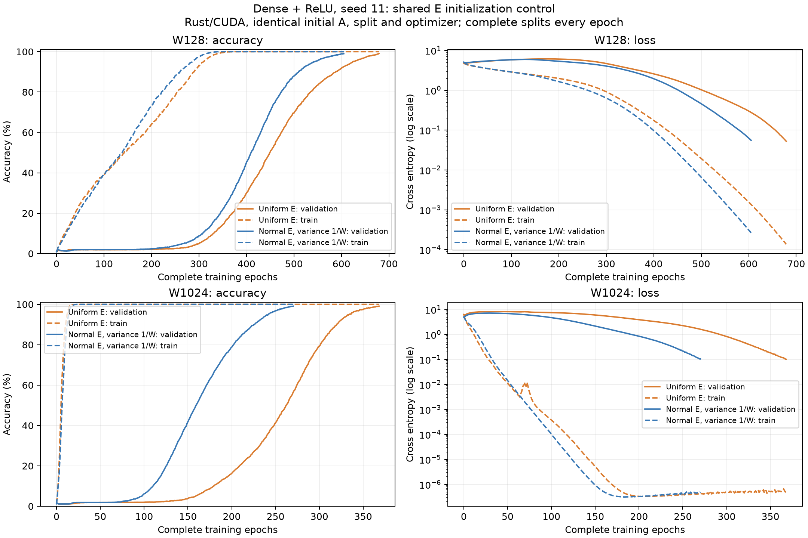

# Dense + ReLU: width-normal shared embedding control

Two completed Rust/CUDA runs replace the shared E initializer with Gaussian
variance 1/W, at widths 128 and 1024. Both use seed 11 and are compared with
the archived uniform-E runs of the same Dense + ReLU model. The initializer
is now used by both local frontend tabs. Rust retains its opt-in switch.

The unchanged model is x0 = E[a] + J(E[b]), r = RMSNorm(x0),
x1 = x0 + ReLU(r A), logits = RMSNorm(x1) E^T. There are no biases or learned
normalization gains. Pre-RMSNorm, the raw skip and final RMSNorm remain.

## Matched control

- Baseline E: uniform in [-1/sqrt(97), +1/sqrt(97)], variance 1/(3*97).
- New E: Normal(0, variance=1/W), standard deviation 1/sqrt(W).
- A: byte-identical Kaiming-normal matrix with variance 2/W in each pair.
- Data/sampling seed, split, architecture, parameter count and optimizer match.
- No embedding norm constraint is imposed during training.

Box-Muller draws consume the same number of uniforms as the old E
initializer, preserving the exact A random stream. The paired audit verifies
A bytes, dataset hashes, initial/final checkpoint hashes and history hashes.
The control changes distribution shape and variance together. Scaling E also
changes the raw skip relative to the normalized residual branch; it is not
a readout-temperature-only intervention.

Both runs use division modulo 97, 4,656 training and 4,656 held-out pairs,
batch 512 with a 48-row tail, AdamW learning rate 0.001, weight decay 0.1,
betas 0.9/0.98, epsilon 1e-8 and ten warmup updates. Both complete splits are
evaluated every epoch. The cap is 1,000 epochs, stopping at test accuracy >=99%.

## Initial geometry

| Width | E initializer | E std | Mean class norm | Centered logit RMS | Probe CE |
| --- | --- | ---: | ---: | ---: | ---: |
| 128 | Uniform | 0.05910 | 0.668 | 0.665 | 4.746 |
| 128 | Normal 1/W | 0.08824 | 0.997 | 1.031 | 5.020 |
| 1024 | Uniform | 0.05864 | 1.876 | 1.940 | 6.309 |
| 1024 | Normal 1/W | 0.03118 | 0.997 | 0.973 | 5.175 |

Logit RMS and cross entropy use independent f64 inference on native f32
checkpoints, for the same 128 fixed held-out pairs. The uniform predictor
has CE log(97) = 4.575. E column/row norms are sampled Gaussian quantities,
not fixed unit norms. Normal 1/W makes the initial logit scale close to one
at both widths; that observation alone does not establish better learning.

## Complete training results

| Width | E initializer | First train >=99% | Train >=99%, test <=10% plateau | First test >=90% | Rise epochs | First test >=99% | Grokking |
| --- | --- | ---: | --- | ---: | ---: | ---: | --- |
| 128 | Uniform | 339 | None | 588 | 257 | 679 | No |
| 128 | Normal 1/W | 315 | None | 510 | 203 | 605 | No |
| 1024 | Uniform | 15 | 15–179: 164 epochs | 320 | 141 | 368 | Yes |
| 1024 | Normal 1/W | 18 | 18–110: 92 epochs | 226 | 116 | 270 | Yes |

The unchanged criterion requires at least 25 elapsed continuous plateau
epochs, a rise from the last test <=10% to the first test >=90% within
250 epochs, and a later test >=99%. Missing observations or train dips
break the plateau. These results cover one seed per width and do not
establish seed robustness or browser crossing epochs.

[SVG comparison](grokking-results/dense-embedding-normal-width/dense-embedding-comparison.svg),
[paired initialization and result audit](grokking-results/dense-embedding-normal-width/paired-comparison.json),
[full histories and provenance](grokking-results/dense-embedding-normal-width/summary.json),
and [baseline results](rotary-dense-results.md) preserve the measured outcomes.

## Reproduce and validate

The queue is [div97-dense-embedding-normal-width.args](../experiments/div97-dense-embedding-normal-width.args).
The new Rust option is `--dense-embedding-initialization normal-width`;
the explicit baseline option is `uniform-fan-in`.

Validation passed 91 Rust tests, strict all-target Clippy, formatting and
the locked sm_86 CUDA build. Four Dense GPU/f64 verification fixtures check
logits, loss, every gradient, gathered/offset minibatches, AdamW and reset
repeatability, including normal-width E at the actual W128/modulus97 shape.
[Validation logs](grokking-results/dense-embedding-normal-width/validation/)
and [source hashes](grokking-results/dense-embedding-normal-width/source.json) are archived.
