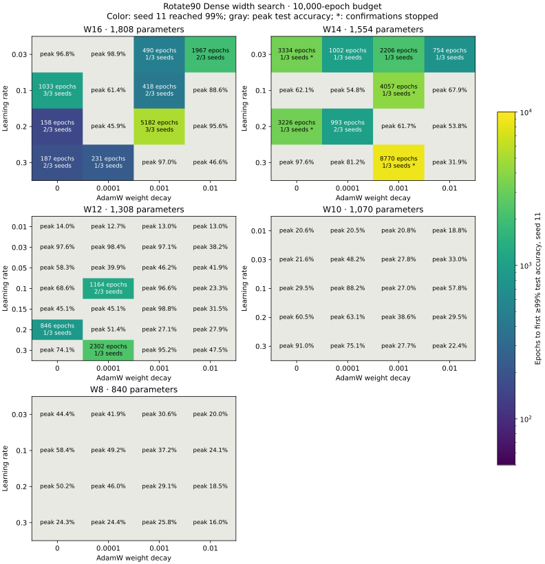
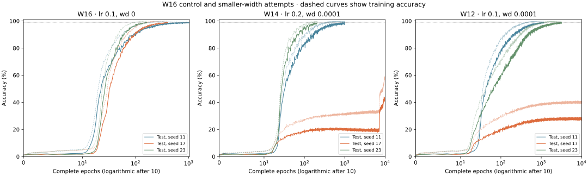

# Small-width Rotate90 Dense + ReLU results

## Optimizer grid and W16 decision, 2026-10-16

Keep W16 as the practical baseline: 1,808 trainable parameters, with a fixed
lr=0.1 and weight decay=0 reaching 99% test accuracy on seeds 11, 17 and 23.
The first crossings occur at epochs 1,033, 407 and 163. This is the fastest
W16 configuration by its worst-seed crossing among those confirmed on all
three seeds. Another confirmed choice, lr=0.2 and weight decay=0.001, takes
5,182 / 1,333 / 7,117 epochs.

The W16 screen covers lr in {0.03, 0.1, 0.2, 0.3} and weight decay in
{0, 0.0001, 0.001, 0.01}: 16 combinations on seed 11. Eight reach 99%; all
eight are repeated on seeds 17 and 23, and two succeed on all three seeds.
Completed earlier W16 runs are reused with their original histories and
manifests. Four missing seed-23 trials were run to finish this comparison.

Earlier smaller-width work is retained below. Further work below W12 was
stopped after W12 failed the three-seed criterion; all subsequent training
was restricted to W16 at the user's request. W14 confirmation coverage is
incomplete, so these results do not prove that W16 is the smallest trainable
width.

| Width | Parameters | Seed-11 configurations reaching 99% | Best seed-11 test accuracy | Confirmation outcome |
| --- | ---: | ---: | ---: | --- |
| 16 | 1,808 | 8 / 16 | 99.31% | Two fixed configurations succeed on all three seeds |
| 14 | 1,554 | 8 / 16 | 99.12% | Stopped before all confirmations completed |
| 12 | 1,308 | 3 / 28 | 99.36% | None of the three positive configurations succeeds on all three seeds |
| 10 | 1,070 | 0 / 20 | 91.02% | No positive screen to confirm |
| 8 | 840 | 0 / 16 | 58.42% | No positive screen to confirm |

W14, W10 and W8 initially used the same 16-cell grid as W16. W12 also tested
lr in {0.01, 0.05, 0.15} with the same four weight decays. None of these 12
additional W12 settings reached 99% on seed 11. Four previously queued
W10 trials at lr=0.01 had completed when the lower-width queue was stopped;
they are included in its 20-cell total. Interrupted W10/W14 runs are excluded
from the metrics and recorded separately in the provenance.

| W12 learning rate | Weight decay | Seed 11: first test ≥99% | Seed 17 | Seed 23 |
| --- | ---: | ---: | --- | --- |
| 0.1 | 0.0001 | 1,164 | No crossing; peak 28.99% | 3,180 |
| 0.2 | 0 | 846 | No crossing; peak 30.07% | No crossing; peak 29.94% |
| 0.3 | 0.0001 | 2,302 | No crossing; peak 46.54% | No crossing; peak 23.20% |

Every negative completed trial received the full 10,000-epoch budget.
Each seed changes initialization, split and training order together. This
finite search measures training reliability for this protocol; it does not
establish an architectural impossibility below W16. Widths use fresh random
initializations, without pruning or distillation.

The architecture and fixed training settings are the same as the earlier
study below; only width, lr, weight decay and seed vary. Runs use the verified
native Rust/CUDA binary on an NVIDIA GeForce RTX 3050 Laptop GPU. The CUDA
verification suite passed all 36 checks, including f64 output/gradient
comparisons and generic non-power-of-two shapes. Every retained history is
checked for finite metrics, all epochs, complete-split evaluation and correct
crossing statistics before archiving. A fresh W16 seed-11 replay reproduces
all 1,034 metric rows and both the initial and final checkpoints from the
earlier binary exactly (ignoring elapsed time). Browser behavior is not
measured here.

[Grid and stopping policy](../experiments/div97-dense-below16-grid.json),
[full metrics](grokking-results/dense-below16-grid/summary.json),
[per-trial metrics](grokking-results/dense-below16-grid/runs.csv),
[provenance and interrupted trials](grokking-results/dense-below16-grid/source.json),
[CUDA verification](grokking-results/dense-below16-grid/cuda-verification.log),
[W16 replay comparison](grokking-results/dense-below16-grid/w16-replay.json).
Each archived trial includes its exact arguments, run manifest and compressed
per-epoch history; model checkpoints remain local under `target/`.





To reproduce the W16 screen and its preferred configuration:

```sh
node scripts/plateau-search.mjs target/optimizer-grid/w16-check 16 0.03,0.1,0.2,0.3 0,0.0001,0.001,0.01 --jobs 4 --confirm 0
node scripts/plateau-search.mjs target/optimizer-grid/w16-check 16 0.1 0 --seeds 17,23 --jobs 2 --confirm 0
```

The driver requires `target/optimizer-grid/cuda-ready.json` and reuses
conclusive cached trials. The archive contains the validated evidence for
the completed search.

## Earlier fixed-optimizer comparison, 2026-10-14

Rust/CUDA, seed 11, NVIDIA GeForce RTX 3050 Laptop GPU, 2026-10-14.
W=32 and W=64 generalize to at least 99% test accuracy. W=16 does not learn
the training set within the 10,000-epoch budget with these hyperparameters.
These are individual seed results, not guarantees for other initializations.

| Width | Parameters | First train ≥99% epoch | First test ≥90% epoch | First test ≥99% epoch | Final train / test |
| --- | ---: | ---: | ---: | ---: | --- |
| 16 | 1,808 | Not reached | Not reached | Not reached | 32.09% / 18.11% (epoch 10,000) |
| 32 | 4,128 | 931 | 858 | 3690 | 99.98% / 99.03% |
| 64 | 10,304 | 460 | 477 | 560 | 100% / 99.03% |
| 128 (previous control) | 28,800 | 315 | 510 | 605 | See the normal-width initialization study |

W=64 reaches 99% test accuracy in 45 fewer epochs than W=128 (7.4% fewer).
This comparison concerns epochs, not browser throughput. W=64 had already
completed before the cancellation arrived; no additional W=64 runs were made.
The website adds W=16 and W=32 alongside its existing W=128 and W=1024 tabs.

The shared E is normal with variance 1/W; A is Kaiming normal with variance
2/W. The input is E[a] + Rotate90(E[b]). One RMSNorm → Dense A → ReLU branch
adds a residual skip; final RMSNorm and Eᵀ produce 97 logits. Normalization
has epsilon 1e-5 and no learned gain. All parameters use AdamW, lr=0.001,
weight decay=0.1, betas=(0.9,0.98), epsilon=1e-8 and a ten-update warmup.

The task is division modulo 97, with 4,656 train and 4,656 test equations.
Each epoch visits every training equation exactly once: nine batches of 512
and one batch of 48. Full train/test evaluation occurs after every epoch.
Runs stop at their first test ≥99% crossing or after 10,000 epochs.
W=16's best recorded train/test accuracies are 33.35% and 19.14%.

[Commands](../experiments/div97-dense-small-widths.args),
[metrics, run manifests and source/binary hashes](grokking-results/dense-small-widths/summary.json).
The reused binary's source hashes match the current native files and the
previous normal-width initialization study. The earlier W=128 control is
described in `rotary-dense-embedding-results.md`.
