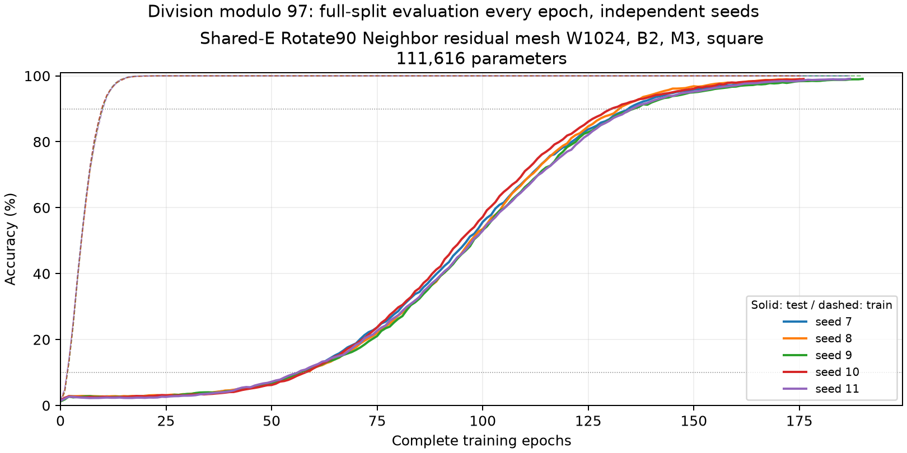
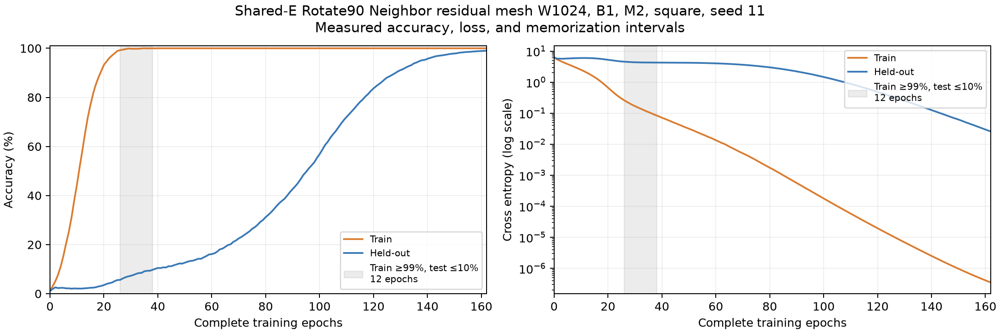
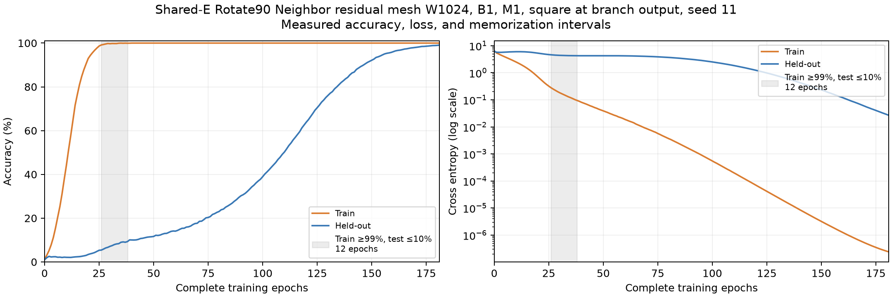
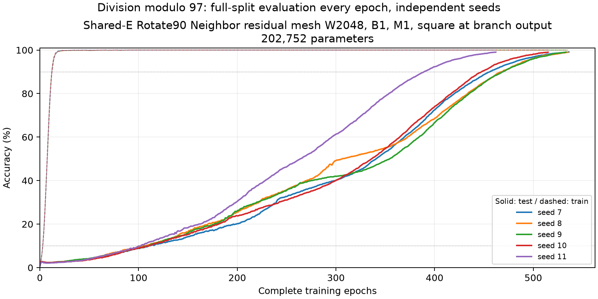
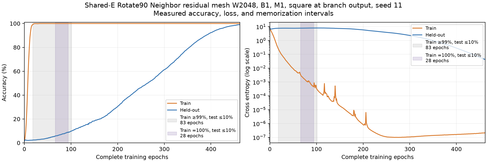
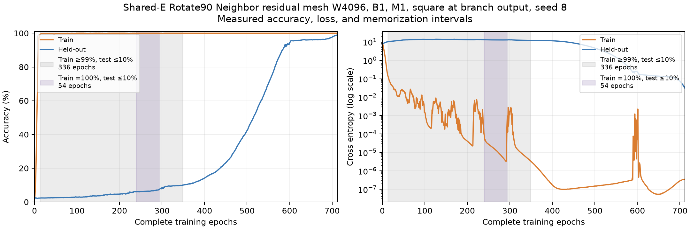

# Shared-E Rotate90 Neighbor measurements

The current local tabs now use [Dense + ReLU](rotary-dense-results.md), retaining
pre-RMSNorm and the shared embedding/readout. This document preserves the
earlier Neighbor experiments and their browser measurements.

The previous local browser tabs used **one block, one Neighbor Mesh, and Square
after the Mesh**, at widths **128** and **1024**. They have **12,672** and
**101,376** unique parameters. Both widths reached held-out accuracy ≥99% on
all five tested Rust seeds. The wider minimal model has an 11–15 epoch
memorization interval, below the unchanged 25-epoch grokking criterion.
The [browser implementation](../web/own-channel/README.md) trains from scratch
with live weights, activations, loss, and accuracy. The earlier two-block,
three-Mesh baseline qualified on all five wide seeds and remains archived.

## Previous browser architecture

```text
J(u, v) = (-v, u)
x0 = E[a] + J(E[b])
r = RMSNorm(x0)
z[c] = α[c] r[c] + β[c] r[(c + 1) mod W]
x1 = x0 + z²
logits = RMSNorm(x1) Eᵀ
```

The sole Mesh contributes `2W` weights, giving `99W` unique parameters. Both
engines preserve the training protocol below. The All view draws every
learned connection: all three shared-E roles and every self/neighbor edge.
There are **37,504** displayed connections at W128 and **300,032** at W1024;
the three E roles do not create additional parameters. White nodes and signed
arrows follow Wolfram's [mesh topology diagram](https://content.wolfram.com/sites/43/2024/08/sw08202024topologyimg1.png).
Dense edges use low opacity; zoom, pan, channel emphasis and a separate
2 → 1 channel inspector retain readable detail. Fixed global normalization
dependencies are represented by the layer labels. Browser training and
visualization are local only.

## Two-block baseline architecture

One learned table `E` of shape `97 × W` supplies both operand embeddings and
the output readout. A fixed +90° rotation distinguishes operand `b`:

```text
J(u, v) = (-v, u)                         # each adjacent channel pair
x0 = E[a] + J(E[b])

for block in 0..2:
    r = RMSNorm(x)
    z1 = M1(r)
    z2 = M2(z1²)
    branch = M3(z2²)
    x = x + branch

logits = RMSNorm(x) Eᵀ
M(z)[c] = α[c] z[c] + β[c] z[(c + 1) mod W]
```

Each block has its own three mesh layers; every layer has independent signed
self and neighbor weights. RMSNorm uses all channels, epsilon 1e-5, and no
learned affine parameters. All layers are bias-free. The six mesh layers
contribute `12W` parameters and `E` contributes `97W`, giving **109W** unique
parameters: **13,952** at W128 and **111,616** at W1024.

The role rotation is inspired by the pairwise rotations in
[RoFormer §3.2](https://arxiv.org/html/2104.09864v5). Its angle is fixed by
operand role, independent of residue value. The model has no attention or
position-dependent frequency ladder. Backpropagation adds the `a` lookup,
`Jᵀ`-rotated `b` lookup, and readout gradients into one gradient for `E`, with
one AdamW state per unique parameter.

SplitMix64 initializes `E` uniformly in `[-1/√97, +1/√97]`. Each mesh starts
with `α=1, β=0`; an initial branch therefore computes `RMSNorm(x)⁴`.
Its skip adds that branch to `x`.

For visualization, a selected output channel's branch has **4 → 3 → 2 → 1**
ancestors: ten nodes, twelve learned edges, and the residual skip. The local
diagram displays actual probe activations. Its normalization depends on all
W channels, including channels outside the displayed ancestor tree.

## Protocol and criterion

Division modulo 97 has 9,312 ordered pairs, with `a ∈ [0,96]` and
`b ∈ [1,96]`. Each seed fixes initialization and a shuffled 50% split:
4,656 training pairs and 4,656 held-out pairs. Every epoch visits all training
pairs once using nine 512-row batches and a 48-row tail. Both complete splits
are evaluated every ten updates, exactly once per epoch.

The baseline uses two blocks and three Neighbor layers per branch. The
ablations below vary the block count, branch depth, final activation, and
width. All runs use AdamW learning rate 0.001, decay 0.1, betas (0.9, 0.98),
epsilon 1e-8, and ten warmup updates. They stop at the first held-out accuracy
≥99% or 10,000 epochs.

A qualifying curve needs at least 25 contiguous epochs with train ≥99% and
held-out ≤10%, then a rise of at most 250 epochs from the last ≤10% report to
the first ≥90%, followed by ≥99%. Train dips and missing epoch observations
break the interval. The train =100% interval is recorded separately. Interval
length is `end − start`; a 34-epoch interval contains 35 endpoint-inclusive
observations. The measured held-out rises are continuous over dozens of epochs.

## Five-seed Rust/CUDA replication

Runs were sequential on an NVIDIA GeForce RTX 3050 Laptop GPU with 4 GiB,
driver 615.71.09, and CUDA 13.4. Other training jobs were stopped during these
measurements. W128 reaches the target on every seed, with **0/5** qualifying
memorization plateaus:

| Seed | First train ≥99% | Test at that report | Last test ≤10% | First test ≥90% | Rise (epochs) | First test ≥99% |
| --- | ---: | ---: | ---: | ---: | ---: | ---: |
| 7 | 105 | 88.79% | 60 | 107 | 47 | 131 |
| 8 | 102 | 87.59% | 50 | 106 | 56 | 133 |
| 9 | 90 | 87.91% | 48 | 94 | 46 | 123 |
| 10 | 104 | 86.47% | 57 | 109 | 52 | 137 |
| 11 | 101 | 85.72% | 57 | 106 | 49 | 133 |

W1024 reaches the target and qualifies on **5/5** seeds. Each also has at least
25 epochs of perfect training accuracy while held-out accuracy remains ≤10%:

| Seed | Train ≥99% plateau | Length | Train =100% plateau | Length | First test ≥90% | Rise | First test ≥99% |
| --- | --- | ---: | --- | ---: | ---: | ---: | ---: |
| 7 | 15–57 | 42 | 22–57 | 35 | 135 | 78 | 187 |
| 8 | 15–57 | 42 | 22–57 | 35 | 133 | 76 | 175 |
| 9 | 15–57 | 42 | 24–57 | 33 | 136 | 79 | 190 |
| 10 | 16–57 | 41 | 23–57 | 34 | 131 | 74 | 176 |
| 11 | 15–56 | 41 | 22–56 | 34 | 136 | 80 | 187 |



An eight-run seed-11 screening varied width, block count, branch depth, and
decay. W1024 B2 M3 was the only qualifying configuration. W512 with decay 0.1
had a three-epoch ≥99%-train plateau, below the criterion. This screening
motivated the five-seed replication; its other configurations are recorded in
[the variant archive](grokking-results/rotary-neighbor-variants/summary.json).

## Block-count and branch-depth ablation

Two later comparisons remove one residual block, then reduce its branch from
three mesh layers to two. Both widths were replicated on seeds 7–11. Learning
rate, decay, initialization, sampler protocol, split, and stopping criterion
remain unchanged. The initial shared embedding is byte-identical to the
two-block baseline for every paired seed. All twenty new runs reach test ≥99%.

With one block and three mesh layers, parameters are `97W + 6W = 103W`:
13,184 at W128 and 105,472 at W1024, a 5.5% reduction from two blocks. With two
mesh layers, parameters become `97W + 4W = 101W`: **12,928** and **103,424**,
another 1.94% reduction. The embedding table dominates the parameter count.

The two-layer branch applies Square once:

```text
x0 = E[a] + Rotate90(E[b])
r = RMSNorm(x0)
x1 = x0 + M2(M1(r)²)
logits = RMSNorm(x1) Eᵀ
```

Its selected output has **3 → 2 → 1** mesh ancestors: six nodes, six learned
edges, and the residual skip. Both mesh layers have independent self/neighbor
weights. At identity mesh initialization, the branch computes `RMSNorm(x0)²`.

The table gives ranges across the same five seeds, measured on Rust/CUDA:

| Width | Blocks | Mesh layers / branch | Parameters | Train ≥99% plateau (epochs) | Test ≤10% → ≥90% rise | First test ≥99% |
| --- | ---: | ---: | ---: | --- | --- | --- |
| 128 | 2 | 3 | 13,952 | 0 | 46–56 | 123–137 |
| 1024 | 2 | 3 | 111,616 | 41–42 | 74–80 | 175–190 |
| 128 | 1 | 3 | 13,184 | 0 | 37–47 | 76–92 |
| 1024 | 1 | 3 | 105,472 | 21–24 | 78–84 | 152–156 |
| 128 | 1 | 2 | 12,928 | 0 | 50–58 | 95–103 |
| 1024 | 1 | 2 | 103,424 | 11–14 | 91–95 | 157–167 |

Removing a block reaches the target earlier on every paired seed at both
widths. Reducing that remaining branch to two layers makes the model smaller,
but takes more epochs to reach the target on every paired seed. The wide
model's plateau becomes shorter and its held-out rise takes longer. The
ablated wide models have a short observed memorization interval; neither
meets the existing ≥25-epoch plateau criterion on any tested seed.

For seed 11, W128 reaches test ≥99% at epochs 133 → 86 → 97 for B2 M3 → B1 M3
→ B1 M2; W1024 reaches it at 187 → 152 → 162. The W1024 ≥99%-train plateau
shrinks from 41 → 21 → 12 epochs, and its test rise takes 80 → 82 → 91 epochs.
These ablations were measured in Rust/CUDA. The browser then used the later
one-block, one-Mesh-plus-Square variant described above.



Raw CSVs, metadata, initialization/final checkpoint hashes, and plots are in
the [B1 M3 W128](grokking-results/rotary-neighbor-one-block-128/summary.json),
[B1 M3 W1024](grokking-results/rotary-neighbor-one-block-1024/summary.json),
[B1 M2 W128](grokking-results/rotary-neighbor-one-block-m2-128/summary.json), and
[B1 M2 W1024](grokking-results/rotary-neighbor-one-block-m2-1024/summary.json)
archives. The [paired comparison](grokking-results/rotary-neighbor-ablation/paired-comparison.json)
records the baseline/ablation runs, exact embedding hashes, and checked
protocol fields. Other owned CUDA training jobs were stopped during these runs,
then the continuous search was resumed.

Reproduce either width with its argument manifest; use a new output directory
for a fresh study:

```bash
target/release/sharp-mesh-search \
  --output target/grok-div97-search/rotary-neighbor-one-block-m2-1024 \
  --trainer target/release/mesh-gpt \
  --plateau-epochs 25 --report-every 10 \
  --queue experiments/div97-rotary-neighbor-one-block-m2-1024.args --max-trials 5

UV_CACHE_DIR=/tmp/grokking-uv-cache uv run --locked scripts/analyze-short-mesh.py \
  target/grok-div97-search/rotary-neighbor-one-block-m2-1024 \
  --output docs/grokking-results/rotary-neighbor-one-block-m2-1024 --detail-seed 11
```

## One mesh with and without a final Square

Setting `mesh-depth=1` removes the between-layer Square entirely. The remaining
branch is `RMSNorm → Mesh + skip`; RMSNorm still makes this model nonlinear.
Full-budget seed-11 controls at both widths failed to generalize:

| Width | Parameters | Epoch budget completed | Final train accuracy | Final test accuracy |
| --- | ---: | ---: | ---: | ---: |
| 128 | 12,672 | 10,000 | 36.96% | 1.87% |
| 1024 | 101,376 | 10,000 | 75.21% | 1.78% |

The one-mesh variant can preserve Square after the sole mesh. The optional
`--mesh-output-activation` switch implements that branch output activation,
using the configured Square or ReLU. It defaults to false and is valid only
for residual mesh families. It adds no parameters:

```text
x0 = E[a] + Rotate90(E[b])
r = RMSNorm(x0)
z[c] = α[c] r[c] + β[c] r[(c + 1) mod W]
x1 = x0 + z²
logits = RMSNorm(x1) Eᵀ
```

The selected channel now has **2 → 1** mesh ancestors: three nodes, two learned
edges, and the skip. Square acts on the branch output before the skip sum.
Unique parameters are `97W + 2W = 99W`: **12,672** at W128 and **101,376** at
W1024, 1.98% fewer than M2. Initial `E` and the first mesh are identical to the
matched M2 model. At identity initialization, M2's last mesh is an identity
map, so the two variants have the same mathematical initial forward function.

W128 and W1024 M1+Square reached test ≥99% on **all five seeds 7–11**:

| Width | M2 first test ≥99% | M1+Square first test ≥99% | M1+Square train ≥99% plateau | M1+Square test ≤10% → ≥90% rise |
| --- | --- | --- | --- | --- |
| 128 | 95–103 | 105–113 | none | 59–72 epochs |
| 1024 | 157–167 | 178–188 | 11–15 epochs | 102–117 epochs |

For seed 11, W128 reaches the target at epoch 113 and W1024 at 181. The wide
seed-11 ≥99%-train plateau is 26–38 (12 epochs), followed by a 109-epoch test
rise. Removing the second mesh while keeping Square saves parameters and
simplifies the diagram, while requiring more epochs to reach the target on
every paired seed. The wide model retains a short memorization interval and
does not meet the existing ≥25-epoch plateau criterion on these five seeds.

The no-Square controls use one seed per width; the successful M1+Square cases
were replicated five times per width. Both controls completed the full
10,000-epoch budget. The control results apply to the tested seed and optimizer
settings.

The new CUDA kernels fuse the branch activation into the skip addition and
differentiate the cached pre-activation into existing scratch storage. The
skip derivative is preserved separately; no extra activation tensors or
optimizer states are allocated. Typed launch contracts reject mismatched
input/output lengths before launch. The independent f64 reference checks the
final activation, shared embedding, normalization, and skip derivatives.

Validation passed: 57 host library tests, nine scheduler tests, strict Clippy,
formatting, and 47 CUDA model configurations plus input/launch validation.
Exact W128/W1024 M1+Square fixtures check every gradient group for 1/37/130
gathered rows, offset AdamW updates, and repeatability. Their maximum relative
gradient errors were 3.7e-7 and 2.1e-6. Verification metadata and source/binary
hashes are in [M1+Square verification](grokking-results/rotary-neighbor-ablation/m1-square-verification.json),
with the [complete CUDA log](grokking-results/rotary-neighbor-ablation/m1-square-cuda-verification.log).



Archives preserve the [W128 no-Square control](grokking-results/rotary-neighbor-one-block-m1-128/summary.json),
[W1024 no-Square control](grokking-results/rotary-neighbor-one-block-m1-1024/summary.json),
[W128 M1+Square five-seed study](grokking-results/rotary-neighbor-one-block-m1-square-128/summary.json), and
[W1024 M1+Square five-seed study](grokking-results/rotary-neighbor-one-block-m1-square-1024/summary.json).
The [paired comparison](grokking-results/rotary-neighbor-ablation/paired-comparison.json)
includes 42 W128/W1024 baseline/control/ablation runs, their effective activation
counts, and protocol/initialization checks. The wide control overlapped host
compilation and the CUDA verification suite, so its elapsed time is not a
serial performance comparison. The M1+Square replications were sequential.

```bash
target/release/sharp-mesh-search \
  --output target/grok-div97-search/rotary-neighbor-one-block-m1-square-1024 \
  --trainer target/release/mesh-gpt \
  --plateau-epochs 25 --report-every 10 \
  --queue experiments/div97-rotary-neighbor-one-block-m1-square-1024.args --max-trials 5

UV_CACHE_DIR=/tmp/grokking-uv-cache uv run --locked scripts/analyze-short-mesh.py \
  target/grok-div97-search/rotary-neighbor-one-block-m1-square-1024 \
  --output docs/grokking-results/rotary-neighbor-one-block-m1-square-1024 --detail-seed 11
```

## One-mesh width 2048 comparison

A further five-seed study doubles the M1+Square width to **2048**, keeping one
residual block, one Neighbor mesh, and Square before the residual addition.
The shared embedding and mesh contain `97W + 2W = 99W = 202,752` parameters.
Architecture, optimizer, initialization rule, data split fraction, sampler,
evaluation cadence, and stopping rule match W128/W1024; only width changes.
The same seeds 7–11 are used, with seed 11 run first. Different-width tensors
have different shapes; their initial checkpoints are not identical.

All five W2048 runs reached test ≥99%. Training first reached ≥99% at epochs
17–18, followed by **83–92 epochs** with train ≥99% and test ≤10%. The later
held-out rise took **289–363 epochs** from the last ≤10% report to the first
≥90%, exceeding the unchanged 250-epoch limit on every seed. Thus **0/5**
qualify despite their longer memorization intervals.

| Width | Parameters | Train ≥99% plateau (epochs) | Test ≤10% → ≥90% rise | First test ≥99% |
| --- | ---: | --- | --- | --- |
| 128 | 12,672 | 0 | 59–72 | 105–113 |
| 1024 | 101,376 | 11–15 | 102–117 | 178–188 |
| 2048 | 202,752 | 83–92 | 289–363 | 462–536 |

W2048 per-seed observations, with both plateau definitions kept separate:

| Seed | Train ≥99% plateau | Length | Train =100% plateau length | Last test ≤10% | First test ≥90% | Rise | First test ≥99% |
| --- | --- | ---: | ---: | ---: | ---: | ---: | ---: |
| 7 | 17–109 | 92 | 14 | 109 | 456 | 347 | 536 |
| 8 | 18–105 | 87 | 2 | 105 | 468 | 363 | 535 |
| 9 | 18–108 | 90 | 16 | 110 | 470 | 360 | 533 |
| 10 | 18–108 | 90 | 16 | 110 | 448 | 338 | 515 |
| 11 | 18–101 | 83 | 28 | 101 | 390 | 289 | 462 |

In these settings, increasing width lengthens memorization and delays
generalization, while the test accuracy rises gradually over hundreds of
epochs. The selected mesh-channel diagram remains **2 → 1**, with two learned
edges and the residual skip. This experiment uses the previously verified
CUDA binary with no model-code changes. The previous browser used W128 and W1024 of
this one-Mesh-plus-Square architecture; W2048 remains a native experiment.





The [W2048 archive](grokking-results/rotary-neighbor-one-block-m1-square-2048/summary.json)
preserves all five raw histories, run metadata, checkpoint hashes, and plots.
The [three-width comparison](grokking-results/rotary-neighbor-ablation/m1-square-width-comparison.json)
records 15 runs, checked common protocol fields, and unchanged verified model
source hashes. Runs were sequential on the same RTX 3050 Laptop GPU, while
the separate continuous search remained stopped. The five-run queue completed
and stopped automatically; it did not resume random search.

```bash
target/release/sharp-mesh-search \
  --output target/grok-div97-search/rotary-neighbor-one-block-m1-square-2048 \
  --trainer target/release/mesh-gpt \
  --plateau-epochs 25 --report-every 10 \
  --queue experiments/div97-rotary-neighbor-one-block-m1-square-2048.args --max-trials 5

UV_CACHE_DIR=/tmp/grokking-uv-cache uv run --locked scripts/analyze-short-mesh.py \
  target/grok-div97-search/rotary-neighbor-one-block-m1-square-2048 \
  --output docs/grokking-results/rotary-neighbor-one-block-m1-square-2048 --detail-seed 11
```

## One-mesh width 4096 extension

W4096 keeps the same one-block, one-Neighbor-mesh branch with Square before
the skip. It has `99W = 405,504` parameters. The five-seed queue uses the same
training protocol, unchanged CUDA binary, and seeds 7–11 as the width studies
above. The user stopped this extension: four runs completed, and the fifth
was interrupted. No W4096 training remains active. The archive below was
written after the first three completed runs and retains those three.

The seed-11 pilot reached test ≥99% at epoch **734**. Its train ≥99%, test ≤10%
plateau is **13–409 (396 epochs)**; its longest train =100% interval under the
same test threshold is 64 epochs. Test first reached ≥90% at epoch **700**,
giving a **291-epoch** rise from the last ≤10% observation at epoch 409. It
exceeds the unchanged 250-epoch limit, so the pilot does not qualify. Its
accuracy curve nevertheless separates memorization and later generalization
more clearly than the W2048 seed-11 curve.

Seed 7 reached test ≥99% at epoch **864**, with a **375-epoch** train ≥99%
plateau and a **345-epoch** test ≤10% → ≥90% rise. Both completed seeds exceed
the unchanged 250-epoch rise limit.

Seed 8 meets the full criterion: train ≥99%, test ≤10% from epochs **13–349
(336 epochs)**; first test ≥90% at **584**, a **235-epoch** rise; and first test
≥99% at **712**. It qualifies among **1/3 archived seeds**. The detail
plot below displays this qualifying seed; the raw seed-11 history remains in
the archive.



The first three completed runs are preserved in the [W4096 archive](grokking-results/rotary-neighbor-one-block-m1-square-4096/summary.json).
The cancelled queue is [the W4096 argument manifest](../experiments/div97-rotary-neighbor-one-block-m1-square-4096.args).
The separate continuous search also remains stopped. W4096 is not a browser
tab.

## Archived one-Mesh-plus-Square browser runs

Fresh seed-11 training from the minimal Rust initialization reached test ≥99%
at the same crossing epochs in Rust, WASM SIMD and hardware WebGPU:

| Width | Rust test ≥99% | WASM SIMD test ≥99% | WebGPU test ≥99% | WASM training + evaluation | WebGPU training + evaluation |
| --- | ---: | ---: | ---: | ---: | ---: |
| 128 | 113 | 113 | 113 | 6.17 s | 1.32 s |
| 1024 | 181 | 181 | 181 | 72.18 s | 12.50 s |

The W1024 train ≥99% / test ≤10% interval is 26–38 (**12 epochs**), with no
perfect-train plateau. Test first reaches ≥90% at epoch 147, a 109-epoch rise
from the last ≤10% observation at 38. W128 has no memorization plateau and
first reaches ≥90% at 95. Both default runs report `Generalized`. FP32 traces
can differ even when crossing epochs agree.

WASM used one CPU thread on the AMD Ryzen 5 5600H in Node v24.21.0. WebGPU
used a hardware adapter (`fallback: false`), whose description is hidden.
Times exclude engine setup and ordinary live readbacks/drawing. Current
histories and exact source hashes are preserved in
[W128 WASM](../web/own-channel/tests/results/neighbor-rotary-m1-square-wasm-simd-seed11/run.json),
[W1024 WASM](../web/own-channel/tests/results/neighbor-rotary-wide-m1-square-wasm-simd-seed11/run.json),
[W128 WebGPU](../web/own-channel/tests/results/neighbor-rotary-m1-square-webgpu-seed11/run.json), and
[W1024 WebGPU](../web/own-channel/tests/results/neighbor-rotary-wide-m1-square-webgpu-seed11/run.json).

The minimal browser model passed all **74 Node tests** and **18 independent
f64 WebGPU gradient/optimizer checks per width**, including signed Square
gradients, skip/RMSNorm, shared E, wraparound, partial batches and AdamW.
WebGPU minibatch caches now use five planes: 1.25 MiB at W128 and 10 MiB at
W1024. WASM SIMD binaries are 3,634 / 3,652 bytes; fixed memory is 448 KiB /
2.50 MiB.

The current [WebGPU verification](../web/own-channel/tests/results/rotary-m1-square-webgpu-verification.json)
and [browser evidence](../web/own-channel/tests/results/rotary-m1-square-browser-verification.json)
record source hashes, all numerical checks, 26 successful layout checks,
actual live weight changes and both initial network views. Complete-network arrow
drawing measured 0.4 ms on the integrated AMD Radeon OpenGL adapter, with
25.7 ms for the Canvas fallback at 1250×520, excluding nodes, probe inference
and other panels. The [drawing measurement](../web/own-channel/tests/results/rotary-m1-square-all-weights-performance.json)
also checks texture reuse, actual pointer panning, Fit and all fallback bands.
The [expanded native verification](grokking-results/rotary-neighbor-ablation/m1-square-verification.json)
passed 47 CUDA configurations plus validation, 57 library tests and nine
scheduler tests.

The later [all-connections dynamics update](../web/own-channel/tests/results/rotary-all-weights-dynamics-verification.json)
adds fixed-scale Weights/Change ×4 views and optional channel highlighting,
off by default. Every connection remains in the draw. RGBA16F accumulation
preserves weak E changes, with Canvas fallback when unavailable. A complete
actual W1024 WebGPU run retained all 300,032 connections and the same scale
through 99.03% held-out accuracy at epoch 181; snapshots preserve initialization,
epochs 41/101 and the target. Updated standalone drawing medians were 0.3 ms
for WebGL2 and 27.4 ms for Canvas, excluding nodes, probe and other panels.

## Historical two-block browser baseline

The earlier two-block browser version defaulted to seed 11. All engines start from the same byte-identical
Rust initialization; complete metrics are actual training observations.

| Width / engine | Train ≥99% plateau | Train =100% plateau | First test ≥90% | Rise | First test ≥99% | Training + evaluation |
| --- | --- | --- | ---: | ---: | ---: | ---: |
| 128 / Rust CUDA | none | none | 106 | 49 | 133 | — |
| 128 / WASM SIMD | none | none | 106 | 49 | 133 | 9.32 s |
| 128 / hardware WebGPU | none | none | 106 | 49 | 133 | 1.73 s |
| 1024 / Rust CUDA | 15–56 (41) | 22–56 (34) | 136 | 80 | 187 | — |
| 1024 / WASM SIMD | 15–56 (41) | 22–56 (34) | 136 | 80 | 187 | 95.09 s |
| 1024 / hardware WebGPU | 15–56 (41) | 22–56 (34) | 135 | 79 | 186 | 13.40 s |

WASM measurements used one thread in Node v24.21.0 on an AMD Ryzen 5 5600H.
WebGPU used Chrome 155.0.8059.39 and a hardware adapter (`fallback: false`);
the adapter description is hidden. Timings exclude engine setup and normal
live visualization readbacks. They describe this machine and measurement
procedure. Different f32 reduction orders can move crossing epochs.

Historical runs through the real UI worker also reached ≥99% at epochs 133 and 186.
The compact tab reported `Generalized`; the wide tab reported
`Short-plateau grokking`. Raw browser histories, CSV exports, source hashes,
measurement metadata, and UI outcomes are in
[`web/own-channel/tests/results/`](../web/own-channel/tests/results/).

## Historical baseline verification and archived evidence

The independent f64 reference differentiates every parameter and checks central
finite differences, including the shared embedding's three roles, Square,
RMSNorm, skip, and circular neighbor edges. Rust host tests passed (56 library
tests and nine scheduler tests), as did strict Clippy and formatting.

The CUDA verifier passed 42 model configurations plus validation checks.
Exact W128 and W1024 fixtures check logits, loss, every gradient group for
1/37/130 gathered rows, offset AdamW updates, and bitwise repeatability. Maximum
gradient errors relative to each group's maximum were 7.5e-7 and 1.3e-6.
Typed launch contracts reject odd rotary widths before launch.

The complete Node suite passed 73 tests; a subsequently added checkpoint test
also passed separately for widths 128/1024 and seeds 7/11. Scalar and SIMD
checks cover batches 1/37/48/512, signed mesh weights, wraparound, and three
AdamW updates. WebGPU passed 18 gradient/optimizer checks per width against the
f64 reference. Both UI tabs were checked for independent state, controls,
live weight changes, channel selection, and viewport fit from 320×568 to
1920×1080, including tablet and landscape layouts.

Archives retain raw Rust CSVs, arguments, outcome metadata, source/checkpoint
hashes, and plots:

- [W128 five-seed study](grokking-results/rotary-neighbor/summary.json).
- [W1024 five-seed study](grokking-results/rotary-neighbor-wide/summary.json).
- [W1024 verification metadata](grokking-results/rotary-neighbor-wide/verification.json)
  and [CUDA verification log](grokking-results/rotary-neighbor-wide/cuda-verification.log).
- [Seed-11 replay check](grokking-results/rotary-neighbor-wide/replay-check.json):
  all saved numerical fields match at 188 common observations (epochs 0–187),
  with elapsed time excluded and comparison limited to CSV precision.
- [Earlier untied Neighbor results](neighbor-mesh-results.md) and
  [concat/dense/butterfly comparisons](grokking-browser-models.md).

## Reproduce

```bash
cargo oxide build --arch sm_86 -- --release --locked --bin mesh-gpt
target/release/mesh-gpt grok-simple --verify
cargo test --locked --lib
cargo test --locked --bin sharp-mesh-search
cargo clippy --locked --all-targets -- -D warnings
cargo build --release --locked --bin sharp-mesh-search

# Stop other training jobs before running the sequential replication.
target/release/sharp-mesh-search \
  --output target/grok-div97-search/rotary-neighbor-wide-check \
  --trainer target/release/mesh-gpt \
  --plateau-epochs 25 --report-every 10 \
  --queue experiments/div97-rotary-neighbor-wide.args --max-trials 5

UV_CACHE_DIR=/tmp/grokking-uv-cache uv run --locked scripts/analyze-short-mesh.py \
  target/grok-div97-search/rotary-neighbor-wide-check \
  --output docs/grokking-results/rotary-neighbor-wide --detail-seed 11

node web/own-channel/server.mjs
```

Use a new output directory for a fresh replication: the scheduler resumes
existing studies. The W128 manifest is
[`experiments/div97-rotary-neighbor-plateau.args`](../experiments/div97-rotary-neighbor-plateau.args).
The app and training remain local; Node serves static files on
`http://127.0.0.1:8080`.
